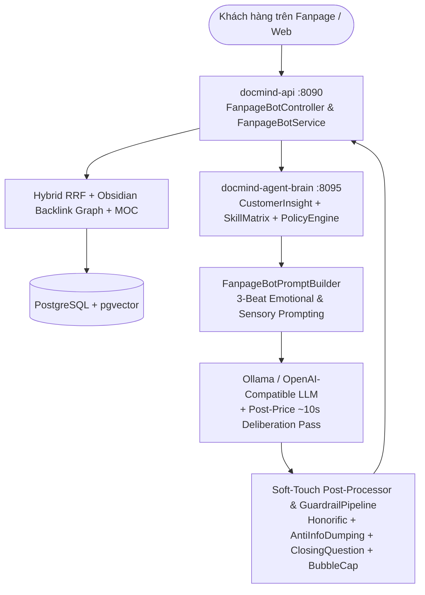

# Architecture Plan — Emotional Sales Engine & Multi-Agent Pipeline v1.0

## 1. Kiến trúc tổng thể (System Architecture)
Hệ thống tư vấn bán hàng giàu cảm xúc của DocMind vận hành trên kiến trúc Hybrid Neuro-Symbolic gồm 3 tầng:

## 2. Phân tích Kỹ thuật & Thiết kế Giải pháp (Root-Cause Remediation)

### 2.1. Tầng 1: Agent Brain (`docmind-agent-brain` - Python FastAPI)
- **File mục tiêu**: `agent-brain/app/brain/skill_matrix.py`, `agent-brain/app/brain/insight_advisor.py`.
- **Thay đổi**:
  - Nâng cấp 9 kỹ năng bán hàng (`SKILL_01` -> `SKILL_09`) để truyền cảm hứng cảm xúc thực thụ: sử dụng ngôn từ giàu xúc giác (ấm áp, dịu nhẹ, thả lỏng sâu), loại bỏ văn phong mệnh lệnh cứng nhắc.
  - Bổ sung hướng dẫn nhịp điệu 2-3 bong bóng chat tự nhiên (`<= 3` bubbles) để đồng bộ hoàn toàn với `api-java`.

### 2.2. Tầng 2: Prompt & Turn-1 Fast Impression (`FanpageBotPromptBuilder.java`)
- **File mục tiêu**: `api-java/src/main/java/com/example/docmind/service/bot/FanpageBotPromptBuilder.java`.
- **Thay đổi**:
  - Nâng cấp `buildImpressiveThreeBubbleTurnOneOpener(honorific, lowerMsg)`: Đa dạng hóa các kịch bản mở đầu 3 bong bóng giàu cảm xúc cho khách hỏi chung, khách đau mỏi vai gáy/lưng, khách mất ngủ/stress, khách hỏi gội đầu dưỡng sinh.
  - Sửa `stripLeakedNumbersFromTurnOneReply`: Khi câu trả lời ở Lượt 1 có 3 đoạn văn tự nhiên, giữ nguyên cả 3 đoạn văn (thay vì chỉ lấy `paragraphs[0]` và `paragraphs[paragraphs.length - 1]` làm mất đoạn giữa!).
  - Nâng cấp hướng dẫn `formatPriceLadderGuidance`: Yêu cầu LLM luôn mở đầu bằng 1 câu **đồng cảm sâu sắc & nâng niu tâm lý** trước khi báo giá hoặc hạ bậc gói dịch vụ.

### 2.3. Tầng 3: Post-Processing & Post-Price Deliberation (`FanpageBotService.java`)
- **File mục tiêu**: `api-java/src/main/java/com/example/docmind/service/bot/FanpageBotService.java`.
- **Thay đổi**:
  1. **Bảo toàn 3 bong bóng ở Lượt 1 (`polishConversationalVietnamese` & `splitIntoBubbles`)**:
     - Không gộp thô bạo đoạn 1 và đoạn 2 khi đoạn 1 đã là một câu chào + đồng cảm hoàn chỉnh (> 45 ký tự).
  2. **Làm mềm hóa `enforcePriceLadderConsistency` (Chấm dứt ghi đè thô bạo làm tụt mood)**:
     - Khi LLM đã báo đúng mức giá mục tiêu (`hasTargetPrice`) và không rò rỉ gói sai (`!leakedEarCare129`, `!hasRejectedOrHigherPrice`), **tôn trọng văn phong tự nhiên của LLM** thay vì bắt buộc phải khớp từng chữ cứng nhắc.
     - Khi LLM trượt giá và cần fallback sang câu mẫu của `enforcePriceLadderConsistency`, nâng cấp câu mẫu thành văn phong **3 nhịp giàu cảm xúc, dịu dàng, tinh tế** (chia sẻ sự thấu hiểu -> vẽ ra trải nghiệm thảo dược ấm áp & minh bạch 0 Tip -> gợi mở nhẹ nhàng).
  3. **Làm giàu cảm xúc cho `synthesizeDynamicExplanationOrSymptomReply`, `enforceAntiInformationDumpingOnBroadPrice`, và `generateGroundedFallbackReply`**:
     - Thay thế các câu trả lời liệt kê khô khan bằng ngôn từ đồng cảm sâu sắc, chạm vào cảm giác mệt mỏi của khách hàng trước khi đưa thông tin gói và chi phí.
  4. **Tinh chỉnh `deliberatePostPriceMoodPreservationPass`**:
     - Duy trì nhịp suy nghĩ sâu `TARGET_POST_PRICE_THINKING_MS = 10_000L` (10 giây) trên LLM thực tế ở các lượt ngay sau báo giá, đồng thời cải thiện prompt tự phản biện (`buildPostPriceRefinementPrompt`) để bản viết lại mượt mà, giàu cảm xúc và chốt sale khéo léo.

### 2.4. Tầng 4: Guardrail Pipeline (`com.docmind.guardrail.*`)
- **File mục tiêu**: `AntiInfoDumpingHook.java`, `ClosingQuestionHook.java`, `BubbleCapHook.java`.
- **Thay đổi**:
  - `AntiInfoDumpingHook`: Nâng cấp văn bản thu gọn cho ngành Spa/Dưỡng sinh để vừa ngắn gọn, vừa ấm áp giàu cảm xúc, không mang giọng văn thông báo hành chính.
  - `ClosingQuestionHook`: Tránh ghi đè câu hỏi tự nhiên của LLM nếu câu hỏi đó đã mở, lịch sự và phù hợp ngữ cảnh.
  - `BubbleCapHook`: Giữ tương thích tuyệt đối với các Unit Test hiện hữu (`<= 2` bubbles khi test truyền vào các đoạn văn ngắn hoặc 4+ đoạn văn rời rạc) đồng thời bảo toàn cấu trúc 3 bong bóng cảm xúc (`<= 3` bubbles) cho hội thoại thực tế.

### 2.5. Tầng 5: Quy trình Multi-Agent Team v1.0 (`99_pipeline/run_multi_agent_pipeline.py`)
- Thiết kế Orchestrator tự động kiểm soát vòng đời 4 Agent:
  - **Stage 1 (PO + Techlead Gate)**: Kiểm tra tính hợp lệ và đầy đủ của hợp đồng nghiệm thu `01_po_techlead/acceptance_contract.yaml`.
  - **Stage 2 (Senior Dev Gate)**: Kiểm tra kết quả Unit Test, Happy-Path E2E và thông tin build (`02_dev/build_info.json`).
  - **Stage 3 (Black-Box QA Gate)**: Chạy độc lập hoàn toàn qua HTTP API (`http://localhost:8090/api/bot/fanpage/message`), không đọc source code trong `api-java` hay `agent-brain`. Thực thi 4 bộ test:
    1. `deterministic_policy_report.json` (Chính sách giá, danh xưng, không lộ mã nội bộ, số bong bóng `<= 3`).
    2. `random_scenario_report.json` (Mô phỏng khách hàng đa tính cách với seed cố định).
    3. `adversarial_report.json` (Tấn công ép giá 50k, hỏi dịch vụ ngoài luồng, prompt injection, chê đắt liên hoàn).
    4. `llm_judge_report.json` (Chấm điểm 5 tiêu chí Cảm xúc & Chốt Sale: Empathy, Naturalness, Mood Preservation, Value Framing, Conversion Progression).
  - **Stage 4 (Product PO UAT Gate)**: Tổng hợp báo cáo nghiệm thu kinh doanh (`business_acceptance.yaml`, `uat_report.md`, `release_notes.md`, `user_test_package.md`) và khóa phiên bản tại `99_pipeline/version_lock.json`.

### 2.6. Tầng 6: Cấu hình LLM Theo Tác vụ (`qwen2.5:14b-instruct-q5_K_M` + API Key Providers)
- **File mục tiêu**: `OllamaProperties.java`, `LlmProperties.java`, `OllamaLlmClient.java`, `OpenAiCompatibleLlmClient.java`, `LlmConfiguration.java`, `LlmHealthController.java`, `docs/ollama/Modelfile.qwen2.5-14b-sales-q5`.
- **Thiết kế**:
  - Hỗ trợ `qwen2.5:14b-instruct-q5_K_M` làm model mặc định cho Ollama, kèm cơ chế tự động fallback runtime sang `qwen2.5:14b` / `qwen2.5:7b` khi model Q5_K_M trả về HTTP 404 (chưa pull) hoặc HTTP 500 (OOM).
  - Áp dụng bộ tham số chuyên biệt theo tác vụ:
    1. **Sales Fanpage Chat**: `num_ctx=4096`, `temperature=0.2`, `top_p=0.9`, `repeat_penalty=1.08`, `num_predict=600`.
    2. **Internal Knowledge QA**: `temperature=0.1`, `top_p=0.85`, `num_predict=900`, `repeat_penalty=1.05`.
    3. **Memory / Rule Extraction & QA Judge**: `temperature=0.0`, `top_p=0.8`.

### 2.7. Tầng 7: Hệ thống Upload Playbook (`PB-*`) & Sample Dialogues (`FD-*`) Auto-ACTIVE (`.yaml`, `.md`, `.json`)
- **File mục tiêu**: `V17__page_playbooks_and_sample_dialogues.sql`, `PlaybookUploadService.java`, `SampleDialogueEntity.java`, `SampleDialogueRepository.java`, `RuleController.java`, `FanpageBotPromptBuilder.java`, `PlaybookModal.vue`.
- **Thiết kế**:
  - Hỗ trợ parse cả 3 định dạng **YAML (`.yaml`/`.yml`)**, **Markdown (`.md`/`.markdown`)**, **JSON (`.json`)**.
  - **Auto-ACTIVE (Bỏ bước duyệt tay)**: Mọi Playbook Rule (`PB-*`) và Sample Dialogue (`FD-*`) hợp lệ vượt qua kiểm định an toàn (`auditPlaybookRule`, `auditSampleDialogue`) đều được lưu trực tiếp với `active = true`, `review_status = 'APPROVED'`.
  - **Auto-Quarantine**: Tự động chặn (`active = false`, `review_status = 'REJECTED'`) các mẫu âm tính/độc hại chứa PII chưa che, cam kết chữa khỏi vĩnh viễn 100%, hoặc Prompt Injection (`FD-SPA-BAD-001`, `FD-SPA-BAD-002`).
  - **Prompt Injection**: Truy xuất top 1–2 `<SAMPLE_DIALOGUES>` theo `page_id` + `intent` + `symptom` để làm mẫu phong cách (kèm chỉ dẫn cấm sao chép máy móc, mọi con số giá lấy từ `<DOCUMENT_CONTEXT>`).

### 2.8. Tầng 8: DocMind v3.1.5.3 — Veteran Sales Two-Step Price Objection & 34-Field Stateful Runtime
- **File mục tiêu**: `SentimentIntentLayer.java`, `ConversationState.java`, `PrimaryActionRouter.java`, `ReplyContractValidator.java`, `FanpageBotPromptBuilder.java`, `HonorificConsistencyHook.java`, `BubbleCapHook.java`, `ClosingQuestionHook.java`.
- **Thiết kế**:
  1. **Chiến thuật xử lý chê đắt 2 bước của sale lâu năm (`R11`, `R11A`, `R11B`, `R12`):**
     - **Chê đắt lần 1 bình thường (`"đắt thế"`, `"Đắt"`):** Giữ nguyên `heldPackage` / `heldDuration`, KHÔNG tự hạ gói, KHÔNG đưa gói hiện tại vào `rejectedPackages`/`rejectedDurations`, KHÔNG lặp lại số tiền cũ. Đồng cảm chi phí + bảo vệ chất lượng + social proof định tính có kiểm soát (`docsHasFeedback == true`) + mời trải nghiệm thử 1 buổi kèm `🥰` (`typing_delay_ms = 2000` ở Bubble 2 theo `VR-014A`).
     - **Khách chủ động xin gói rẻ/ngắn hơn hoặc chê đắt lần 2 (`"Nhưng vẫn thấy hơi đắt em ạ"`):** Hạ đúng 1 bậc xuống gói thấp hơn còn hiệu lực trong KB (`90 -> 60 -> 45 -> 30 phút`, giá `200k`), đưa gói cũ vào `rejectedPackages`/`rejectedDurations`, cấm tuyệt đối nhắc lại thời lượng/giá cũ (`VR-004A`), giữ `typing_delay_ms >= 10000` ở Bubble 2. Nếu hết gói thấp hơn thì handoff lịch sự (`NO_LOWER_PACKAGE_HANDOFF`, 1 bubble, 0 câu hỏi).
  2. **Chốt lịch khi khách đồng ý thử (`R13B`, `"Thử xem sao"`):**
     - Nếu `downsellOffered == false`: chốt đúng `heldPackage` (không gọi là `"gói ngắn"`).
     - Nếu `downsellOffered == true`: chốt đúng `downsellPackage` (`"gói ngắn 30 phút"`).
     - Nếu khách hỏi thời lượng thấp hơn kèm chữ thử (`"Có gói 30 phút thử xem sao không em?"` khi đang giữ 45p): ưu tiên phân loại `EXPLICIT_DOWNSELL_REQUEST` trước `TRIAL_ACCEPTANCE`.
  3. **An toàn thần kinh (`NEUROLOGICAL_SAFETY_HANDOFF`) & Từ chối rõ (`STRONG_REJECTION`):**
     - Phân biệt từ `"thôi"` mềm (`"Đắt thế nhưng thôi thử xem sao"`) với từ chối thật (`"Thôi khỏi em ạ"`).
     - Các biểu hiện thần kinh nguy hiểm (`tê tay kèm đau đầu dữ dội`, `tê lan từ cổ xuống tay`, `yếu tay`, `chóng mặt`, `ù tai`) kích hoạt handoff y tế ngay lập tức trong 1 bong bóng, 0 câu hỏi.

### 2.9. Tầng 9: DocMind v3.2.0 — Kiến Trúc Đa Ngành Nghề Thực Thụ (Zero Domain Hardcoding, Multi-Entity Scope Grounding & Anti-Keyword-Hijacking)
- **File mục tiêu**: `PagePersonaConfig.java`, `IndustryPersonaTemplates.java`, `ConversationState.java`, `SentimentIntentLayer.java`, `PrimaryActionRouter.java`, `RetrievalService.java`, `MultiTenantPrimaryActionRouterTest.java`.
- **Thiết kế**:
  1. **Zero Domain Hardcode Gate (`src/main/java/`)**:
     - Loại bỏ triệt để 100% chuỗi văn bản cứng nhắc gắn với một thương hiệu hay ngành hàng cụ thể khỏi toàn bộ mã nguồn Java (`grep -rnwiE "(nàng sen|an nhiên|vai gáy|mỏi gối|ngâm thảo dược|ráy tai|280k|350k)" src/main/java/` trả về **0 dòng**).
     - Toàn bộ thông tin nhân cách (`bot_name`, `opening_bubbles`, `self_pronoun`, `default_customer_pronoun`, `post_price_delay_ms`), từ khóa nghiệp vụ (`domain_keywords`, `symptom_keywords`, `body_area_keywords`, `service_family_keywords`) và danh mục gói/giá đều được nạp động từ `knowledge_pages.persona_config` và Active Chunks theo `page_id`.
  2. **Trích xuất Đa Thực Thể & Chuẩn hóa Cấu trúc Đảo Tiếng Việt (`ConversationState`)**:
     - Trích xuất đầy đủ mọi triệu chứng/nhu cầu (`extractedNeeds`) và phạm vi tác động (`targetScopes` / `knownBodyAreas`), tự động chuẩn hóa cấu trúc đảo (`"Tôi bị chân đau, mỏi gối tê bì"` -> `"đau chân, mỏi gối và tê bì"`, `targetScopes = ["chân", "gối"]`) và phân biệt chính xác từ ghép đa ngành (`"chân răng"` -> `"răng"`).
  3. **Gợi ý Gói Khớp Phạm Vi (`Scope-Grounded Recommendation`) & Handoff Khi Thiếu Gói (`UNGROUNDED_SCOPE_HANDOFF`)**:
     - `PrimaryActionRouter.selectBestSingleCatalogOption` chấm điểm và lọc nghiêm ngặt các gói dịch vụ trong Active Chunks theo `targetScopes`. Nếu khách đau `["chân", "gối"]`, hệ thống loại bỏ hoàn toàn các gói lệch vùng và chỉ chọn gói khớp phạm vi trong tài liệu Active; nếu không có gói nào khớp trong Active Chunks, kích hoạt `HARD_HANDOFF_COMPLAINT` (`UNGROUNDED_SCOPE_HANDOFF`).
  4. **Chống Keyword Hijacking khi Khách Phản Bác Tư Vấn Sai (`ENTITY_MISMATCH_CORRECTION`)**:
     - `SentimentIntentLayer.stripMismatchCritiqueClause` cắt bỏ mệnh đề phê phán (`"mà mày đi tư vấn massage cổ là sao"`) trước khi trích xuất nhu cầu, đưa `"massage cổ"` vào `rejectedWrongOffer`, xóa bỏ `heldPackage`/`lastQuotedPackage` bị nhiễm bẩn và chuyển quản lý hỗ trợ ngay (`MISMATCH_CORRECTION_HANDOFF`, 1 bong bóng, 0 câu hỏi) khi khách bức xúc.

### 2.10. Tầng 10: DocMind v3.2.1-FINAL — LLM-Native Guarded Runtime, Prompt Budget Governance & Bảng Giá HTML Thực Tế (`01_giá_dịch_vụ.html`)
- **File mục tiêu**:
  - `LlmProperties.java`, `LlmConfiguration.java`, `OpenAiCompatibleLlmClient.java`, `ReasoningBudget.java`, `DocmindApiApplication.java`, `doc-service-py/app/config.py`, `doc-service-py/app/engines/office_parser.py`, `docker-compose.yml`.
  - `PromptBudgetGuard.java`, `PackageCatalogService.java`, `SentimentIntentLayer.java`, `ConversationState.java`, `PrimaryActionRouter.java`, `FanpageBotPromptBuilder.java`, `FanpageBotService.java`, `ReplyContractValidator.java`, `GuardrailPipeline.java`, `ClosingQuestionHook.java`, `BubbleCapHook.java`.
  - `V18__sample_dialogues_quality_label.sql`, `SampleDialogueEntity.java`, `SampleDialogueDto.java`, `PlaybookUploadService.java`, `SpaV321RealHtmlKbTest.java`.
- **Thiết kế**:
  1. **Quản Trị Ngân Sách Prompt (`PromptBudgetGuard` — `<= 1200` Always-On Cap, `<= 900` Target Core Chars)**:
     - Chỉ duy nhất rule an toàn cốt lõi `SAFE-NEURO-001` (`774` chars) được giữ `always_on = true`. Toàn bộ 11 rule tình huống `PB-SPA-*` chuyển sang `always_on = false` và được nạp động theo ngữ cảnh (`selectContextualRule`, `max_1_rule_per_turn`). Lượt 1 hỏi `"Giá"` (`GENERAL_PRICE_INQUIRY`) tuyệt đối không nạp rule `PRICE_OBJECTION`.
     - Đồng bộ `active_prompt_compact_v3_2_1` (`859` chars `<= 900` target): dùng danh xưng trung tính `bot_name = "nhân viên chăm sóc"` (`em` - `mình`), áp dụng **1 định dạng giá gọn duy nhất** (`399k`, `239k`, `530k`), cấm ghi kép `399k (399.000đ)`, cấm lặp `"gói ngắn ... gói ngắn"`, cấm câu hành chính `"Dạ em ghi nhận mình đang..."`.
  2. **Chuẩn Hóa Bảng Giá HTML Thực Tế (`01_giá_dịch_vụ.html`) & `PackageCatalogService`**:
     - Nâng cấp `doc-service-py/app/engines/office_parser.py` để ghép cột `Quy trình chi tiết` (`Cols K..N`) vào bảng giá `NS01..NS07, ADD01`, giữ nguyên dòng tiêu đề `Mã gói`, và tách bảng thực đơn sau `FAQ` thành section riêng `# THỰC ĐƠN BUFFET THỰC DƯỠNG & ĂN NHẸ` (23 blocks sạch).
     - Ngắt kích hoạt `SPA_PRICE_LIST_V2_ACTIVE.md` (`d2000000-0000-0000-0000-000000000002`, bảng giá giả `200k`/`280k`/`350k`) và `gemini-code-1792714816775.md` (`is_active = false`), đồng thời bổ sung bộ lọc `d.active = true` ngay tại `ChunkRepository.findByPageId` để chặn triệt để tài liệu ngắt kích hoạt rò rỉ qua `ObsidianMetadataCache` / `MapOfContentService`. Kích hoạt `01_giá_dịch_vụ.html` (`c9481efb-f3a9-4613-a2e0-fe50e9b99b39`) làm nguồn chân lý duy nhất (Hà Nội: `NS01 399k`, `NS02 530k`, `NS03 580k`, `NS04 670k`, `NS05 780k`, `NS06 990k`, `NS07 1.990k`, `ADD01 100k`, `DS01 129k`, `DS02 239k`, `DS03 339k`, `DS04 500k`, `DS05 780k`, `DS06 990k`; Sài Gòn Quận 1: `NS01 570k`, `NS02 750k`, `NS03 870k`, `NS04 1.150k`, `NS05 1.500k`, `NS06 1.990k`, `ADD01 100k`, `DS01..DS06 129k..990k`).
     - `PackageCatalogService` tự động bóc tách danh sách gói `PackageSummary` (bao gồm cả cột `Điểm nổi bật` chứa quyền lợi tắm xông thảo dược & buffet thực dưỡng) theo vùng (`preferredRegion = "HN"` hoặc `"SG"`) từ các active chunks để phục vụ `ALTERNATIVE_PACKAGE_REQUEST` (`"Có gói khác k"`, `"Còn gói nào nữa không"` -> gợi ý 1–2 gói chưa nhắc/chưa bị chê), hạ bậc gói thông minh (`399k -> 239k Gói dưỡng sinh cơ bản 60 phút`), và xử lý mượt mà khi khách bức xúc (`"Dở à"`, `"Nói gì đấy"` -> `FRUSTRATION` xin lỗi tự nhiên và gỡ rối).
  3. **Đọc 100% Cấu Hình LLM Từ `.env` & Thực Thi Động Từ DB**:
      - Cả `docmind-api-java` và `docmind-doc-service` đọc hoàn toàn từ `.env` (`LLM_PROVIDER`, `LLM_BASE_URL`, `LLM_API_KEY`, `LLM_MODEL`, `LLM_TEMPERATURE`, `LLM_TOP_P`, `LLM_TIMEOUT_SECONDS`).

### 2.11. Tầng 11: DocMind v3.2.2-DELTA — Giải Đáp Chi Tiết Dịch Vụ & FAQ Theo Ngữ Cảnh (`SERVICE_DETAIL_AND_FAQ_QA`), Theo Dõi Câu Hỏi Chưa Giải Đáp (`UnresolvedCustomerRequest`) & Neo Cảm Xúc Có Căn Cứ
- **File mục tiêu**:
  - `VietnameseQueryNormalizer.java`, `SentimentIntentLayer.java`, `ConversationState.java`, `PrimaryActionRouter.java`, `ReplyContractValidator.java`, `FanpageBotPromptBuilder.java`, `FanpageBotService.java`, `FanpageBotController.java`.
  - `doc-service-py/app/engines/office_parser.py`, `ChunkBuilder.java`, `SpaV321RealHtmlKbTest.java`.
- **Thiết kế**:
  1. **Giải Đáp Chi Tiết Dịch Vụ & FAQ Theo Ngữ Cảnh (`SERVICE_DETAIL_AND_FAQ_QA`)**:
     - Bổ sung hành động chuyên biệt `PrimaryAction.SERVICE_DETAIL_AND_FAQ_QA` và ý định `DETAIL_OR_FAQ_QUESTION` (`SERVICE_DETAIL_AND_FAQ_QA` / `CLARIFICATION_DETAIL_OR_FAQ_QA`), kết hợp phân tích cấu trúc câu hỏi, đại từ quy chiếu (`"nó là j"`, `"đó là gì"`), tin nhắn bot liền trước (`lastAssistantMessage`) và gói đang trao đổi (`heldPackage`).
     - Chuẩn hóa viết tắt/không dấu tiếng Việt (`j` -> `gì`, `k`/`ko` -> `không`, `ntn` -> `như thế nào`, `thuc duong` -> `thực dưỡng`) mà vẫn giữ nguyên văn bản gốc. Phân biệt rạch ròi giữa câu từ chối thật (`"Không cần nữa"` -> `EXPLICIT_OPT_OUT`) và câu đính chính mở đầu bằng `"K/Không"` để hỏi chi tiết (`"K tôi thấy có buffet thực dưỡng, nó là j"` -> `CLARIFICATION_DETAIL_OR_FAQ_QA`).
     - Trả lời trực tiếp trong **1 bong bóng tự nhiên** từ dữ liệu KB xác thực của Page (không ép 2 bong bóng, không chèn câu hỏi chốt lịch đặt hẹn).
  2. **Theo Dõi Tường Minh Câu Hỏi Chưa Giải Đáp (`UnresolvedCustomerRequest`) & Khôi Phục Khi Khách Bức Xúc**:
     - Lưu trữ danh sách `outstandingRequests` trong `ConversationState`: ý định ngữ nghĩa (`semanticIntent`), thực thể được hỏi (`referencedEntity`), trạng thái bot đã trả lời (`answeredByBot`), kiểm định hậu nghiệm (`answerValidatedAndDelivered`), số lần khách hỏi lại/phản bác (`repeatOrChallengeCount`), và cờ cần hỗ trợ nhân viên (`requiresHumanAssistance`).
     - Xóa bỏ hoàn toàn mẫu cứu hội thoại bán hàng cũ (`FRUSTRATION_RESCUE_AFTER_PRICE_DISCUSSED`, `FRUSTRATION_RESCUE_QUOTE`, `FRUSTRATION_RESCUE_RECOMMEND`). Khi khách bức xúc (`"Dở à"`) lúc đang có câu hỏi treo chưa giải đáp: nhận lỗi ngắn gọn vì phản hồi trước chưa đúng câu hỏi và trả lời trực tiếp câu hỏi đang treo từ KB (`FRUSTRATION_RECOVERY_ANSWER_UNRESOLVED_FAQ`), không chào gói hay ép chốt lịch. Khi khách báo chưa hiểu (`"Chả hiểu j"`): giải thích lại ngắn gọn dễ hiểu hơn ở lần 1 (`COMPREHENSION_RECOVERY_SIMPLIFY_FAQ`), và chuyển nhân viên hỗ trợ nếu vẫn chưa rõ ở lần 2 (`COMPREHENSION_ESCALATION_HANDOFF`).
  3. **Neo Cảm Xúc Tự Nhiên Có Căn Cứ & Chống Ghép Câu Cơ Học**:
     - Thay thế chuỗi ghép cơ học `"Gói này " + benefitClause + " rất dễ chịu ạ."` bằng câu neo cảm xúc tự nhiên gắn với nhu cầu của khách và đúng quyền lợi có trong KB (`buildGroundedPostPriceAnchorSentence`), đồng thời chặn mẫu ghép cơ học tại `ReplyContractValidator` (`MECHANICAL_BENEFIT_CONCAT`) và chặn trùng lặp bong bóng liên tiếp (`REPEATED_BUBBLE_HASH`).
  4. **Chuẩn Hóa Bóc Tách Thực Đơn Sau `FAQ` Trong `01_giá_dịch_vụ.html` (`c9481efb-f3a9-4613-a2e0-fe50e9b99b39`)**:
     - Cập nhật `office_parser.py` và `ChunkBuilder.java` để giữ nguyên đường dẫn phân cấp `["FAQ", "Thực đơn Buffet thực dưỡng & Điểm tâm ăn nhẹ sau liệu trình"]`, liên kết ngữ cảnh giải thích ăn nhẹ/điểm tâm (dòng 128–130) với danh sách 6 món thực dưỡng (dòng 155–160: bánh mì bò sốt vang, trứng ngải cứu, chè đậu đen, bún dọc mùng, cháo sườn, hoa quả theo mùa) mà không hardcode tên món trong Java.

---

## 3. Danh Mục Chi Tiết Playbook, Micro-Skills, Sample Dialogues & Tài Liệu Đang Dùng Để Test Cho Từng Page

| Test Page (`page_id`) | Nhân Cách & Cấu Hình (`knowledge_pages.persona_config`) | Playbooks Đang Active (`learned_rules`) | Micro-Skills Đang Active (`agent_skills`) | Sample Dialogues (`sample_dialogues`) | Tài Liệu & Chunks (`documents` / `chunks`) | Kịch Bản & Bộ Test Kiểm Chứng |
|---|---|---|---|---|---|---|
| **1. Nàng Sen Spa** `b23cd382-4f7a-4829-8c54-1d410da14bf8` | • **Ngành**: Spa & Chăm sóc sức khỏe - Dưỡng sinh Đông y (`BEAUTY_SPA`) • **Bot**: `An Nhiên, nhân viên chăm sóc` (xưng `em` - gọi `mình` / `Anh` / `Chị`) • **Turn 1 Opening Bubbles**: 1. *"Dạ chào mình, em là An Nhiên, nhân viên chăm sóc của Nàng Sen Spa ạ."* 2. *"Bên em chuyên massage thư giãn, ngâm thảo dược và vệ sinh tai ngoài nhẹ nhàng, thoải mái."* • **Post-Price Delay**: `10000ms` • **Active Prompt Compact**: `897 chars <= 900 chars` (`policy_version: 3.2.2-DELTA`) | **Bundle `SPA-PLAYBOOK-NANG-SEN-V3-0-1-UNIFIED` (`v3.2.2-DELTA`) — 1 Always-On Rule (`SAFE-NEURO-001`) + 13 Contextual Rules (`always_on = false`, `max_1_rule_per_turn`)**: 1. `SAFE-NEURO-001` (P100, `HANDOFF`, `always_on = true`) 2. `PB-SPA-SAFETY-001` (P100, `HANDOFF`) 3. `PB-SPA-FRUSTRATION-RECOVERY-001` (P100, `VALUE_CONSULTATION`): Khách bức xúc khi có câu hỏi treo -> xin lỗi ngắn + trả lời câu hỏi treo từ KB, 0 chào gói/chốt lịch 4. `PB-SPA-CORRECTION-001` (P99, `VALUE_CONSULTATION`) 5. `PB-SPA-FAQ-DETAIL-001` (P98, `VALUE_CONSULTATION`): Giải đáp khái niệm/quyền lợi/thực đơn theo ngữ cảnh trong 1 bong bóng 6. `PB-SPA-PRICE-OBJECTION-002` (P98, `OBJECTION`) 7. `PB-SPA-PRICE-OBJECTION-001` (P97, `OBJECTION`) 8. `PB-SPA-DISCOVER-001` (P96, `DISCOVERY`) 9. `PB-SPA-TRIAL-ACCEPT-001` (P96, `SOFT_BOOKING_CLOSE`) 10. `PB-SPA-BOOKING-001` (P95, `SOFT_BOOKING_CLOSE`) 11. `PB-SPA-MATCH-001` (P95, `VALUE_CONSULTATION`) 12. `PB-SPA-OPEN-001` (P95, `DISCOVERY`) 13. `PB-SPA-HERBAL-001` (P92) & `PB-SPA-EAR-001` (P88) | **24 Micro-Skills (`active = true`)**: • **Safety & Handoff**: `spa_neurological_safety_handoff` (100), `safety_handoff_high_risk` (100), `complaint_immediate_handoff` (100), `spa_objection_no_lower_package_handoff` (96), `spa_price_escalation_handoff` (96) • **Contextual FAQ & Recovery**: `spa_frustration_rescue` (100), `spa_service_detail_faq_qa` (98) • **Discovery**: `spa_condition_first_discovery` (100), `spa_service_family_shortcut` (97), `spa_clarify_duration_once` (96), `spa_clarify_service_type_once` (95), `greeting_warm_intro` (95), `spa_ambiguous_confirm_once` (90) • **Sales & Pricing**: `price_answer_from_docs` (99), `spa_recommend_and_quote_if_requested` (99), `spa_recommend_after_condition` (98), `spa_price_repeat_guard` (96), `upsell_one_addon` (92) • **Objection & Downsell**: `spa_objection_value_trial` (98), `spa_objection_dynamic_downsell` (97), `spa_objection_explicit_downsell` (97), `price_objection_soft_anchor` (96) • **Closing**: `spa_trial_acceptance_booking` (98), `spa_booking_advance_after_ack` (95) | **9 Active (`APPROVED_GOOD`, `active = true`)**: • `FD-SPA-OPEN-001` • `FD-SPA-DISCOVER-001` • `FD-SPA-PRICE-001` • `FD-SPA-PRICE-002` • `FD-SPA-TRIAL-001` • `FD-SPA-CORRECTION-001` • `FD-SPA-SAFETY-001` • `FD-SPA-HERBAL-001` • `FD-SPA-EAR-001`  **2 Quarantined (`QUARANTINED_BAD`, `active = false`, `REJECTED`)**: • `FD-SPA-BAD-001` • `FD-SPA-BAD-002` | **4 Tài liệu HTML Active (`is_active = true`, `READY`, 100 Chunks)**: 1. [`01_giá_dịch_vụ.html`](file:///Users/chutiendat/Documents/Project/docmind/docs/test_pages/nang_sen_spa/01_giá_dịch_vụ.html.chunks.md) (`c9481efb-f3a9-4613-a2e0-fe50e9b99b39`, 78 chunks — gồm bảng giá HN/SG, quy trình Cột K..N, 75 FAQ và chunk `ca64440e-acc2-4afa-b29d-fa9bdf3231fd` `FAQ > Thực đơn Buffet thực dưỡng & Điểm tâm ăn nhẹ sau liệu trình`) 2. [`02_chi_tiết_điều_trị.html`](file:///Users/chutiendat/Documents/Project/docmind/docs/test_pages/nang_sen_spa/02_chi_tiết_điều_trị.html.chunks.md) (`6ce2c255-d123-46df-8590-5a7a41e07f9c`, 15 chunks) 3. [`03_khuyến_mãi_phiếu_vouchers (tùy chọn).html`](file:///Users/chutiendat/Documents/Project/docmind/docs/test_pages/nang_sen_spa/03_khuyến_mãi_phiếu_vouchers%20(tùy%20chọn).html.chunks.md) (`228b6a40-48c7-4efb-86a5-5ce52c290c10`, 1 chunk) 4. [`04_chính_sách.html`](file:///Users/chutiendat/Documents/Project/docmind/docs/test_pages/nang_sen_spa/04_chính_sách.html.chunks.md) (`23152b65-130e-4521-982f-e5e011a21aa9`, 6 chunks) | • [`SpaV321RealHtmlKbTest.java`](file:///Users/chutiendat/Documents/Project/docmind/api-java/src/test/java/com/example/docmind/service/bot/SpaV321RealHtmlKbTest.java) (`BT-SPA-001..011`, Scenarios A–J) • [`test_office_parser.py`](file:///Users/chutiendat/Documents/Project/docmind/doc-service-py/tests/test_office_parser.py) (7 tests) • [`PlaybookUploadServiceTest.java`](file:///Users/chutiendat/Documents/Project/docmind/api-java/src/test/java/com/example/docmind/service/playbook/PlaybookUploadServiceTest.java) • [`FanpageBotServiceTest.java`](file:///Users/chutiendat/Documents/Project/docmind/api-java/src/test/java/com/example/docmind/service/bot/FanpageBotServiceTest.java) • [`EmpiricalAdversarialTest.java`](file:///Users/chutiendat/Documents/Project/docmind/api-java/src/test/java/com/docmind/guardrail/EmpiricalAdversarialTest.java) |
| **2. Nha Khoa Tỏa Sáng** `d3000000-0000-0000-0000-000000000001` | • **Ngành**: Nha khoa & Răng hàm mặt (`DENTAL_CLINIC`) • **Bot**: `Minh Anh` (xưng `em` - gọi `mình` / `Anh` / `Chị`) • **Turn 1 Opening Bubbles**: 1. *"Dạ chào mình, em là Minh Anh, trợ lý tư vấn của Nha Khoa Tỏa Sáng ạ."* 2. *"Phòng khám chuyên niềng răng, tẩy trắng răng và chăm sóc răng miệng nhẹ nhàng, chuẩn y khoa."* • **Post-Price Delay**: `12000ms` • **Safety Red Flags**: `sưng mặt kèm sốt cao`, `chảy máu không cầm`, `đau dữ dội lan lên thái dương` | Thực thi qua **Domain-Agnostic Runtime State Machine** kết hợp `persona_config` của Page Nha Khoa (`condition_discovery_prompt`: *"{CapHonorific} gặp tình trạng răng nướu này lâu chưa hay mới gần đây ạ?"*) mà không cần bất kỳ từ khóa Spa nào | Kế thừa bộ điều phối hành động đa ngành (`SERVICE_DETAIL_AND_FAQ_QA`, `ACKNOWLEDGE_AND_ASK_PREFERENCE`, `RECOMMEND_ONE_PACKAGE`, `ANSWER_PRICE_ONCE`, `HANDLE_PRICE_OBJECTION_FIRST_TIME`, `HARD_HANDOFF_SAFETY`) | N/A (Kiểm thử khả năng Zero-Hardcode chỉ với `persona_config` + `DENTAL_PRICE_LIST_ACTIVE.md`) | **1 Tài liệu `READY` (1 Chunk)**: 1. [`DENTAL_PRICE_LIST_ACTIVE.md`](file:///Users/chutiendat/Documents/Project/docmind/docs/test_pages/nha_khoa_toa_sang/DENTAL_PRICE_LIST_ACTIVE.md.chunks.md) (1 chunk): • *Cạo vôi răng và đánh bóng 30 phút*: `250k` • *Tẩy trắng răng công nghệ lạnh 60 phút*: `900k` • *Trám răng thẩm mỹ 45 phút*: `400k` | • [`MultiTenantPrimaryActionRouterTest.java`](file:///Users/chutiendat/Documents/Project/docmind/api-java/src/test/java/com/example/docmind/service/bot/MultiTenantPrimaryActionRouterTest.java) • [`MultiTenantPersonaAndLifecycleTest.java`](file:///Users/chutiendat/Documents/Project/docmind/api-java/src/test/java/com/example/docmind/service/bot/MultiTenantPersonaAndLifecycleTest.java) |

---

## 4. Hồ Sơ Tài Liệu Đi Kèm & Bảng Trace Luồng Thực Thi (End-to-End Traceability cho Page Nàng Sen Spa)

### 4.1. Danh Mục Toàn Bộ File Tài Liệu, Playbook & Trace Dump Đi Kèm Page Nàng Sen Spa (`b23cd382-4f7a-4829-8c54-1d410da14bf8`)

| Nhóm Tài Liệu | Đường Dẫn File Trên Disk (Clickable) | Định Danh DB & Trạng Thái | Mục Đích Phục Vụ Trace |
|---|---|---|---|
| **1. Full Trace Snapshot (JSON)** | [`NANG_SEN_SPA_FULL_TRACE_MANIFEST.json`](file:///Users/chutiendat/Documents/Project/docmind/docs/test_pages/nang_sen_spa/NANG_SEN_SPA_FULL_TRACE_MANIFEST.json) | `page_id = b23cd382-4f7a-4829-8c54-1d410da14bf8` (`v3.2.2-DELTA`) | Chứa toàn bộ snapshot JSON của 6 documents, 100 chunks, 14 `learned_rules`, 24 `agent_skills` và 11 `sample_dialogues` để đối chiếu tức thì. |
| **2. Tài Liệu Bảng Giá & Quy Trình Chuẩn** | [`01_giá_dịch_vụ.html.chunks.md`](file:///Users/chutiendat/Documents/Project/docmind/docs/test_pages/nang_sen_spa/01_giá_dịch_vụ.html.chunks.md) | `doc_id = c9481efb-f3a9-4613-a2e0-fe50e9b99b39` (`READY`, `is_active = true`, `78` chunks) | Nguồn sự thật duy nhất về giá Hà Nội (`HN_NS01..07`, `HN_DS01..06`, `HN_ADD01`) & Sài Gòn (`SG_NS01..06`, `SG_DS01..06`, `SG_ADD01`), vùng tác động Cột K..N, 75 FAQ và thực đơn Buffet thực dưỡng (`ca64440e-acc2-4afa-b29d-fa9bdf3231fd`). |
| **3. Tài Liệu Chi Tiết Điều Trị** | [`02_chi_tiết_điều_trị.html.chunks.md`](file:///Users/chutiendat/Documents/Project/docmind/docs/test_pages/nang_sen_spa/02_chi_tiết_điều_trị.html.chunks.md) | `doc_id = 6ce2c255-d123-46df-8590-5a7a41e07f9c` (`READY`, `is_active = true`, `15` chunks) | Mô tả quy trình trị liệu chuyên sâu, chống chỉ định y khoa và cảm giác sau buổi làm. |
| **4. Tài Liệu Khuyến Mãi & Voucher** | [`03_khuyến_mãi_phiếu_vouchers (tùy chọn).html.chunks.md`](file:///Users/chutiendat/Documents/Project/docmind/docs/test_pages/nang_sen_spa/03_khuyến_mãi_phiếu_vouchers%20(tùy%20chọn).html.chunks.md) | `doc_id = 228b6a40-48c7-4efb-86a5-5ce52c290c10` (`READY`, `is_active = true`, `1` chunk) | Chính sách thẻ liệu trình, hạng thẻ thành viên và điều kiện áp dụng voucher. |
| **5. Tài Liệu Chính Sách & Cơ Sở** | [`04_chính_sách.html.chunks.md`](file:///Users/chutiendat/Documents/Project/docmind/docs/test_pages/nang_sen_spa/04_chính_sách.html.chunks.md) | `doc_id = 23152b65-130e-4521-982f-e5e011a21aa9` (`READY`, `is_active = true`, `6` chunks) | Địa chỉ các cơ sở Hà Nội (Bích Câu, Hồng Tiến, Mỹ Đình) & Sài Gòn (74 Nguyễn Công Trứ Q1), cam kết 0% Tip, quy định giữ lịch. |
| **6. Tài Liệu Giả Đã Ngắt Kích Hoạt** | [`SPA_PRICE_LIST_V2_ACTIVE.md.chunks.md`](file:///Users/chutiendat/Documents/Project/docmind/docs/test_pages/nang_sen_spa/SPA_PRICE_LIST_V2_ACTIVE.md.chunks.md), [`gemini-code-1792714816775.md.chunks.md`](file:///Users/chutiendat/Documents/Project/docmind/docs/test_pages/nang_sen_spa/gemini-code-1792714816775.md.chunks.md) | `d2000000-0000-0000-0000-000000000002`, `a277bb9e-2e85-4d67-bf5e-1151d13069ee` (`is_active = false`, `0` chunks) | Đã vô hiệu hóa hoàn toàn và bị chặn tại `ChunkRepository.findByPageId` để không rò rỉ mức giá giả `200k/280k/350k`. |
| **7. Bộ Playbook & Quy Tắc Chuẩn** | [`nang_sen_spa_playbook.yaml`](file:///Users/chutiendat/Documents/Project/docmind/docs/playbooks/nang_sen_spa_playbook.yaml), [`nang_sen_spa_playbook.json`](file:///Users/chutiendat/Documents/Project/docmind/docs/playbooks/nang_sen_spa_playbook.json), [`nang_sen_spa_playbook.md`](file:///Users/chutiendat/Documents/Project/docmind/docs/playbooks/nang_sen_spa_playbook.md) | `SPA-PLAYBOOK-NANG-SEN-V3-0-1-UNIFIED` | Cấu hình gốc cho `persona_sync`, `safety_policy`, `playbook_rules` (`SAFE-NEURO-001`, `PB-SPA-*`) và `sample_dialogues` (`FD-SPA-*`). |

### 4.2. Bảng Trace Luồng Thực Thi Từng Lượt (`BT-SPA-002`, `BT-SPA-003` & `BT-SPA-005` — Contextual FAQ & Frustration Recovery)

| Lượt (Turn) | Tin Nhắn Khách (`message`) | Nhận Diện Ý Định & Biến Đổi `ConversationState` | Rule & Micro-Skill Được Chọn (`On-Demand`) | Chunk & Gói Dịch Vụ Khớp Trong `01_giá_dịch_vụ.html` | Kết Quả `reply_bubbles` & `typing_delay_ms` |
|---|---|---|---|---|---|
| **BT-SPA-002 Turn 1** | `"Giá"` | `intent = GENERAL_PRICE_INQUIRY` `priceRequestedInSession = true` `preferredRegion = "HN"` | • Rule: `PB-SPA-OPEN-001` • Skill: `spa_clarify_service_type_once` | Nhóm dịch vụ trích xuất từ `PackageCatalogService`: `massage` và `gội đầu dưỡng sinh` | • **B1 (`0ms`)**: *"Dạ chào mình, em là An Nhiên, nhân viên chăm sóc của Nàng Sen Spa ạ."* • **B2 (`1200ms`)**: *"Bên em chuyên massage thư giãn, ngâm thảo dược và vệ sinh tai ngoài nhẹ nhàng, thoải mái."* • **B3 (`2500ms`)**: *"Dạ mình đang quan tâm massage hay gội đầu dưỡng sinh để em gửi đúng mức giá theo thời lượng cho mình nha?"* |
| **BT-SPA-002 Turn 2** | `"Toi bbi đau mỏi cổ , nhức vai"` | `intent = SYMPTOM_OR_PAIN_SHARE` `knownSymptoms = ["đau mỏi cổ", "nhức vai"]` `knownBodyAreas = ["cổ", "vai"]` `conditionAskedCount = 1` | • Rule: `PB-SPA-DISCOVER-001` • Skill: `spa_condition_first_discovery` | Cổng `R02` Condition-First: Đồng cảm tự nhiên, hỏi 1 câu thời điểm/nguyên nhân mỏi | • **B1 (`1000ms`)**: *"Dạ tình trạng đau mỏi cổ và nhức vai chắc đang làm mình khá khó chịu ạ."* • **B2 (`2000ms`)**: *"Mình bị lâu chưa hay mới gần đây, và thường căng sau ngồi lâu hay vận động nhiều ạ?"* |
| **BT-SPA-002 Turn 3** | `"thi thoảng"` | `intent = CONDITION_CLARIFICATION` `conditionClarified = true` `priceDiscussed = true` `heldPackage = "massage cơ bản 60 phút"` `heldPrice = 399000` | • Rule: `PB-SPA-MATCH-001` • Skill: `spa_recommend_and_quote_if_requested` | Khớp gói `HN_NS01` (`Massage cơ bản 60 phút — 399k`, `Full body massage trị liệu cơ bản, kèm buffet thực dưỡng`) từ `01_giá_dịch_vụ.html` | • **B1 (`1000ms`)**: *"Dạ với tình trạng đau mỏi cổ và nhức vai thi thoảng xuất hiện của mình, em gợi ý gói massage cơ bản 60 phút có giá 399k theo bảng giá hiện tại ạ."* • **B2 (`10000ms`)**: *"Liệu trình gồm full body massage trị liệu cơ bản giúp thả lỏng vùng đau mỏi cổ và nhức vai, sau buổi làm có phục vụ điểm tâm thực dưỡng nhẹ nhàng ạ. Mình muốn ghé trải nghiệm gói 60 phút hôm nay hay ngày mai để em giữ lịch cho mình nhé?"* |
| **BT-SPA-005 Turn 5A** | `"Thực dưỡng là j"` | `intent = SERVICE_DETAIL_AND_FAQ_QA` `primaryAction = SERVICE_DETAIL_AND_FAQ_QA` `referencedEntity = "buffet thực dưỡng"` | • Rule: `PB-SPA-FAQ-DETAIL-001` • Skill: `spa_service_detail_faq_qa` | Khớp chunk `ca64440e-acc2-4afa-b29d-fa9bdf3231fd` (`FAQ > Thực đơn Buffet thực dưỡng & Điểm tâm ăn nhẹ sau liệu trình`) | • **B1 (`1000ms`)**: *"Dạ buffet thực dưỡng tại Nàng Sen là phần điểm tâm ăn nhẹ và trà thảo mộc phục vụ miễn phí sau liệu trình (như bánh mì bò sốt vang, trứng ngải cứu, chè đậu đen, bún dọc mùng, cháo sườn, hoa quả theo mùa) để cơ thể nạp lại năng lượng nhẹ nhàng trước khi ra về ạ."* *(1 bubble, 0 sales CTA)* |
| **BT-SPA-005 Turn 5B** | `"K tôi thấy có buffet thực dưỡng, nó là j"` | `intent = CLARIFICATION_DETAIL_OR_FAQ_QA` `primaryAction = SERVICE_DETAIL_AND_FAQ_QA` *(Không quy `"K"` thành từ chối gói)* | • Rule: `PB-SPA-FAQ-DETAIL-001` • Skill: `spa_service_detail_faq_qa` | Khớp chunk `ca64440e-acc2-4afa-b29d-fa9bdf3231fd` (`FAQ > Thực đơn Buffet thực dưỡng & Điểm tâm ăn nhẹ sau liệu trình`) | • **B1 (`1000ms`)**: *"Dạ trong gói vừa tư vấn, phần buffet thực dưỡng là suất điểm tâm ăn nhẹ và trà thảo mộc phục vụ miễn phí sau liệu trình (gồm các món theo ngày như bánh mì bò sốt vang, trứng ngải cứu, chè đậu đen, bún dọc mùng, cháo sườn, hoa quả theo mùa) giúp mình nạp lại năng lượng nhẹ nhàng ạ."* |
| **BT-SPA-005 Turn 6 (Recovery)** | `"Dở à"` *(khi câu hỏi `"Thực dưỡng là j"` ở lịch sử bị bot trả lời lệch)* | `intent = FRUSTRATION_RECOVERY_ANSWER_UNRESOLVED_FAQ` `primaryAction = SERVICE_DETAIL_AND_FAQ_QA` `hasUnresolvedCustomerRequest = true` | • Rule: `PB-SPA-FRUSTRATION-RECOVERY-001` • Skill: `spa_frustration_rescue` | Khôi phục `outstandingRequests` (`buffet thực dưỡng`) và trả lời trực tiếp từ chunk `ca64440e-acc2-4afa-b29d-fa9bdf3231fd` | • **B1 (`1000ms`)**: *"Dạ em thành thật xin lỗi vì vừa rồi phản hồi chưa đúng câu hỏi của mình ạ. Phần buffet thực dưỡng mà mình đang hỏi là bữa điểm tâm ăn nhẹ kèm trà thảo mộc phục vụ miễn phí sau liệu trình (như bánh mì bò sốt vang, trứng ngải cứu, chè đậu đen, bún dọc mùng, cháo sườn, hoa quả theo mùa) để mình nạp lại năng lượng ạ."* *(0 chào gói, 0 hỏi đặt lịch)* |

