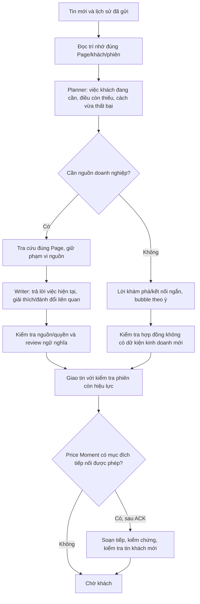

# Sales Core 4 — UX trước, chốt sale theo sau

Phạm vi: core tư vấn dùng chung, nghiệm thu thực tế ưu tiên Nàng Sen. Cơ sở quyết định là các hội thoại người dùng cung cấp và ba bản góp ý ngày 07/11, cộng với lượt thử UI thực tế. Không đổi model, không mở thêm Page, không thêm agent hay quyền giao dịch.

## Đích sản phẩm

Khách cảm thấy được đón tiếp, được hiểu và được giúp đúng việc. Lời mời mua chỉ xuất hiện khi có ích cho quyết định của khách. Chất lượng không được suy từ số skill, nhãn cảm xúc, JSON hợp lệ hay lời model tự đánh giá.

“Có duyên” ở đây là: nói đúng lúc, dùng một chi tiết đúng, bớt câu không cần, chia ý dễ đọc, biết nhận lỗi rồi sửa ngay. Không phải tăng lời đồng cảm, emoji, diễn giải cảm xúc thay khách hay tạo cảm giác mắc nợ.

## Chắt lọc góp ý

Giữ:

- Opening thích ứng với yêu cầu; khách đã hỏi cụ thể không phải đi lại quy trình khám phá.
- EQ thể hiện bằng quyết định: khách bực vì bị hỏi nhiều thì trả lời phần có thể trả lời; khách ngại chất lượng thì dùng bằng chứng; khách muốn dừng thì dừng.
- Nhu cầu → khu vực thuận tiện → phương án phù hợp là các điều kiện thông tin cho tư vấn, không phải funnel bắt buộc.
- Chia bubble theo mục đích giao tiếp, không cắt theo dấu câu hoặc ép hai tin mỗi lượt.
- Price Moment có điều kiện, quyền tiếp nối có thể bị thu hồi khi khách nhắn mới; im lặng không phải đồng ý.
- Tách Core / Industry / Business / Channel; không biến ví dụ Spa thành nhánh từ khóa trong Java.

Điều chỉnh:

- “Emotion first” không có nghĩa gửi lời đồng cảm trước rồi mới chịu trả lời. Đôi khi câu trả lời ngắn, chính xác là cách quan tâm tốt nhất.
- Không cần thêm một service hay một cuộc gọi LLM cho mỗi năng lực được đặt tên trong góp ý. Planner sở hữu mục tiêu và chế độ trả lời; writer thực hiện nhịp ý; channel sở hữu việc giao tin.
- Không gửi giá chưa kiểm chứng để đổi lấy tốc độ. Giá vẫn qua nguồn, điều kiện áp dụng, kiểm tra con số và review; chỉ phần tiếp nối được thực hiện sau ACK.
- Không chuyển nhân viên chỉ vì thiếu công cụ lịch. Bot tiếp nhận phần yêu cầu có thể làm; chỉ xác nhận giữ chỗ khi có kết quả nghiệp vụ. Hiện chưa có adapter đặt lịch.
- Bộ chấm tự động hỗ trợ tìm lỗi; không thay thế việc đọc cả hội thoại như một khách khó tính. “PASS” kỹ thuật không phải nghiệm thu trải nghiệm.

## Pipeline thực thi

Planner không thấy catalog để tránh chọn sản phẩm trước khách. Giai đoạn cần dữ kiện mới nạp evidence. DISCOVERY/TRUST_REPAIR/CLOSE có thể hoàn tất bằng một cuộc gọi; không gọi đây là kết quả đã qua semantic review. Memory đề xuất ở đường nhanh không được tự nâng thành facts đã duyệt; giữ nguyên nguồn khách và facts cũ.

`stage` là nơi quyết định đường lấy nguồn; `needsBusinessEvidence` còn đọc để tương thích nhưng không được xóa nguồn khỏi lượt LOCATION/CONSULTATION/COMMITMENT/ESCALATION. Hai tín hiệu mâu thuẫn từng khiến bot tự nhắc gói khách chọn rồi bị chặn vì không có nguồn, phải gọi lại. Runtime không còn để cờ phụ quyết định ngược stage.

Phàn nàn về cách nói là tín hiệu điều chỉnh, không phải lý do che mất câu hỏi hiện tại. Nếu việc sửa đòi địa chỉ/giá/chính sách, đi qua LOCATION/CONSULTATION để trả lời ngay. TRUST_REPAIR chỉ dành cho việc sửa cách tư vấn không cần dữ kiện doanh nghiệp mới.

## Hợp đồng thay đổi

| Trách nhiệm | Thực thi |
|---|---|
| Đề xuất phù hợp | `recommendationRequirements` từ industry pack; `contextEvidence` phải trích lời khách. Không dùng địa danh bot tự đề xuất làm lựa chọn khách. |
| Trả lời thông tin cụ thể | `ANSWER` có nguồn không bắt khách cung cấp nhu cầu cá nhân không liên quan. Review vẫn kiểm tra đúng phạm vi/địa điểm. |
| Nhịp hội thoại | `ReplyMode.DIRECT` mặc định, bubble theo ý nghĩa; tiền xuất hiện không kích hoạt quy trình giá. |
| Báo giá theo hai pha | `PRICE_MOMENT` do planner chọn theo mục đích; tin đầu ngắn, kiểm chứng trước. Tiếp nối hiện chỉ cho COMMITMENT có mục đích và lời khách làm bằng chứng. |
| Handoff | Chỉ ESCALATION có lý do và lời khách: yêu cầu người thật, khiếu nại dịch vụ đã nhận tại doanh nghiệp, hoàn/trả, tranh chấp. Lỗi kỹ thuật là lỗi có thể thử lại, không đổi quyền điều khiển sang sale. |
| Trí nhớ | Lỗi JSON của đề xuất memory không làm mất kế hoạch hợp lệ. Update bị lỗi/bị review bác bỏ không được lưu thành fact. |
| Dữ liệu ngành | Runtime không chứa `evaluationScenarios`; mã ngành cấu hình sai bị từ chối rõ, không âm thầm dùng GENERIC. |

Các điều kiện này chỉ xác minh được một phần: trích nguyên văn chứng minh nguồn của câu, không chứng minh model hiểu đúng nghĩa. Những quyết định như khu vực đã đủ chi tiết hay câu hỏi có duyên vẫn cần semantic review và nghiệm thu người đọc.

## Nghiệm thu Spa như một khách

Trước khi thử, chọn mục tiêu khách và ràng buộc; không soạn sẵn câu trả lời mong muốn cho model. Sau mỗi tin, phản ứng theo câu bot vừa nói, không tiếp tục kịch bản bất kể bot trả gì.

Mỗi cuộc phải đọc lại toàn bộ với các câu hỏi:

1. Lượt đầu có tạo thiện cảm và giúp mình trả lời dễ không?
2. Mình có phải nhắc lại dữ kiện đã nói? Bot có dùng dữ kiện để thay lời khuyên không?
3. Hỏi thêm điều này có thực sự cần, hay đẩy việc sang khách?
4. Mỗi bubble có một ý, đọc trên điện thoại có ngợp không?
5. Khi chất vấn, bot sửa việc đang sai hay chỉ xin lỗi?
6. Khi chê đắt, bot giữ nhu cầu và tìm băn khoăn thật, hay tự đổi gói?
7. Khi muốn đặt, bot tiến đúng bước và nói trung thực về khả năng xác nhận?
8. Khi từ chối hoặc muốn dừng, bot có tôn trọng không?

Đánh trượt ngay nếu tự chọn chi nhánh, quên ưu tiên rõ ràng, bịa quyền lợi/khả dụng, chuyển sale vì lỗi bot, hoặc hỏi vòng lặp. Ghi riêng độ trễ đến câu có ích đầu tiên. Một lượt đúng vẫn không cứu được cả cuộc hội thoại khiến khách bỏ đi.

Không tuyên bố tăng chuyển đổi hoặc “EQ cao” từ pilot nhỏ. Chỉ báo điều đã quan sát, lỗi còn lại và phần chưa kiểm chứng; mở ngành khác sau khi trải nghiệm Spa đạt tiêu chí chủ sản phẩm.
