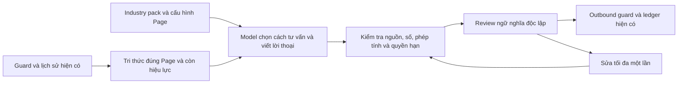

# Sales Core — kết quả triển khai và kiểm chứng

## Trạng thái

Đã triển khai core tư vấn mới trong repo và tích hợp vào đường xử lý Fanpage. Chưa deploy, push hoặc bật cho khách thật. Cờ mặc định tắt, có allowlist từng Page để pilot. Chưa có bằng chứng đủ để tuyên bố bot đạt EQ cao hoặc tăng tỷ lệ chốt sale ngoài thực tế.

## Thay đổi kiến trúc

Core mới không đi qua planner phản đối giá, price ladder hoặc sanitizer ACI cũ. Không có nhánh Java phân biệt spa/thuê xe hoặc luật «Đắt lần hai phải dừng hỏi». Industry pack là dữ liệu; bảng giá và chính sách thuộc Page. Bộ kiểm tra kỹ thuật vẫn có quy tắc cố định về quyền hạn, định dạng và số học — đó là ranh giới hệ thống, không phải kịch bản bán hàng.

| Kỳ vọng | Cơ chế đã làm | Giới hạn cần nhìn đúng |
|---|---|---|
| Hiểu mong muốn/insight | Lịch sử có nguồn, lời khách tách khỏi giả thuyết, giữ nhu cầu khi so phương án | Câu «Đắt» không chứng minh nguyên nhân hoặc ngân sách; model vẫn có thể suy diễn sai |
| EQ và gần gũi | Model viết theo giọng Page, không bị sanitizer ép câu đồng cảm hoặc xóa câu hỏi cần thiết | Reviewer còn bỏ sót câu lặp/thiếu tinh tế; chưa có đánh giá khách thật |
| Chiến lược bán hàng | Chọn bước tiếp theo theo ngữ cảnh; không ép mỗi lượt hỏi/chốt; phân biệt lựa chọn rẻ hơn với giảm phạm vi | Chưa chứng minh tăng chuyển đổi; chưa nối hệ thống đặt lịch/tồn xe thật |
| Ngôn từ thu hút | Một chủ thể quyết định lời thoại, dữ kiện có nguồn, không lắp đoạn từ nhiều planner | Model/endpoint đang cấu hình còn viết dài và lặp |
| Nhiều ngành/Page | GENERIC, BEAUTY_SPA, VEHICLE_RENTAL; file pack và file cấu hình Page riêng | Danh mục rất lớn và lịch sử dài cần nâng cấp truy xuất/memory có đánh giá riêng |

## Kiểm thử kỹ thuật

- **Release check cục bộ: 56/56 PASS**, gồm 31 ca mới/snapshot và 25 ca hồi quy Stage 1, Stage 2, ledger; `mvn ... package` BUILD SUCCESS. Log `artifacts/sales-core-release-check.log`; JAR `api-java/target/docmind-api-0.0.1-SNAPSHOT.jar`. Đây là gói build cục bộ, không phải deployment.
- **31/31 PASS** ở mốc cuối trước đóng gói (17 core, 12 gateway/source, 1 HTTP boundary, 1 snapshot), log `artifacts/sales-core-final-offline.log`. Bao gồm chặn Page trống thay vì rơi về kho toàn cục và không coi số điện thoại là bằng chứng chốt sale. Trong đợt tổng hợp trước đó, một mock còn gọi `enabled()` sau khi runtime chuyển sang `enabledFor(pageId)`; đã cập nhật mock theo đúng interface và chạy lại, không bỏ assertion outbound fence.
- Kiểm thử mới bao phủ public Fanpage service, phạm vi tài liệu/Page, giá hết hiệu lực, bảo toàn câu hỏi sau phản đối, nguồn giả/giá giả, xác nhận giao dịch không có quyền, JSON sai, deadline, review và sửa, số học có nguồn, phân loại lỗi chất lượng, tiếp quản của nhân viên, lượt khách mới làm câu cũ mất hiệu lực, allowlist và handoff.
- Kiểm thử request HTTP xác minh policy nằm ở system role và dữ liệu ở user role qua client OpenAI-compatible thật; phản hồi mạng được giả lập.
- Frontend `npm run build`: PASS. Badge phân biệt Sales Core; token chưa đo được hiển thị thiếu thống kê, không ghi 0 như số đo thật.
- Full suite tại mốc tích hợp: 1.040 test, 17 failure, 3 error, 8 skip. Bản HEAD gốc chạy riêng từ git archive: 1.022 test, đúng 17 failure và 3 error, 7 skip. Tập 20 tên test lỗi giống hệt, không sửa assertion cũ để làm xanh. Đây là kết quả tại mốc đó; thay đổi tiếp theo được chạy lại bằng bộ test core liên quan.
- Log full suite: `artifacts/sales-core-full-verified.log`; baseline: `artifacts/sales-core-baseline-suite.log`. Không gọi full suite là xanh. Một số test cũ có phụ thuộc DB/fixture nên cần DB kiểm thử riêng khi phát hành.

## Replay model thật: catalog giả lập

Artifact: `artifacts/sales-core-live/final-synthetic.json`. Writer/reviewer dùng alternate đã cấu hình (`hada/deepseek-ai/deepseek-v4.1-flash-1017` qua endpoint hiện có). Primary vẫn giữ nguyên cấu hình; lựa chọn writer là property, không chọn theo ngành.

| Chỉ số | Kết quả |
|---|---:|
| Lượt hội thoại | 12, chia đều spa và thuê xe |
| Fallback vì không xác minh được phản hồi | 0 |
| Lượt phải sửa | 4 |
| Cảnh báo chất lượng còn lại sau sửa | 1 |
| Thời gian trung bình | 18,46 giây |
| Nhanh nhất / chậm nhất | 9,34 / 39,03 giây |

Không coi 12 lượt không fallback là 12 lượt bán hàng tốt. Đọc thủ công còn thấy lặp giá/câu hỏi chi nhánh; một số cách nói như «bên em đang có» dễ bị hiểu thành xác nhận tồn xe, hoặc «em báo lại» tạo kỳ vọng tác vụ chưa thực hiện. Reviewer chưa bắt hết. Vì vậy chưa bật rộng hoặc gắn nhãn production-ready.

Khác biệt có ích đã quan sát: sau lần «Đắt» cuối, bot hỏi mức chi phù hợp thay vì chỉ lặp gói 239k rồi dừng; nói rõ gói rẻ hơn thiếu chân tay; thuê xe tính 300k/440k cho hai ngày, phân biệt tiền thuê và cọc. Các số này là fixture kiểm thử, không đưa vào Page thật.

Các replay thất bại trước được giữ ở `artifacts/sales-core-live/` (initial-single-pass, deepseek-reviewed, hybrid-first, alternate-before-citation-fix...). Chúng đã giúp tìm lỗi role, citation giữa bubble, phép tính nối tiếp và false handoff; không gộp với bản cuối thành một benchmark giả.

## Snapshot Nàng Sen và dữ liệu

Đã đọc SELECT snapshot của 65 chunk đang hiệu lực. Bộ dựng ngữ cảnh thật giữ 24 đoạn trong ngân sách 18.000 ký tự và báo `contextTruncated=true`. Bảng giá được ưu tiên trước bảng quy trình; tiêu đề chi nhánh thuộc chứng cứ hợp lệ. Không sửa dữ liệu Page. Snapshot test dùng repository giả chứa dữ liệu xuất; không phải kiểm thử toàn bộ đường HTTP–DB–Facebook.

Replay snapshot cuối: **6/6 lượt không fallback**, 2 lượt sửa, 2 cảnh báo QUALITY còn lại; trung bình **20,69 giây**, khoảng **12,77–31,34 giây**. Artifact `artifacts/sales-core-live/final-page.json`, log `artifacts/sales-core-page-final.log`. Bản trước lỗi tiêu đề/thứ tự nguồn giữ ở `page-before-heading-fix.json` (3/6 fallback), không che kết quả thất bại đó.

Trong replay này bot giữ được nhu cầu cổ vai gáy/tay chân và phân biệt massage toàn thân với dưỡng sinh ít phạm vi hơn. Tuy nhiên sau lần «Đắt» cuối vẫn có lời lặp giá và hỏi lại khu vực. Chưa đạt tiêu chuẩn «nhân viên sale chuyên nghiệp» trên mọi lượt; phần cải thiện kiến trúc và đúng dữ kiện đã kiểm chứng, phần EQ/chiến lược vẫn phải chấm và nâng chất lượng tiếp trên tập hội thoại độc lập.

Trong bảng có nội dung cần chủ doanh nghiệp xác minh: cùng dòng NS01 ghi «Phòng chung» nhưng phần nổi bật nói «Phòng Vip»; NS02 cũng có mô tả phòng chưa nhất quán. Core không thể tự quyết định điều kiện kinh doanh nào đúng. Không âm thầm sửa nguồn hoặc cam kết riêng tư dựa trên mâu thuẫn đó.

## Phát hành có kiểm soát

Hướng dẫn và lệnh chạy lại ở `docs/sales-core.md`. Chỉ bật Page thử nghiệm sau khi đọc transcript và xác minh bảng giá/phạm vi/chính sách. Chốt giao dịch chỉ tính khi hệ thống nghiệp vụ hoặc nhân viên xác nhận; hiện core có thể tư vấn và yêu cầu handoff, không xác nhận đặt chỗ/thanh toán/tồn kho giả.

Trước khi mở rộng: chấm tập hội thoại chưa dùng để chỉnh prompt, gồm khách đổi ý, so đối thủ, lưỡng lự, giới hạn ngân sách, sẵn sàng mua và yêu cầu ngoài nguồn. Chấm riêng đúng dữ kiện, giữ nhu cầu, lặp ý, chất lượng câu hỏi, bước tiếp và handoff; đo latency P50/P95 và chi phí. So với nhân viên và phiên bản cũ trên cùng dữ kiện. Tỷ lệ chuyển đổi cần pilot thật, không suy ra từ test tự động.

Embedding hiện có vẫn là cấu hình cũ; chưa đổi model hoặc reindex. Catalog/reference được lấy bổ sung độc lập vector để không mất bảng giá khi khách trả lời ngắn, nhưng đây chưa phải bằng chứng retrieval ngữ nghĩa đã tốt trên mọi danh mục.
