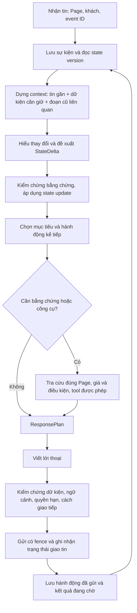

# ADR — Định hướng sản phẩm và kiến trúc hội thoại bán hàng DocMind

**Status:** Hướng triển khai đã được người dùng yêu cầu thực hiện. Sales Core 4 bổ sung hợp đồng UX, truy xuất khi cần và quyền bàn giao có điều kiện trên nền M1/M2. [Quyết định UX hiện hành](../analysis/2026-11-07-sales-core-v4-ux-design.md) ưu tiên nghiệm thu Spa trước. Các năng lực khác bên dưới vẫn là mục tiêu, chưa phải tính năng đã hoàn tất.
**Date:** 2026-11-07, Asia/Bangkok.
**Deciders:** Chủ sản phẩm quyết định tiêu chuẩn trải nghiệm, quyền hạn kinh doanh và phạm vi pilot; engineering chịu trách nhiệm hợp đồng dữ liệu, đo lường và triển khai.
**Baseline inspected:** `af1c236`, nhánh `fix/post-cp3-quality-remediation`.
**Phạm vi bản gốc:** đánh giá thiết kế trên baseline. **Bổ sung triển khai:** xem [phản biện và thiết kế Sales Core 3](../analysis/2026-11-07-sales-core-v3-design-review.md); vẫn pilot một Page, không mở rộng quyền nghiệp vụ.

## 1. Context: sản phẩm thực sự cần làm gì?

DocMind là nhân viên tư vấn qua hội thoại cho từng doanh nghiệp: giúp khách làm rõ nhu cầu, cân nhắc lựa chọn, giải quyết băn khoăn và hoàn tất bước họ đồng ý. Kết quả kinh doanh cần được gắn với hành động thật. Giọng nói tự nhiên, EQ và sức thuyết phục là năng lực phục vụ quá trình đó.

Core dùng chung cho spa, thuê xe và các ngành tiếp theo. Industry pack mô tả tiêu chí lựa chọn, thông tin chuyên môn và giới hạn; Page cung cấp danh mục, giá, chính sách, giọng thương hiệu và công cụ được phép. Cùng câu «Đắt» có thể dẫn đến các hành động khác nhau tùy nhu cầu, những gì đã trao đổi và nguyên nhân đã biết.

Giả định pilot hiện tại: Nàng Sen trước; thuê xe là miền thứ hai để chứng minh khả năng chuyển ngành. Khi chưa có adapter đặt lịch/tồn xe, kết quả cao nhất có thể xác minh là tiếp nhận yêu cầu/bàn giao có xác nhận. Không gọi yêu cầu liên hệ hay một số điện thoại là đơn hàng thành công.

Một phản hồi «có hồn» phải thể hiện sự chú ý liên tục: hiểu chi tiết cụ thể, dùng chi tiết đó để thay đổi lời khuyên, nhớ điều đã nói, sửa khi hiểu sai, đưa bước tiếp dễ thực hiện. Không đo bằng số từ đồng cảm, emoji hay mức độ văn hoa.

## 2. Đánh giá bản góp ý được chia sẻ

Đã đọc bản 48 mục tại [góp ý kiến trúc DocMind](https://chatgpt.com/s/t_6aee83db025881918ca446c089739bda). Đây là định hướng sản phẩm hữu ích; nó đã nói rõ hành trình có thể bỏ qua/quay lại, phân biệt fact/inference/unknown, tách dữ kiện nghiệp vụ khỏi RAG và không yêu cầu mỗi lớp là một agent/service riêng.

Những quyết định cần cụ thể hóa trước triển khai:

- Ai sở hữu trạng thái chính thức, ai chỉ đề xuất, cập nhật phiên bản nào, xử lý sửa lời/mâu thuẫn/ngắt ngang ra sao?
- Mỗi giả thuyết cần bằng chứng, điều chưa biết và dấu hiệu phản bác. Con số confidence do model tự khai chưa phải xác suất đã hiệu chỉnh.
- Bước «Check» cần so phản hồi khách với kết quả mong đợi của hành động trước. Nhãn phản đối lặp lại không đủ để biết vì sao chiến lược thất bại.
- Sơ đồ thực thi cần hai nhánh rõ: tra cứu trước khi đưa dữ kiện; giao dịch sau xác nhận cần thiết và chỉ thông báo thành công sau kết quả thật.
- Crisis là chế độ ưu tiên/phạm vi quyền hạn; không phải một cấp reasoning tương đương FAST/THINKING. Cần phản hồi kịp thời và quy trình phù hợp, không mặc định thêm nhiều suy luận.
- Các mục tiêu «tự nhiên», «thấu hiểu», «không hỏi lại» cần rubric, bộ kiểm tra giữ riêng và người chấm. Kiểm định bằng một LLM không chứng minh đã đạt EQ.
- Kiểm tra dữ liệu/parser/embedding là cần thiết, nhưng cần audit đường chạy thật trước khi quyết định làm lại toàn bộ ingestion. Log cũ có `provider_model=stub` là bằng chứng cần điều tra, không chứng minh cấu hình hiện tại vẫn như vậy.

Không chuyển cả tài liệu thành system prompt. Các nguyên tắc phải được phân bổ vào hợp đồng, dữ liệu, quy trình cập nhật và kiểm thử đúng nơi.

## 3. Những gì code hiện tại đã có và còn thiếu

| Năng lực | Bằng chứng tại baseline | Ý nghĩa |
|---|---|---|
| Chọn bước trước khi viết | `SalesConversationPlanner.Brief`: latestContribution, nextDecision, reason, needsBusinessEvidence | Có nền tảng, nhưng chưa có lịch sử chiến lược/kết quả và giả thuyết có vòng đời trong hợp đồng này |
| Hiểu khách | `SalesContracts.Understanding`: goal, facts kèm quote, uncertainties, obstacleHypothesis | Có dữ kiện có dẫn chứng, nhưng chưa có fact ID/turn ID, supersession và state revision |
| Ngữ cảnh | `SalesKnowledgeSource.load`: tối đa 40 tin / 14.000 ký tự; query dùng tối đa 6 tin gần nhất / 3.500 ký tự | Lưu transcript trong DB không đồng nghĩa các dữ kiện cũ luôn được mang vào quyết định hiện tại |
| Thứ tự lấy dữ liệu | `SalesCoreGateway.respond` gọi `knowledge.load` trước planner; planner sau đó có thể bỏ evidence | Catalog không đi vào planner, nhưng retrieval vẫn đã chạy; chưa phải truy xuất hoàn toàn theo nhu cầu quyết định |
| Kiểm chứng | `SalesTurnOrchestrator.run`: schema/nguồn + semantic review, một sửa và một recovery | Giới hạn được vòng sửa; QUALITY vẫn có thể được gửi sau sửa, không đồng nghĩa trải nghiệm tốt |
| Tách ngành | `IndustryProfileRegistry` đọc pack ngoài image hoặc resources | Hướng phù hợp; pack hiện là tiêu chí/hints/boundaries, chưa có đầy đủ capability/schema nghiệp vụ |
| Nhịp gửi | ticket tiếp nối, kiểm tra supersession, gửi sau ACK đầu | Giữ lại; cải thiện vận chuyển không tự giải quyết hiểu khách |
| Đánh giá | Báo cáo 92 test có 1 live test chứa 12 lượt | Có kiểm chứng kỹ thuật; chưa có benchmark EQ được người chấm độc lập |

Từ các đường gọi core đã đọc, chưa thấy Understanding được lưu và nạp lại như một mô hình trạng thái bền vững có phiên bản. Không suy ra toàn bộ repository không có state: ACI cũ có nhiều state, nhưng không nên mặc định nó đã trở thành trí nhớ có thẩm quyền của core mới.

## 4. Decision: một bộ điều phối, trạng thái có nguồn, hành động thích ứng

Giữ Spring Boot, PostgreSQL và các đường gửi/inbox đã kiểm chứng. Xây các năng lực dưới dạng module logic trong core, không mặc định thêm service hay agent. LLM đề xuất hiểu khách và hành động; code sở hữu xác thực, cập nhật trạng thái, quyền hạn và kết quả nghiệp vụ.

### Pipeline xử lý một lượt

Đây là các trách nhiệm, không phải số lần gọi LLM. Có thể gộp hiểu lượt + đề xuất kế hoạch thành một lời gọi có cấu trúc nếu kiểm thử chứng minh vẫn tốt. Không sinh chuỗi suy luận dài để làm log; chỉ cần quyết định, bằng chứng và lý do ngắn kiểm chứng được.

Planner được biết doanh nghiệp cung cấp loại dịch vụ/capability nào. Nó chưa cần toàn bộ giá/catalog để hiểu khách. Kế hoạch sơ bộ được điều chỉnh sau tra cứu nếu không có phương án khả thi; không cố viết cho phù hợp một kế hoạch đã sai.

Nhánh giao dịch: đề nghị hành động → xác nhận cần thiết của khách → kiểm tra quyền hạn/điều kiện → tool với idempotency key → kết quả → câu xác nhận đúng trạng thái. Tool lỗi hoặc chưa rõ kết quả phải đối soát, không tự retry giao dịch mù hay báo thành công.

### Quyền quyết định

| Thành phần | Được quyết định | Không được tự quyết định |
|---|---|---|
| LLM hiểu lượt | Đề xuất facts/giả thuyết/cập nhật tham chiếu có nguồn | Ghi đè DB state hoặc suy đoán thành fact |
| State reducer bằng code | Scope, phiên bản, trạng thái cập nhật hợp lệ, kiểm tra nguồn | Tự suy luận cảm xúc từ từ khóa và áp kịch bản bán hàng |
| Planner | Mục tiêu, hành động, thông tin còn thiếu, mức mời bước tiếp | Giá, khuyến mãi, tồn hàng hay quyền hạn mới |
| Writer | Cách diễn đạt và nhịp theo kế hoạch | Tự đổi gói, tăng cam kết, tạo booking |
| Validator/reviewer | Bắt lỗi và yêu cầu sửa có phạm vi | Viết lại vô hạn hoặc coi tự chấm PASS là kết quả khách hàng |
| Tool/delivery | Thực hiện quyền hạn cho phép, trả trạng thái thật | Tự mở rộng quyền theo nội dung model |

Không hardcode tình huống nghĩa là không có `if contains("đắt") => giảm giá`. Vẫn phải có quy tắc ổn định về schema, tenant, nguồn, quyền hạn và giao dịch. Đưa nhánh kịch bản cứng vào JSON chỉ đổi chỗ hardcode; industry pack không được trở thành danh sách if/else trá hình.

## 5. Bảy yêu cầu trải nghiệm được chuyển thành hành vi quan sát được

### 5.1. Có hồn

- Phản hồi có ít nhất một liên hệ có ích với điều riêng của khách khi ngữ cảnh có chi tiết đó.
- Liên hệ phải thay đổi lời khuyên/cách hỏi; chỉ nhắc lại câu khách chưa đủ.
- Không buộc câu nào cũng có empathy/CTA/câu hỏi. Khách hỏi trực tiếp cần câu trả lời trực tiếp.
- Có khả năng tự sửa: nhận ra đã hỏi lại, làm phiền, tư vấn quá rộng hoặc hiểu sai.
- Giọng ổn định theo Page, xưng hô có căn cứ; mức trang trọng/độ dài thích ứng với yêu cầu và tình huống.

### 5.2. EQ cao

Chuỗi năng lực: nhận ra tín hiệu → xét nguyên nhân và độ chắc chắn → chọn hành động phù hợp → điều chỉnh cách nói → quan sát phản ứng ở lượt sau.

EQ thể hiện ở thay đổi hành vi: ngừng hỏi lại khi khách bực vì bị hỏi, xử lý đúng điều khách lo, không ép quyết định, giải thích giới hạn mà vẫn giúp được khách. Không cố đo «cảm xúc thật» từ vài chữ. «Đắt» chỉ xác nhận khách phản ứng về giá; nguyên nhân chưa rõ nếu chưa có bằng chứng khác.

Xây năng lực này bằng bộ cặp phản hồi tốt/xấu có lý do từ người làm sales, model đủ năng lực tiếng Việt, context có nguồn và benchmark nhiều lượt. Few-shot được chọn theo nguyên tắc giao tiếp, không sao chép giá/câu chữ. Chỉ cân nhắc fine-tuning khi state/knowledge đã đúng nhưng lỗi diễn đạt/quyết định còn lặp có hệ thống.

### 5.3. Thấu hiểu

Mô hình khách cần: kết quả mong muốn, tiêu chí ưu tiên, điều không chấp nhận, ràng buộc, trải nghiệm đã kể, phương án đang cân nhắc, băn khoăn chưa giải quyết và mức cam kết đã thể hiện. Mọi trường đều có thể chưa biết. Không yêu cầu thu thập đầy đủ trước khi giúp.

Một câu hỏi có giá trị nếu các câu trả lời khác nhau sẽ làm thay đổi đề xuất hoặc hành động. Nếu không, thường không cần hỏi. Insight là giả thuyết có ích để kiểm tra, không phải tuyên bố đọc được tâm lý.

### 5.4. Lắng nghe hay chốt

Ưu tiên nhu cầu hiện tại của khách. Chọn một bước đủ nhỏ để có ích, với mức cam kết tương xứng:

| Bằng chứng hội thoại | Mục tiêu hợp lý |
|---|---|
| Câu hỏi cụ thể còn chưa được trả lời | Trả lời hoặc làm rõ tối thiểu để trả lời đúng |
| Khách đang kể trải nghiệm/lo ngại, hoặc bot vừa gây khó chịu | Hiểu/khắc phục vấn đề trước lời mời mua |
| Có nhu cầu nhưng thiếu thông tin làm thay đổi lựa chọn | Một câu hỏi có giá trị quyết định |
| Phương án phù hợp, rào cản chính đã được giải quyết | Mời bước tiếp dễ từ chối, không khẳng định khách đã đồng ý |
| Khách chủ động chọn và hỏi cách thực hiện | Chuyển sang thu thập thông tin nghiệp vụ cần thiết/tra cứu khả dụng |
| Khách từ chối, yêu cầu dừng hoặc gặp người thật | Tôn trọng lựa chọn, thực hiện đúng yêu cầu |

Hỏi lịch/giấy tờ là tín hiệu cần phục vụ, chưa tự động là chấp thuận giao dịch. Không lấy điểm «nhiệt độ mua» do model tự chấm làm điều kiện đủ để chốt.

### 5.5. Chiến lược khi gặp vấn đề

Các ví dụ dưới đây là tiêu chí kiểm thử, không phải bảng định tuyến theo từ khóa:

| Hiện tượng | Điều cần hiểu | Hướng xử lý | Dấu hiệu phải thay đổi |
|---|---|---|---|
| Bực | Bực vì bot, trải nghiệm dịch vụ, chậm hay điều khác? | Nhận trách nhiệm nếu bot sai; khắc phục điểm gây bực; lấy lại thông tin đã có; handoff khi cần | Khách tiếp tục chỉ ra cùng lỗi; không lặp lời xin lỗi rồi tiếp tục hành vi cũ |
| Chê đắt | Vượt ngân sách, chưa thấy giá trị, so sánh, sợ phụ phí hay thương lượng? | Dựa trên điều đã biết; hỏi tối thiểu nếu cần; giải thích hoặc đưa phương án thật và nói rõ đánh đổi | Phản đối lặp lại không tự chứng minh thiếu tiền; đổi giả thuyết/cách giúp |
| Lưỡng lự | Thiếu dữ kiện, ngại rủi ro, cần người khác, chưa đúng lúc? | Giải quyết đúng phần thiếu, tóm tắt để cân nhắc hoặc cho khoảng dừng | Khách muốn dừng; không đổi mọi im lặng thành lý do gửi thêm |
| So đối thủ | Tiêu chí so có cùng phạm vi, điều kiện và tổng phí không? | So sánh dựa nguồn; dữ kiện đối thủ do khách nói được ghi là lời khách, chưa xác minh | Không đủ bằng chứng thì không suy diễn đối thủ kém |
| Đã muốn mua | Còn thiếu gì để thực hiện yêu cầu? | Giúp thực hiện và xác nhận trạng thái thật | Không tiếp tục discovery hay thuyết phục đã thừa |

Mỗi StrategyAttempt lưu objective, action, evidence, expectedCustomerContribution, deliveredMessageIds, observedOutcome và unresolvedReason. Outcome gồm tiến triển, sửa thông tin, từ chối, đổi chủ đề hoặc chưa rõ. Không mặc định im lặng là hài lòng/từ chối.

Lượt mới phải trả lời: hành động trước đã giúp gì, điều nào chưa giải quyết, có thông tin mới nào làm thay đổi giả thuyết? Đây là cơ chế thoát lặp ở cấp hội thoại.

### 5.6. Emotion first

Diễn giải thành «nhu cầu cảm xúc có liên quan được ưu tiên đúng lúc». Không phải lượt nào cũng chèn câu cảm thông trước nội dung. Khi khách đang vội hỏi giá, ngắn gọn và đúng giá có thể là cách tôn trọng tốt nhất. Khi khách bực, xử lý nguồn gây bực là trọng tâm. Khi khách đã chọn, giúp thực hiện là trọng tâm.

Nhịp tạo khoảng nghỉ sau giá là chính sách trình bày, không phải phép đo EQ. Giữ tùy chọn đã yêu cầu khoảng 10 giây, sinh lời tiếp nối sau ACK và hủy khi khách chen ngang. Phải đo riêng thời gian chờ model và thời gian nghỉ có chủ ý; không dùng hoạt ảnh để che độ trễ.

### 5.7. Không quên context

Lưu đầy đủ transcript theo chính sách retention, nhưng mỗi lượt chỉ nạp tập dữ liệu có ích. Thiết kế bốn lớp:

1. **Nhật ký nguồn:** tin khách, tin nhân viên, bot draft, bot accepted/delivered, tool result, thời gian và external ID. Không trộn lời bot với sự thật khách xác nhận.
2. **State có cấu trúc:** facts/ràng buộc/ưu tiên/đề nghị/câu hỏi đang chờ/cam kết và các băn khoăn chưa giải quyết.
3. **Tóm tắt theo giai đoạn:** thông tin nền ít thay đổi, có covered-through event ID và tham chiếu nguồn; có thể dựng lại. Không ghi đè facts quan trọng bằng tóm tắt tự do.
4. **Context lượt hiện tại:** tin gần nhất + facts cần giữ + pending question + phương án/cam kết còn mở + đoạn cũ truy hồi theo nhu cầu.

Khi thiếu context hoặc nguồn mâu thuẫn, đánh dấu rõ và hỏi làm rõ có mục đích. Không hứa nhớ hoàn hảo.

## 6. Hợp đồng tối thiểu cần đặc tả trước coding

Tên dưới đây là đề xuất, chưa phải class đã tồn tại.

### ConversationState

- identity: tenant/page/customer/conversation; stateVersion; processedThroughEventId.
- facts: factId, key, value, sourceEventIds, speaker/sourceType, observedAt, validity, status, supersedesFactId.
- goals/constraints/preferences: tham chiếu facts, phân biệt yêu cầu bắt buộc với ưu tiên mềm.
- hypotheses: nội dung, bằng chứng ủng hộ/phản bác, uncertainty, lastUpdated; không dùng suy đoán này làm fact.
- openRequests: yêu cầu khách chưa được trả lời, gói/phạm vi liên quan, trạng thái.
- pendingQuestions: câu đã gửi, đang hỏi điều gì, tùy chọn nếu có, sự kiện gửi.
- offersDiscussed: offerId, quoteVersion, phạm vi, giá/điều kiện đã báo, mức quan tâm do khách thể hiện.
- commitments/actions: proposed/confirmed/executed/failed, kết quả tool hoặc xác nhận nhân viên tương ứng.
- communication: cách xưng hô, ưu tiên kênh, hạn chế được khách nêu; giả thuyết cảm xúc có thời hạn.
- strategyAttempts: hành động thực tế đã gửi và outcome, không lưu chuỗi suy luận dài.

### StateDelta và cập nhật

LLM đề xuất patch, không thay toàn bộ state. Mỗi patch cần expectedVersion, nguồn mới, thao tác thêm/sửa/rút lại và lý do ngắn. Code kiểm tra scope, nguồn tồn tại, type và version. Sửa lời rõ ràng của khách có thể supersede giá trị cũ; phát biểu mơ hồ không tự ghi đè. Tin đến sai thứ tự được đối soát theo event/time; tránh hai worker cùng ghi thắng một state.

Ví dụ: khách đã nói cần cả cổ vai gáy và chân tay → bổ sung «HN» chỉ cập nhật địa điểm, không thay nhu cầu. Sau đó «Đắt» chỉ thêm phản ứng giá và băn khoăn mở. Nếu khách nói «thôi chỉ cần cổ vai gáy», mới sửa phạm vi theo bằng chứng đó.

### DecisionPlan

primaryObjective, customerEvidenceIds, unresolvedNeed, action, briefRationale, evidenceNeeded, toolRequests, selectedOfferRefs, tradeoffsToDisclose, expectedProgress, invitationLevel, stopOrHandoffReason. Các trường rỗng được phép khi không liên quan; không ép model điền tâm lý giả.

### ResponseContract

mustAnswer, approvedFacts, uncertaintiesToPreserve, relevantCustomerDetails, optionalQuestionPurpose, invitation, voice, deliveryPlan. Writer có quyền diễn đạt, không có quyền đổi dữ kiện/kết quả công cụ. Nếu thiếu dữ kiện để thực hiện kế hoạch, trả lỗi có cấu trúc để điều phối lại có giới hạn.

### DeliveryEvent và Outcome

Phân biệt generated, accepted, delivered, read khi kênh cung cấp được. Chỉ đưa lời đã được kênh chấp nhận vào lịch sử «đã nói»; không gán accepted thành read. Tin tiếp nối bị hủy không trở thành câu hỏi đang chờ khách trả lời. State ghi nhận quan sát từ khách trước, hành động bot sau khi gửi; không đánh dấu đã giải quyết chỉ vì draft vừa được tạo.

## 7. Core, industry, Page và công cụ

| Lớp | Nội dung | Ví dụ |
|---|---|---|
| Core | Ngữ cảnh, facts/giả thuyết, chọn hành động, quyền hạn, review, vận chuyển, eval | Không hỏi lại facts còn hiệu lực; lời đồng ý phải gắn đúng đề nghị |
| Industry pack | Đặc tính cần hiểu, tiêu chí phù hợp, giới hạn, schema chuyên môn | Spa: phạm vi/thời lượng; thuê xe: lịch nhận trả/đường đi/loại xe |
| Page | Giá thật, chính sách, phạm vi, giọng thương hiệu, điều kiện thương mại | Nàng Sen từng cơ sở; một doanh nghiệp thuê xe cụ thể |
| Business adapters | Hợp đồng tool, xác thực, idempotency, kết quả thực thi | Quote, availability, booking request, human handoff |

Một ngành mới có thể cần adapter mới nếu nghiệp vụ khác; «không sửa core» không có nghĩa mọi nghiệp vụ chỉ cần vài dòng JSON. Không cho ngành hoặc tài liệu upload thay đổi quyền hạn, nguồn tin cậy hay khả năng truy cập tenant khác.

## 8. Options considered và trade-offs

| Phương án | Độ phức tạp | Chi phí/latency | Khả năng đo lỗi | Quyết định |
|---|---|---|---|---|
| Thêm quy tắc/prompt sau từng câu sai | Thấp lúc đầu, tăng nhanh | Prompt/phụ thuộc ngày càng lớn | Khó biết sửa đâu ảnh hưởng gì | Không làm mặc định |
| Nhiều agent cảm xúc/sales/critic tự thương lượng | Cao | Nhiều lời gọi và trạng thái phân tán | Khó quy trách nhiệm | Chưa có bằng chứng cần |
| Một orchestrator, state có nguồn, kế hoạch + writer + kiểm chứng | Vừa, có thể bổ sung từng lát | Có ngân sách rõ, tái dùng hiện trạng | Trace theo hợp đồng từng bước | Chọn |
| Fine-tune ngay | Chi phí dữ liệu/vận hành cao | Có thể cải thiện một số hành vi, cần đo | Vẫn không sửa state/nguồn/tool sai | Xem xét sau nền tảng |

Tách trách nhiệm có thể giúp chẩn đoán nhưng cũng thêm lỗi schema và độ trễ. Không mặc định thêm một model call cho từng trường emotion/intent/objection. Ngân sách gọi model, token và thời gian phải được thiết kế rồi đo; không đánh đồng bật thinking với EQ cao.

## 9. Đánh giá: phải đo cả sự phù hợp của hành động

### Rubric mỗi lượt (đề xuất 0/1/2)

0 = sai/gây cản trở; 1 = chấp nhận được nhưng còn thiếu; 2 = đáp ứng rõ tiêu chí. Người chấm phải ghi bằng chứng, không chỉ cảm giác tổng thể.

| Chiều | Dấu hiệu đạt |
|---|---|
| Hiểu và nhớ | Dùng đúng nhu cầu, điều chỉnh theo sửa lời; không hỏi lại dữ kiện còn hiệu lực |
| Hành động | Trả lời/lắng nghe/hỏi/đề xuất/chốt/dừng phù hợp bằng chứng hiện tại |
| EQ | Xử lý nguồn gây lo/bực; không áp đặt tâm lý, không lặp hành vi gây khó chịu |
| Lời văn | Tự nhiên theo Page, cụ thể, vừa đủ, không cảm thông sáo rỗng |
| Tư vấn | Liên hệ nhu cầu với bằng chứng sản phẩm và đánh đổi thực |
| Tiến triển | Giúp khách hiểu/chọn/giải quyết/hoàn tất điều họ muốn; không đếm kéo dài chat là tiến triển |

Lỗi giá/quyền hạn/tenant/xác nhận giao dịch giả là gate riêng, không được bù bằng điểm lời văn cao. Bộ nghiệm thu không có lỗi nghiêm trọng quan sát được mới được qua; điều đó không chứng minh lỗi bằng 0 trong thực tế.

### Dữ liệu và phép đo

- Khởi đầu đề xuất 80–120 hội thoại có mục tiêu rõ, chia development/held-out theo cả hội thoại, thêm các biến thể diễn đạt. Không xem held-out để chỉnh prompt rồi vẫn gọi nó là test độc lập.
- Có bộ replay trạng thái cố định để so sánh từng quyết định và hội thoại phân nhánh do người/simulator điều khiển để đánh giá tiến triển. Câu khách cố định sau câu hỏi bot đổi hướng không đủ đại diện hội thoại thật.
- Bao phủ spa và thuê xe; một ngành giữ riêng để kiểm tra khái quát khi đã có dữ liệu đủ. Nhiều lần chạy cho ca quan trọng để biết độ ổn định.
- Người làm sales chấm ẩn danh cặp trước/sau; người thứ hai chấm chéo một phần để phát hiện bất đồng. Model judge hỗ trợ mở rộng, được hiệu chỉnh với người chấm và không là trọng tài duy nhất.
- Báo tỷ lệ quên/hỏi lại, lặp chiến lược không hiệu quả, mời chốt quá sớm, bỏ lỡ yêu cầu thực hiện, sai nguồn, handoff đúng/sai; đo cả hội thoại kết thúc sớm.
- Đo latency đầu tiên và hoàn tất, phần nghỉ có chủ ý, tỷ lệ repair/fallback, chi phí mỗi hội thoại (gồm planner/reviewer/continuation/retry). Không dùng median 12 lượt để gọi p95 production.
- KPI kinh doanh: bước khách đồng ý được hoàn tất có xác nhận, booking/đơn thật, hủy/khiếu nại và kết quả theo nhóm nhu cầu. Tỷ lệ tiếp tục chat đơn lẻ có thể tăng vì bot hỏi dai.

Chỉ định ngưỡng phát hành sau baseline và thống nhất với chủ sản phẩm. Trước pilot mở rộng cần không thoái lui ở các gate, và cải thiện có bằng chứng ở hành động/EQ trên tập giữ riêng; không tự đặt một «điểm EQ 90» rồi coi đã đạt.

### Các ca bắt buộc

1. «Cổ vai gáy chân tay» → «tất cả» → «HN» → «Đắt»: nhu cầu không mất, địa điểm không thành phản đối giá, không mặc định chấp nhận gói thiếu chân tay.
2. Khách sửa ngày/địa điểm/ngân sách, rồi nhắc «cái lúc nãy»: resolve đúng tham chiếu và giá trị đang hiệu lực.
3. «Tôi nói rồi mà»: không chỉ xin lỗi; phải dùng dữ kiện đã nói và thay hành động.
4. «Ok» sau câu hỏi hiểu nhu cầu khác «Ok» sau đề nghị đặt lịch đã rõ.
5. Đổi chủ đề rồi quay lại, hội thoại vượt 40 tin, restart và worker song song.
6. Khách muốn mua ngay: không ép trải qua discovery hay cảm thông dư thừa.
7. Khách không muốn nhận gọi điện: không mời gọi lại ở các lượt sau.
8. So giá đối thủ với phạm vi khác; bịa ưu đãi; nguồn giá xung đột/hết hiệu lực.
9. Ngắt ngang lúc sinh/chờ bong bóng thứ hai; không lưu lời chưa gửi thành ký ức đã nói.
10. Tool booking timeout/thành công muộn; không báo thành công hoặc tạo giao dịch trùng.
11. Khiếu nại và yêu cầu người thật; không tiếp tục bán và không hứa ngoại lệ vượt quyền.
12. Đổi industry pack + catalog giữ cùng core: không rò ngôn ngữ spa sang thuê xe.

## 10. Lộ trình và điều kiện qua từng mốc

| Mốc | Việc làm | Đầu ra kiểm chứng | Điều kiện qua |
|---|---|---|---|
| M0 — Chuẩn sản phẩm | Chốt hành vi tốt/xấu, rubric, dữ liệu đánh giá và baseline | Một bộ conversation eval có người chấm, trace hiện trạng | Biết hiện đang sai ở state, knowledge, decision hay expression |
| M1 — Memory + dữ kiện | StateDelta/reducer, event provenance, context assembly; audit dữ liệu/giá đang dùng | Ca dài/sửa lời/tham chiếu/restart và kiểm tra nguồn | Không mất các ràng buộc trong bộ nghiệm thu; không rò Page; nguồn giá rõ |
| M2 — Chiến lược + EQ | DecisionPlan, strategy outcome, response contract, viết lời tự nhiên | So sánh ẩn danh trước/sau ở spa và thuê xe | Hành động tốt hơn trên tập giữ riêng; không thoái lui memory/grounding |
| M3 — Chốt bằng hành động | Capability registry, handoff/booking adapters theo phạm vi thực | Kết quả tool, xác nhận, đối soát/retry | Không cam kết giả; đúng một hành động được phép |
| M4 — Pilot | Chạy shadow, pilot giới hạn, theo dõi người thật | Dashboard chất lượng, latency, chi phí và kết quả xác thực | Mở rộng dựa dữ liệu; rollback rõ |

Đây là thứ tự phụ thuộc, không phải yêu cầu dừng mọi việc đến khi một nền tảng lớn hoàn hảo. Kiểm tra ingestion và làm bộ eval có thể tiến hành độc lập; sửa từng lát hoàn chỉnh (memory → quyết định → câu gửi → outcome) trên code đang có. Giữ delivery guards/ledger và industry registry hữu ích, không viết lại toàn bộ dự án.

## 11. Quy trình cải tiến để thoát vòng thủng–vá

Một ca lỗi → lưu trace tối thiểu đã loại dữ liệu nhạy cảm → phân loại nguyên nhân → tìm ca tương tự và phản ví dụ → đặt giả thuyết sửa ở đúng lớp → chạy development + regression → đánh giá held-out → version/release hoặc rollback.

Mỗi thay đổi cần nói được: sửa năng lực nào, bằng chứng nguyên nhân, vì sao khái quát, tác động ngoài ca gốc, kết quả và giới hạn. Không tự thêm learned rule vào production từ một lần người dùng bấm «Báo sai». Sửa prompt là hợp lệ khi lỗi thật sự thuộc instruction/expression; không dùng nó thay sửa state hoặc dữ kiện.

## 12. Consequences và action items

Được: phát hiện quên ở đâu, phân biệt quyết định sai với diễn đạt vụng, kiểm tra chuyển ngành và đo cải thiện thật. Đổi lại: cần quản lý state version, chuẩn bị dữ liệu sales có người chấm và duy trì quy trình đánh giá. Cần xem lại thiết kế khi tăng nhiều replica, tool nghiệp vụ phức tạp hoặc mô hình/chi phí thay đổi.

- [ ] M0: chủ sản phẩm + sales thống nhất rubric và các mẫu hành vi; engineering xuất baseline có nguồn.
- [ ] Đặc tả kỹ StateDelta, trạng thái lời đã gửi và pending question; bắt đầu M1 bằng lát nhỏ trong Sales Core hiện tại.
- [ ] Audit dữ liệu/embedding đang chạy, đo retrieval trên câu hỏi cần bằng chứng; không suy từ log lịch sử thành kết luận hiện tại.
- [ ] Dùng kết quả M0/M1 để chốt ngân sách latency/cost và ngưỡng nghiệm thu M2.
- [ ] Chỉ triển khai M3 với công cụ và quyền hạn thật của từng doanh nghiệp.

## Nguồn và giới hạn của lập luận

Đây là đề xuất kỹ thuật cho code đã kiểm tra, không phải cam kết cảm xúc hay khả năng chuyển đổi của model. Tài liệu tham khảo hỗ trợ nguyên tắc chung; schema và lộ trình ở trên là đề xuất của đợt đánh giá này.

- [Building effective agents — Anthropic](https://www.anthropic.com/research/building-effective-agents): ưu tiên cấu trúc đơn giản, tăng độ phức tạp khi có bằng chứng lợi ích và cân nhắc latency/cost.
- [Effective context engineering — Anthropic](https://www.anthropic.com/research/effective-context-engineering-for-ai-agents): quản lý thông tin đưa vào cửa sổ hữu hạn thay vì chỉ kéo dài prompt.
- [Demystifying evals for AI agents — Anthropic](https://www.anthropic.com/research/demystifying-evals-for-ai-agents): đánh giá trace/kết quả, nhiều lần thử và kết hợp code/model/người chấm.
- [Báo cáo baseline nội bộ](../analysis/2026-11-07-sales-core-paced-validation.md): kết quả kỹ thuật, replay nhỏ và giới hạn chất lượng đã quan sát; không tái chạy benchmark runtime trong lượt thiết kế này.
