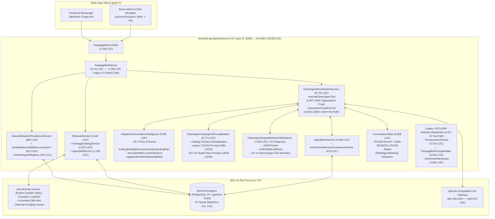

# ARCHITECTURE DISCOVERY REPORT — DOCMIND ADAPTIVE SALES INTELLIGENCE

> **Document Authority**: **AS-IS CURRENT-STATE AUDIT** *(Ghi nhận hiện trạng kiến trúc, mã chết và mâu thuẫn chính sách kinh doanh thuộc giai đoạn `P1 — Architecture Discovery`; thiết kế đích được quy định tại [`TARGET_ARCHITECTURE.md`](file:///d:/Project/digital-spirituality/docmind/docs/architecture/TARGET_ARCHITECTURE.md) và [`STATE_OWNERSHIP.md`](file:///d:/Project/digital-spirituality/docmind/docs/architecture/STATE_OWNERSHIP.md)).*  
> **Phase Gate**: `P1 — Architecture Discovery (Read-Only on Business Logic)`  
> **Approval Status**: **VERIFIED AS-IS AUDIT**  
> **Baseline Commit Before P0**: `244a2ec8a120878f8f863cb0388d72d51ae8bc2e`  
> **P0 Cleanup Commit**: `f091ba557a079da86c8ae14cd7ccc19fe8ece59d` (`chore: retire standalone Python Agent Brain service (8095)`)  
> **P2 Initial Draft Commit**: `5aa985d43b5ef6ea1621f37fa546bcae520633c2`  
> **Primary Architect**: AGY (`Gemini 4 Argon High`)  
> **Independent Reviewer**: `Qwen3.8-Max` via Claude Code CLI (`https://api.vilao.ai`)

---

## 0. Quy ước Bằng chứng (Evidence Classification)

Toàn bộ kết luận trong báo cáo này được phân loại nghiêm ngặt theo 3 mức:
1. **Đã xác minh (Verified)**: Có bằng chứng trực tiếp từ mã nguồn (kèm đường dẫn file + số dòng), lệnh kiểm tra Docker/Windows runtime, kết quả `git grep`, hoặc kết quả chạy test thực tế.
2. **Suy luận kỹ thuật (Inferred)**: Kết luận suy ra trực tiếp từ cấu trúc phụ thuộc tĩnh hoặc hành vi tương tác giữa các hàm đã xác minh.
3. **Chưa xác minh (Unverified)**: Các giả thuyết chưa đo kiểm trên tải thực tế nhiều người dùng đồng thời.

---

## 1. Current Architecture Diagram (Sơ đồ Kiến trúc Hiện tại — Đã xác minh)

---

## 2. Runtime Execution Flow (Luồng Thực thi Hiện tại — Đã xác minh)

Chi tiết từng dòng lệnh đã được lập hồ sơ tại [`CURRENT_EXECUTION_FLOW.md`](file:///d:/Project/digital-spirituality/docmind/docs/architecture/CURRENT_EXECUTION_FLOW.md). Tóm tắt 12 chặng trên Hot-Path `LLM_COGNITIVE_V2`:

1. **Webhook / Simulator Ingress**: [`FanpageBotController.java`](file:///d:/Project/digital-spirituality/docmind/api-java/src/main/java/com/example/docmind/controller/FanpageBotController.java) (`L216` `/message`, `L290` `/webhook`) gom tin nhắn dồn dập (burst debounce), tra cứu tin nhắn được khách quote (`L458`), nâng epoch phiên (`SenderEpochRegistry`), và gọi `fanpageBotService.handleCustomerMessage(request)` (`L586`).
2. **Layer-1 Entry State Guard**: [`FanpageBotService.java`](file:///d:/Project/digital-spirituality/docmind/api-java/src/main/java/com/example/docmind/service/bot/FanpageBotService.java) (`L774–L856`) gọi `inboundSessionPersistenceService.evaluateEntryAndPersistCustomer(...)` (`L799`) để kiểm tra `HUMAN_TAKEOVER`, `OPT_OUT`, Re-consent, chống trùng `external_mid` và ghi bền vững tin nhắn khách vào WAL + PostgreSQL.
3. **Hydration & Security Pre-Check**: Khôi phục bộ nhớ phiên từ PostgreSQL (`agentBrainService.refreshTurnBaseFromDb`, `L927`), đồng bộ lịch sử bong bóng (`SentBubbleLedger.reconcile`, `L951`), chặn trực tiếp Prompt Injection/Jailbreak (`PromptSecurityGuard.isDirectJailbreakAttempt`, `L984`) và lệnh dừng hệ thống (`PrimaryActionRouter.isStrictSystemOptOutMessage`, `L1019`).
4. **Hybrid RAG & Catalog Extraction**: Gọi `retrievalService.retrieveWithRules(...)` (`L1196`), chạy fallback truy vấn neo danh mục nếu kết quả rỗng (`L1221`), làm giàu bằng `PriceLadderTracker` & `OperationalAndPromoFacts` (`L1243–L1244`), và bóc tách danh sách gói dịch vụ qua `PackageCatalogService` (`L1260`).
5. **Three-Stream Input Construction**: Gọi `AdaptiveConversationIntelligence.buildThreeStreamInput(...)` (`L1272`) tách biệt: (a) `verbatimOriginalMessage`, (b) `normalizedQuery`, (c) `unverifiedParserCandidates`.
6. **Memory Recall & Catalog Tiering**: Trong [`CleanAgentOrchestratorService.java`](file:///d:/Project/digital-spirituality/docmind/api-java/src/main/java/com/example/docmind/service/bot/CleanAgentOrchestratorService.java) (`executeAciCognitiveTurn`, `L4215`), hệ thống xếp hạng gói dịch vụ (`rankAndTierCatalogForCleanAgent`, `L4437`), mở khóa toàn bộ gói hợp lệ (`Epistemic Unblinding`, `L4445`), giải quyết quote-reply (`L4497`), và nạp 5 tầng bộ nhớ + `CustomerUnderstandingDraft2Snapshot` + `StructuredBookingState` từ `AgentBrainService` (`L4509–L4568`).
7. **Pre-LLM Turn Planning & Prompt Assembly**: Giải quyết vùng miền tường minh (`resolveExplicitRegionAcrossTurns`, `L4584`), tiền giải quyết lựa chọn tương đối (`resolveContextualOptionFromUtterance`, `L4622`), dựng `TurnContextSnapshot` + `LightweightCustomerUnderstandingPlan` (`L4646`), và lắp ráp prompt đơn lượt qua `CleanAgentCatalogAndPromptBuilder.buildAciSinglePassPrompt` (`L4660`).
8. **Single-Pass LLM Call**: Gọi `llmClient.complete(aciPrompt, aciBudget)` (`L4708`), parse JSON gồm `brain_reflection` + `reply_bubbles` (`L4763`), có retry 1 lần nếu JSON gãy cấu trúc (`L4790`).
9. **Post-LLM Reflection Reconciliation & Pre-Referee Sanitizers**: Gọi `reflection.reconcileWithCurrentUtterance(...)` (`L4826` -> `ACI L2043–L2708`) và chạy **9 hàm sanitize in-place** (`L4863–L4899`) để sửa đại từ, xóa từ thảo mai, cắt CTA khi khách phàn nàn, xóa mã SKU nội bộ, và kiểm tra lời xin lỗi (`enforceGroundedApologyAgainstHistoryInPlace`).
10. **Booking Patch, Conditional Handoff & Referee V2 Loop**: Áp dụng `applyAuthoritativeBookingPatch` (`L4907`), đánh giá `evaluateAndExecuteConditionalHandoff` (`L4919`), và kiểm định sự thật/an toàn qua `checkAciV2TruthAuthorityAndSafety` (`L4979`). Nếu vi phạm sự thật (bịa giá, sai gói, tự nhận người thật...), hệ thống tạo `repairPrompt` (`L5019`) gọi LLM lần 2 (`L5025`) hoặc hạ xuống `buildSafeMultiIndustryTurnFallbackBubbles` (`L5140`).
11. **Post-Referee In-Place Rewriters**: Chạy tiếp `enforceP37B2TurnActionAndBubbleIdeaDisciplineInPlace` (`L5269`), `enforceGroundedApologyAgainstHistoryInPlace` (`L5304`) và `stripUnsolicitedPackagePitchOnNegativeReactionInPlace` (`L5308`).
12. **Atomic State Commit & Layer-2 Outbound Fence**: Ghi nhận 5 tầng bộ nhớ vào `AgentBrainService` + PostgreSQL (`L5388–L5401`), ghi `SentBubbleLedger` (`L5411–L5435`), cập nhật `ConversationState.recordAciV2TurnMinimalState` (`L5449`), dựng `decisionTrace` (`L5774`), và kiểm tra chốt chặn cuối `verifyOutboundStillPermittedFresh` (`FanpageBotService.java` `L609`).

---

## 3. Dependency Map (Bản đồ Phụ thuộc Dịch vụ & Module — Đã xác minh)

Chi tiết đầy đủ nằm tại [`RUNTIME_DEPENDENCY_REPORT.md`](file:///d:/Project/digital-spirituality/docmind/docs/architecture/RUNTIME_DEPENDENCY_REPORT.md).
- **Runtime Containers**:
  - `docmind-api` (`:8090`) phụ thuộc vào `docmind-postgres` (`:5433->5432`), `docmind-doc-service` (`:8091`), và OpenAI-compatible LLM endpoint (`https://api.vilao.ai/v1` với model `qwen3.8-max`).
  - `agent-brain` (`:8095`) đã hoàn toàn ngừng sử dụng và đã được dọn dẹp an toàn khỏi repository tại commit `f091ba5`.
- **Internal Package Dependencies (`com.example.docmind`)**:
  - Package `service.bot` (32 classes, `60,829 LOC`) chiếm **70.28%** toàn bộ mã nguồn backend và có sự phụ thuộc vòng (circular static method dependencies) dày đặc giữa 6 class: `CleanAgentOrchestratorService` <-> `AdaptiveConversationIntelligence` <-> `CleanAgentCatalogAndPromptBuilder` <-> `CleanAgentOutputRefereeAndSanitizer` <-> `ConversationState` <-> `AgentBrainService`.

---

## 4. Module Ownership Map (Bản đồ Quyền sở hữu Module Hiện tại — Đã xác minh)

| Module / Class hiện tại | Quyền sở hữu danh nghĩa | Thực tế đang làm gì (Đã xác minh) | Đánh giá Ranh giới |
|---|---|---|---|
| `FanpageBotController` + `InboundSessionPersistenceService` | Inbound Gateway, Webhook, WAL, Session Lock | Đúng chức năng: quản lý webhook, dedup `external_mid`, `HUMAN_TAKEOVER`, `OPT_OUT`, WAL. | **Rõ ràng (Giữ & Tinh gọn)** |
| `RetrievalService` + `PackageCatalogService` | Hybrid RAG & Bóc tách bảng giá Markdown | Truy xuất chunk + rule + bóc tách `CatalogServiceItem` từ bảng Markdown. Tuy nhiên logic lọc chi nhánh và phân tầng gói lại nằm rải rác ở `ConversationState` và `CleanAgentCatalogAndPromptBuilder`. | **Bị rò rỉ sang Orchestrator & PromptBuilder** |
| `AgentBrainService` + `AciSessionMemoryPersistenceService` | Bộ nhớ khách hàng dài hạn & theo phiên | Lưu trữ cả cấu trúc cũ (`recallAndAdvise`), cấu trúc 5-Tier ACI V2, và cấu trúc 3-Layer `Draft2Snapshot` + `StructuredBookingState`. | **Chồng lấn 3 thế hệ schema bộ nhớ** |
| `AdaptiveConversationIntelligence` | Моhình nhận thức ACI V2/V3 | Chứa 35+ DTO/Record, bộ lập kế hoạch trước LLM (`buildLightweightCustomerUnderstandingPlan`), bộ ghi đè sau LLM (`reconcileWithCurrentUtterance`), và bộ vá trạng thái đặt lịch (`applyAuthoritativeBookingPatch`). | **Vi phạm SRP nghiêm trọng** |
| `CleanAgentCatalogAndPromptBuilder` | Dựng Prompt & Xếp hạng Catalog | Trộn lẫn xếp hạng catalog, giải quyết quote-reply, prompt `CLEAN` cũ (~2,000 LOC) và prompt `ACI V2` mới (~2,800 LOC) kèm chính sách giá cứng. | **Vi phạm SRP nghiêm trọng** |
| `CleanAgentOutputRefereeAndSanitizer` | Kiểm định sự thật & an toàn đầu ra | Vừa parse JSON, vừa kiểm tra sự thật/an toàn, vừa chứa **15+ hàm regex cắt ghép/viết lại câu trả lời của LLM**. | **Vi phạm nguyên tắc Guardrail không viết hộ hội thoại** |
| `CleanAgentOrchestratorService` | Điều phối luồng hội thoại | Chứa 2 bộ điều phối song song (`executeCleanAgentTurn` 1,675 LOC đã chết trên prod + `executeAciCognitiveTurn` 1,610 LOC quá tải). | **God Orchestrator** |

---

## 5. State Ownership Map (Bản đồ Sở hữu Trạng thái — Đã xác minh)

Chi tiết từng trường dữ liệu nằm tại [`STATE_OWNERSHIP_MAP.md`](file:///d:/Project/digital-spirituality/docmind/docs/architecture/STATE_OWNERSHIP_MAP.md).
- **3 vấn đề cốt lõi đã xác minh**:
  1. **Trùng lặp trạng thái đặt lịch (`StructuredBookingState`)**: Được lưu ở cả `ConversationState.SESSION_CACHE`, `AgentBrainService.CustomerBrainMemory.bookingState`, và `Draft2Snapshot.BusinessCommitmentLayer`. Tại `CleanAgentOrchestratorService.java` (`L4507–L4524`), code phải đọc cả hai nơi rồi đoán xem bản nào mới hơn.
  2. **Trùng lặp trạng thái triệu chứng & phạm vi từ chối**: Được lưu ở `ConversationState` (`confirmedScopes`, `explicitForbiddenScopes`), `AgentBrainService` (`aciCustomerStatements`, `aciWorkingHypothesis`, `explicitForbiddenScopes`), và `Draft2Snapshot` (`confirmedCustomerNeeds`, `painPoints`).
  3. **Bốn điểm tranh quyền quyết định chiến thuật trong 1 lượt**: Pre-LLM `buildLightweightCustomerUnderstandingPlan` -> LLM `AdaptiveCognitiveReflection` -> Post-LLM `reconcileWithCurrentUtterance` -> Post-LLM `CleanAgentOutputRefereeAndSanitizer.*InPlace`.

---

## 6. God Classes Audit (Kiểm toán các Class Khổng lồ — Đã xác minh)

Chi tiết đầy đủ nằm tại [`GOD_CLASSES_AUDIT.md`](file:///d:/Project/digital-spirituality/docmind/docs/architecture/GOD_CLASSES_AUDIT.md).
8 class đứng đầu (`CleanAgentOutputRefereeAndSanitizer` 7,820 LOC; `CleanAgentOrchestratorService` 6,718 LOC; `ConversationState` 5,928 LOC; `CleanAgentCatalogAndPromptBuilder` 5,773 LOC; `AdaptiveConversationIntelligence` 5,558 LOC; `FanpageBotService` 5,152 LOC; `PrimaryActionRouter` 4,703 LOC; `AgentBrainService` 3,858 LOC) cộng lại dài **45,509 LOC** và chứa **292 regex**.

---

## 7. Dead Code / Unused Components (Mã Chết & Thành phần Không Còn Chạy Trên Production — Đã xác minh)

| Thành phần / Khối mã | Vị trí (File & Dòng) | Quy mô (LOC) | Bằng chứng xác minh (`git grep` / Call Graph) | Phân loại xử lý |
|---|---|---:|---|---|
| Standalone Python `agent-brain` `:8095` | `agent-brain/*` (21 files deleted) | 2,708 (2,714 total deletions across 23 files in commit `f091ba5`) | Không có container `:8095`, `AgentBrainClient` đã xóa. | **Đã gỡ bỏ tại `P0` (`f091ba5`: 21 files deleted, 2 files modified)** |
| Legacy `CLEAN` Orchestrator (`executeCleanAgentTurn` + helpers) | `CleanAgentOrchestratorService.java` (`L367–L4214`) | ~3,840 | `git grep -n "executeCleanAgentTurn" -- "api-java/src/main"` chỉ trả về chính định nghĩa hàm đó; `FanpageBotService` (`L1278`) gọi thẳng `executeAciCognitiveTurn`. | **Legacy Test-Only Code** (cần cô lập/loại bỏ theo lộ trình `P3–P7`) |
| Legacy V1 Deterministic Bot Methods | `FanpageBotService.java` (`L1743–L4290`) | ~2,550 | Không nằm trên đường đi của `handleCustomerMessageInternal` -> `executeAciCognitiveTurn`. | **Dead V1 Code** |
| Legacy `CLEAN` Prompt Builder (`buildCleanAgentPrompt` + XML contract) | `CleanAgentCatalogAndPromptBuilder.java` (`L981–L2975`) | ~1,995 | Chỉ được gọi bởi `executeCleanAgentTurn` và các test cũ; hot-path gọi `buildAciSinglePassPrompt` (`L4660`). | **Legacy Test-Only Code** |
| `PrimaryActionRouter` V1 Routing Engine | `PrimaryActionRouter.java` (`L1–L4702`) | ~4,550 / 4,703 | Hot-path `executeAciCognitiveTurn` chỉ dùng enum `PrimaryAction`, record `RoutingDecision`, và hàm `isStrictSystemOptOutMessage`. | **96% Bypassed on Hot-Path** |
| `FanpageBotPromptBuilder` V1 | `FanpageBotPromptBuilder.java` (`L1–L2448`) | ~2,420 / 2,448 | Hot-path `executeAciCognitiveTurn` chỉ dùng enum `SalesStage`. | **98% Bypassed on Hot-Path** |
| `SentimentIntentLayer` V1 | `SentimentIntentLayer.java` (`L1–L1496`) | 1,496 | Không được gọi một lần nào trong `executeAciCognitiveTurn` (`L4215–L6240`). | **Bypassed on Hot-Path** |

> **Tổng lượng mã nguồn V1/CLEAN không còn phục vụ Hot-Path `LLM_COGNITIVE_V2`**: Xấp xỉ **`16,850 LOC`** (gần 20% toàn bộ backend!).

---

## 8. Duplicate Logic (Logic Trùng lặp — Đã xác minh)

1. **Phân loại ý định hỏi giá & phản đối giá (4 nơi)**:
   - `AdaptiveConversationIntelligence.classifyPriceIntentSubMode` (`L4895`) & `hasGenuinePriceObjectionCue` (`L4945`)
   - `CleanAgentOutputRefereeAndSanitizer.hasExplicitPriceDemandInMessage` (`L4650`)
   - `PrimaryActionRouter.isPriceInquiryMessage` (`L1150`) & `isPriceObjectionMessage` (`L1210`)
   - `SentimentIntentLayer.isPriceObjectionOrHesitation` (`L1170`).
2. **Phát hiện câu phàn nàn thái độ / cách nói chuyện của bot (3 nơi)**:
   - `CleanAgentOutputRefereeAndSanitizer.isCommunicationStyleComplaintMessage` (`L5190`)
   - `CleanAgentOutputRefereeAndSanitizer.classifyNegativeReactionSubtype` (`L6830`)
   - `SentimentIntentLayer.isConversationStyleComplaint` (`L1080`) & `isWordingOrExpressionFeedback` (`L1110`).
3. **Bóc tách vùng miền / chi nhánh (`HN` vs `HCM` vs `Đà Nẵng`) (3 nơi)**:
   - `ConversationState.resolveExplicitRegionAcrossTurns` (`L1540`)
   - `PackageCatalogService.inferBranchCodeFromText` (`L820`)
   - `AdaptiveConversationIntelligence.extractLocationCueFromUtterance` (`L2890`).
4. **Sửa lỗi đại từ xưng hô & xóa từ thảo mai (chạy lặp 2–3 lần trong cùng 1 lượt)**:
   - Trong `executeAciCognitiveTurn`: `repairWrongPronounOpenersInPlace`, `sanitizePatronizingEmpathyPhrasesInPlace`, `stripInternalCatalogSkuCodesInPlace`, `enforceGroundedApologyAgainstHistoryInPlace` được gọi ở cả trước Referee (`L4863–L4899`), trong nhánh Repair (`L5048–L5084`), và sau Referee (`L5230–L5308`).

---

## 9. Known Runtime Defects & Structural Weaknesses (Khuyết tật Kiến trúc Đã xác minh)

1. **Hội thoại bị cắt ghép cơ học bởi Post-LLM Regex Rewriters (`CleanAgentOutputRefereeAndSanitizer`)**:
   - Khi khách phản ứng tiêu cực hoặc chỉnh sửa thông tin, các hàm như `enforceGroundedApologyAgainstHistoryInPlace` (`L6960`), `stripUnsolicitedPackagePitchOnNegativeReactionInPlace` (`L7140`), và `enforceP37B2TurnActionAndBubbleIdeaDisciplineInPlace` (`L6525`) tự động cắt bỏ các câu chứa số tiền/tên gói hoặc tự nối câu hỏi mẫu vào đuôi bong bóng của LLM. Điều này khiến câu trả lời đôi khi bị cụt ý hoặc lặp cấu trúc câu.
2. **Single-Pass JSON gánh quá nhiều trách nhiệm trong một lần gọi LLM**:
   - Prompt đơn lượt (`buildAciSinglePassPrompt`) yêu cầu model vừa cập nhật trạng thái nhận thức phức tạp (`brain_reflection` gồm 5 khối JSON lồng nhau), vừa lập chiến thuật, vừa chọn skill, vừa đề xuất vá lịch hẹn (`proposed_booking_patch`), vừa viết `reply_bubbles` tự nhiên. Khi tình huống hội thoại phức tạp (vừa đính chính triệu chứng, vừa hỏi chi nhánh, vừa hỏi giá), model dễ bị phân tán sự chú ý giữa việc điền đúng schema JSON và việc viết câu trả lời có hồn.
3. **Chưa có mô hình `Branch Intelligence` chuẩn hóa**:
   - Hiện tại chi nhánh chỉ được xử lý như một chuỗi bộ lọc (`effectivePromptRegion` `"HN"` / `"HCM"` trong `ConversationState.resolveExplicitRegionAcrossTurns` L4584). Chưa có thực thể kiến trúc quản lý rõ: số lượng chi nhánh của Page (1 hay nhiều chi nhánh), thông tin từng chi nhánh (địa chỉ, giờ mở cửa, dịch vụ khác biệt, tình trạng chỗ trống tĩnh/bán tĩnh), và chính sách tiết lộ chi nhánh (`BranchDisclosurePolicy`) theo đúng Mục V của Master Directive.

---

## 10. Business Policy Conflicts (Phát hiện Mâu thuẫn Chính sách Kinh doanh — Đã xác minh)

> [!WARNING]
> **Mâu thuẫn trực tiếp đã xác minh giữa code hiện tại (`244a2ec` / `f091ba5`) và Mục VI.1 của Master Directive**

### 10.1. Nội dung quy định trong Master Directive (Mục VI.1 vs Mục VI.2 vs Mục VI.3)
- **Mục VI.1 — Khách mới gửi tin nhắn cộc lốc chỉ hỏi giá, chưa xác định nhóm dịch vụ (`"Giá"`, `"Cho hỏi giá"`)**:
  - *"Hành vi bắt buộc: 1. Chào khách theo thương hiệu. 2. Ghi nhận câu hỏi về giá. 3. Đặt 1 câu hỏi ngắn để xác định nhóm dịch vụ khách quan tâm (ví dụ: massage thư giãn hay dưỡng sinh). 4. **Chưa giới thiệu các gói hoặc bảng giá trong phản hồi đầu tiên.**"*
  - *"Lưu ý: Đây là chính sách kinh doanh đặc thù của chủ dự án, **không được tự động thay bằng việc báo giá neo 239k/399k**."*
- **Mục VI.2A — Khách hỏi giá đã xác định nhóm dịch vụ (`"Massage bao nhiêu?"`, `"Gội đầu dưỡng sinh giá sao?"`)**:
  - Khách đã nêu nhóm dịch vụ -> Trả ngay mức giá / gói phù hợp trong catalog hoặc hỏi đúng 1 chi tiết tối thiểu nếu cần (không hỏi lại từ đầu như khách chưa nêu nhóm dịch vụ).
- **Mục VI.2B & VI.3 — Dịch vụ cụ thể đã rõ (`"Gói cổ vai gáy 60p bao nhiêu?"`) hoặc khách xin bảng giá trực tiếp (`"Cho xin bảng giá"`, `"Gửi bảng giá giúp mình"`)**:
  - *"Hành vi bắt buộc: Báo giá trực tiếp gói dịch vụ cụ thể hoặc cung cấp khung giá / các gói tiêu biểu từ catalog đã xác minh... Sau đó đặt tối đa 1 câu hỏi ngắn để thu hẹp nhu cầu."*

### 10.2. Bằng chứng trong code hiện tại (`CleanAgentCatalogAndPromptBuilder.java` & `config/aci_v2_system_prompt.md`)
Trong đợt nâng cấp ngay trước đó (commit `244a2ec`), để đáp ứng kịch bản `SC01` của tài liệu cũ, code tại:
- [`CleanAgentCatalogAndPromptBuilder.java`](file:///d:/Project/digital-spirituality/docmind/api-java/src/main/java/com/example/docmind/service/bot/CleanAgentCatalogAndPromptBuilder.java) (`L4595–L4630`, nhánh `GENERAL_BARE_PRICE_INQUIRY`)
- [`config/aci_v2_system_prompt.md`](file:///d:/Project/digital-spirituality/docmind/config/aci_v2_system_prompt.md) (Mục `GENERAL_BARE_PRICE_INQUIRY`)
- [`AdaptiveConversationIntelligence.java`](file:///d:/Project/digital-spirituality/docmind/api-java/src/main/java/com/example/docmind/service/bot/AdaptiveConversationIntelligence.java) (`L5150–L5170`, `PriceIntentSubMode.GENERAL_BARE_PRICE_INQUIRY`)

đang chỉ thị cho LLM rằng khi gặp `GENERAL_BARE_PRICE_INQUIRY` (`"Giá bên mình thế nào em?"`, `"Giá sao shop?"`), bot **phải báo ngay 1–2 mốc gói tiêu biểu (ví dụ 239.000đ và 399.000đ)** ngay trong phản hồi đầu tiên!

### 10.3. Đề xuất Phương án Giải quyết 3 Trường hợp Câu hỏi Giá (Trình Chủ dự án phê duyệt tại Architecture Lock — `ADR-08`)
Tuân thủ tuyệt đối nguyên tắc của chủ dự án (*"Nếu phát hiện mâu thuẫn giữa code hiện tại và Master Directive, hãy chỉ ra bằng chứng và đề xuất phương án. Không được tự ý chọn một phương án làm thay đổi chính sách kinh doanh"*), chúng tôi đề xuất phân biệt rõ 3 trường hợp trong `PricePolicyMode` của `TurnStrategyContract`:
1. **Trường hợp 1 — `FIRST_TURN_BARE_PRICE_CLARIFY_FIRST` (Khách chưa xác định nhóm dịch vụ: `"Giá"`, `"Cho hỏi giá"`, `"Giá sao?"`)**:
   - Kích hoạt khi: Lượt đầu tiên (`turnIndex == 1`, `serviceCategory == UNKNOWN`) và khách hỏi giá cộc lốc chưa nêu nhóm dịch vụ.
   - Hành vi khóa cứng: Chào thương hiệu + ghi nhận câu hỏi giá + hỏi 1 câu ngắn xác định nhu cầu/nhóm dịch vụ + **KHÔNG báo gói hay bảng giá ở lượt 1**. Ngay khi khách trả lời ở lượt 2, lập tức báo giá gói phù hợp.
2. **Trường hợp 2 — `CATEGORY_PRICE_QUOTE_OR_MINIMAL_CLARIFY` (Khách đã xác định nhóm dịch vụ: `"Massage bao nhiêu?"`, `"Gội đầu dưỡng sinh giá sao?"`)**:
   - Kích hoạt khi: Khách đã nêu nhóm dịch vụ (`serviceCategory == FACT`, `specificService == UNKNOWN`).
   - Hành vi khóa cứng: Trả ngay mức giá / gói phù hợp của nhóm dịch vụ đó trong catalog hoặc hỏi đúng 1 chi tiết tối thiểu nếu cần (ví dụ thời lượng / thư giãn hay trị liệu).
3. **Trường hợp 3 — `DIRECT_SPECIFIC_PRICE_QUOTE` / `PROVIDE_VERIFIED_PRICE_RANGE_OR_REPRESENTATIVE_PACKAGES` (Dịch vụ cụ thể đã rõ hoặc xin bảng giá trực tiếp: `"Gói cổ vai gáy 60p bao nhiêu?"`, `"Cho xin bảng giá"`)**:
   - Kích hoạt khi: Khách đã nêu rõ dịch vụ cụ thể/triệu chứng (`specificService/symptom == FACT`) HOẶC chủ động xin bảng giá (`"Cho xin bảng giá"`).
   - Hành vi khóa cứng: Báo giá trực tiếp từ catalog xác thực + tối đa 1 câu hỏi ngắn định hướng.

---

## 11. Risk Register (Sổ đăng ký Rủi ro — Tóm tắt)

Chi tiết đầy đủ nằm tại [`RISK_REGISTER.md`](file:///d:/Project/digital-spirituality/docmind/docs/architecture/RISK_REGISTER.md).
- **R-01 (High)**: Xung đột giữa bộ test cũ (`C3A..C3D` gọi `executeCleanAgentTurn`) và kiến trúc mới khi loại bỏ nhánh `CLEAN` cũ.
- **R-02 (High)**: Mất đồng bộ trạng thái đặt lịch khi gộp `ConversationState.structuredBookingState` và `AgentBrainService.bookingState` vào `ConversationMemoryStore`.
- **R-03 (Medium)**: Tăng độ trễ (latency) nếu lạm dụng chế độ gọi LLM 2 pha (`Two-Phase Strategic Execution`) cho cả các lượt hội thoại đơn giản.
- **R-04 (High)**: Hồi quy hành vi báo giá lượt 1 nếu ranh giới giữa Mục VI.1 (`"Cho hỏi giá"`) và Mục VI.3 (`"Cho xin bảng giá"`) không được định nghĩa tường minh trong `TurnStrategyContract`.

---

## 12. Migration Risks (Rủi ro Chuyển đổi Kiến trúc)

1. **Tương thích ngược với Schema JSONB trong PostgreSQL (`conversation_sessions.aci_memory_state_json`)**:
   - Khi tái cấu trúc `AgentBrainService` và `AciCustomerBrainMemorySnapshot`, các phiên hội thoại đang mở trong DB có thể chứa JSONB theo cấu trúc cũ. Cần giữ deserializer tương thích ngược (`@JsonIgnoreProperties(ignoreUnknown = true)` + migration mapper an toàn).
2. **Tương thích với hợp đồng API Frontend (`FanpageBotResponse` & `decisionTrace`)**:
   - Giao diện Simulator và Admin Inbox trên `docmind-frontend` đọc trực tiếp `replyBubbles`, `salesStage`, `customerInsight`, `activatedSkills`, và `decisionTrace`. Mọi thay đổi bên trong Orchestrator phải giữ nguyên hợp đồng JSON trả về cho HTTP controller.

---

## 13. Rollback Strategy (Chiến lược Quay lui An toàn)

1. **Mức Git Commit / Phase Gate**:
   - Baseline trước khi thực hiện Master Directive: `244a2ec8a120878f8f863cb0388d72d51ae8bc2e`.
   - Baseline sau `P0 — Runtime Cleanup`: `f091ba557a079da86c8ae14cd7ccc19fe8ece59d`.
   - Mỗi Phase (`P0`, `P1/P2`, `P3`, `P4`, `P5`, `P6`, `P7`, `P8`) được commit độc lập; nếu bất kỳ phase nào gây hồi quy, có thể `git revert` hoặc `git reset` về đúng commit của phase liền trước trong vòng < 30 giây.
2. **Mức Runtime / Feature Flag**:
   - Trong quá trình chuyển đổi `P3–P6`, giữ cờ cấu hình cho phép chuyển đổi giữa chế độ LLM Execution (`FAST_SINGLE_PASS` vs `TWO_PHASE_STRATEGIC`) mà không cần sửa code hay restart DB.
3. **Mức Database**:
   - Không xóa cột hay bảng hiện hữu trong `conversation_sessions` / `conversation_messages` / `sent_bubble_ledger_entries`. Mọi bổ sung metadata (như `BranchIntelligence` config) đều bersifat additive (không phá vỡ dữ liệu cũ).
