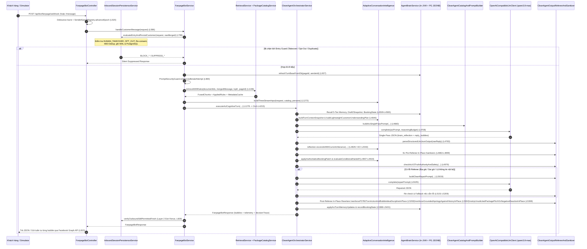

# CURRENT EXECUTION FLOW — HOT-PATH & COLD-PATH TRACE (AS-IS)

> **Document Authority**: **AS-IS CURRENT-STATE AUDIT** *(Dấu vết thực thi từng dòng code của hệ thống hiện tại; luồng thực thi đích giữa Gateway và `SalesTurnOrchestrator` được quy định tại [`MODULE_OWNERSHIP.md`](file:///d:/Project/digital-spirituality/docmind/docs/architecture/MODULE_OWNERSHIP.md)).*  
> **Phase Gate**: `P1 — Architecture Discovery`  
> **Approval Status**: **VERIFIED AS-IS AUDIT**  
> **Baseline Commit Before P0**: `244a2ec8a120878f8f863cb0388d72d51ae8bc2e`  
> **P0 Cleanup Commit**: `f091ba557a079da86c8ae14cd7ccc19fe8ece59d`  
> **P2 Initial Draft Commit**: `5aa985d43b5ef6ea1621f37fa546bcae520633c2`  
> **Trạng thái xác minh**: Đã xác minh 100% bằng số dòng thực tế trong mã nguồn (`api-java` & `doc-service-py`).

---

## 1. Sơ đồ Luồng Thực thi Tổng thể (End-to-End Runtime Flow)

---

## 2. Dấu vết thực thi từng bước trên Hot-Path (Line-by-Line Code Trace)

### Bước 1: Điểm vào HTTP Controller ([`FanpageBotController.java`](file:///d:/Project/digital-spirituality/docmind/api-java/src/main/java/com/example/docmind/controller/FanpageBotController.java))
- **REST Simulator / API trực tiếp**: `POST /api/bot/fanpage/message` (`handleMessage`, `L216–L251`) -> gọi `fanpageBotService.handleCustomerMessage(request)` (`L226`), sau đó lưu tin nhắn assistant qua `conversationInboxService.recordBotTurnExchange` (`L230`).
- **Meta Messenger Webhook**: `POST /api/bot/fanpage/webhook` (`receiveMetaWebhook`, `L290–L456`) -> gom burst messages theo `burstDebounceMs`, giải quyết tin nhắn trích dẫn (`resolveQuotedMessageTextForWebhook`, `L458`), tăng epoch chống race condition (`SenderEpochRegistry`), gọi `processCoordinatedSenderEvent` (`L520`) -> `fanpageBotService.handleCustomerMessage` -> gửi từng bong bóng qua `sendSequentialBubblesToFacebook` (`L815–L945`).

### Bước 2: Cổng Kiểm soát Phiên & Truy xuất Tri thức ([`FanpageBotService.java`](file:///d:/Project/digital-spirituality/docmind/api-java/src/main/java/com/example/docmind/service/bot/FanpageBotService.java))
- **Khởi tạo Turn Context (`L586–L597`)**: Sinh `turnId`, gắn ThreadLocal `CURRENT_TURN_ID` và `CURRENT_TURN_LIFECYCLE`.
- **Chuẩn hóa chuỗi đầu vào (`L739–L755`)**:
  - `mergeBurstMessages(request)` (`L739`)
  - `verbatimOriginalMessage = VietnameseQueryNormalizer.sanitizeVerbatimOriginalMessage(rawMerged)` (`L742`)
  - `mergedMessage = VietnameseQueryNormalizer.normalize(verbatimOriginalMessage)` (`L743`).
- **Layer-1 Entry State Guard (`L774–L856`)**:
  - Gọi `inboundSessionPersistenceService.evaluateEntryAndPersistCustomer(effectivePersistenceReq, verbatimToStore)` (`L799`).
  - Xử lý 6 kịch bản: `BLOCK_HUMAN_TAKEOVER`, `BLOCK_HUMAN_TAKEOVER_AND_OPT_OUT_RECORDED`, `BLOCK_OPTED_OUT`, `RECONSENTED_PROCEED_TO_BOT`, `SUPPRESS_DUPLICATE_INBOUND`, `BLOCK_FAIL_CLOSED_WEBHOOK`.
- **Khôi phục lịch sử hội thoại & Bộ nhớ (`L911–L963`)**:
  - Nếu `resetSession=true`: Xóa `SentBubbleLedger` và `agentBrainService.clearCustomerMemory(pageId, senderId)` (`L919`).
  - Nếu `resetSession=false`: Gọi `agentBrainService.refreshTurnBaseFromDb(pageId, senderId)` (`L927`), nạp lịch sử từ DB nếu client không truyền `history` (`L933`), và đối chiếu qua `SentBubbleLedger.reconcile(...)` (`L951`).
- **Kiểm tra Bảo mật Prompt Injection & Strict Opt-Out (`L983–L1127`)**:
  - `PromptSecurityGuard.isDirectJailbreakAttempt(promptBoundSecurityTarget)` (`L984`).
  - `PrimaryActionRouter.isStrictSystemOptOutMessage(verbatimOriginalMessage)` (`L1019`).
- **Truy xuất Hybrid RAG & Catalog (`L1178–L1260`)**:
  - Khởi tạo state tối thiểu: `ConversationState.hydrateMinimalForAciV2(...)` (`L1180`).
  - Gọi `retrievalService.retrieveWithRules(documentIds, mergedMessage, topK, List.of(), pageId)` (`L1196`).
  - Nếu `fused.isEmpty()` (ví dụ câu khách ngắn như `"Ok em"`, `"Đắt thế"`), tự động chạy truy vấn neo danh mục (`anchorRetrieval`, `L1223`).
  - Làm giàu kết quả bằng `enrichFusedChunksWithPriceLadderTargets` (`L1243`) và `enrichFusedChunksWithOperationalAndPromoFacts` (`L1244`).
  - Parse danh mục gói dịch vụ từ các chunk Markdown qua `preRetrievalState.withCatalogOnlyForAciV2(fused, safeDomainKeywords)` (`L1260` -> gọi `PackageCatalogService.extractCatalogFromChunks`).

### Bước 3: Điều phối Nhận thức ACI V2/V3 ([`CleanAgentOrchestratorService.java`](file:///d:/Project/digital-spirituality/docmind/api-java/src/main/java/com/example/docmind/service/bot/CleanAgentOrchestratorService.java))
- **Điểm vào**: `executeAciCognitiveTurn` (`L4215`).
- **Giải quyết đại từ xưng hô (`L4246–L4263`)**: Nếu chưa biết giới tính khách (`priorInferredCustomerPronoun == null`), chuyển đại từ gọi khách về trung tính `"mình"` (trừ khi Page cấu hình `"bạn"`).
- **Xếp hạng & Mở khóa toàn bộ Catalog (`L4436–L4485`)**:
  - Gọi `CleanAgentCatalogAndPromptBuilder.rankAndTierCatalogForCleanAgent(...)` (`L4437`).
  - Áp dụng `Epistemic Unblinding` (`L4445`): Giữ đầy đủ các gói dịch vụ hợp lệ của Page với nhãn `PRIMARY` hoặc `ECONOMICAL_OPTION`.
- **Khôi phục 5 Tầng Bộ nhớ từ `AgentBrainService` (`L4505–L4568`)**:
  - `priorBookingState` (`L4509` từ Brain + `L4515` fallback từ `ConversationState`).
  - `tier1Statements` (`L4526`), `tier2Hypothesis` (`L4528`), `tier4Facts` (`L4531`), `tier5OpState` (`L4533`), `previousStrategy` (`L4536`), `sessionCommitments` (`L4539`), `draft2Before` (`L4541`).
- **Tiền giải quyết lựa chọn tương đối & lọc vùng miền (`L4584–L4641`)**:
  - `ConversationState.resolveExplicitRegionAcrossTurns` (`L4584`): Chỉ lọc theo chi nhánh nếu khách đã nêu rõ vùng miền; nếu chưa nêu thì giữ nguyên mọi biến thể chi nhánh.
  - `AdaptiveConversationIntelligence.resolveContextualOptionFromUtterance` (`L4622`): Khóa `selected_product_id` nếu khách nói `"gói đầu tiên"`, `"gói rẻ hơn"`, `"gói không làm tóc"`.
- **Dựng Snapshot & Turn Planner (`L4644–L4684`)**:
  - `AdaptiveConversationIntelligence.buildTurnContextSnapshot` (`L4646`) -> bên trong gọi `buildLightweightCustomerUnderstandingPlan` (`ACI L5050`).
  - `CleanAgentCatalogAndPromptBuilder.buildAciSinglePassPrompt` (`L4660`).
- **Gọi LLM Single-Pass (`L4690–L4805`)**:
  - Gọi `llmClient.complete(aciPrompt, aciBudget)` (`L4708`).
  - Parse JSON qua `CleanAgentOutputRefereeAndSanitizer.parseStructuredLlmJsonOutput(rawReply, 0)` (`L4763`). Nếu JSON lỗi, retry 1 lần (`L4790`).
- **Đối chiếu Hậu-LLM & Chuỗi Sanitizer Lần 1 (`L4826–L4903`)**:
  - `reflection.reconcileWithCurrentUtterance(...)` (`L4826` -> `ACI L2043–L2708`).
  - Chạy liên tiếp 8 hàm sanitize in-place trên `candidateBubbles` (`L4863–L4899`): sửa đại từ đầu câu, xóa cụm từ thảo mai (`"thấy thương/xót quá"`), cắt CTA nếu là câu phàn nàn, cắt câu hỏi nếu khách tạm dừng, xóa mã SKU nội bộ, chuẩn hóa định dạng giá, xóa cam kết tip không có căn cứ, gộp bong bóng dấu hai chấm, và `enforceGroundedApologyAgainstHistoryInPlace`.
- **Cập nhật Booking Patch & Kiểm định Referee V2 (`L4906–L5215`)**:
  - `AdaptiveConversationIntelligence.applyAuthoritativeBookingPatch` (`L4907`).
  - `AdaptiveConversationIntelligence.evaluateAndExecuteConditionalHandoff` (`L4919`).
  - `CleanAgentOutputRefereeAndSanitizer.checkAciV2TruthAuthorityAndSafety` (`L4979`).
  - Nếu Referee phát hiện vi phạm: Dựng `repairPrompt` (`L5019`), gọi LLM lần 2 (`L5025`), kiểm tra lại (`L5101`), và nếu vẫn lỗi thì hạ xuống `buildSafeMultiIndustryTurnFallbackBubbles` (`L5140`/`L5175`).
- **Chuỗi Sanitizer Lần 2 (Hậu-Referee) (`L5226–L5312`)**:
  - `enforceP37B2TurnActionAndBubbleIdeaDisciplineInPlace` (`L5269`).
  - `enforceGroundedApologyAgainstHistoryInPlace` (`L5304`).
  - `stripUnsolicitedPackagePitchOnNegativeReactionInPlace` (`L5308`).
- **Commit Bộ nhớ, Ledger & Trả kết quả (`L5386–L5824`)**:
  - `agentBrainService.applyAciTurnMemoryUpdates(...)` (`L5388`) -> ghi xuống PostgreSQL qua `AciSessionMemoryPersistenceService`.
  - `agentBrainService.recordBookingState(...)` (`L5401`).
  - `SentBubbleLedger.recordCustomerTurn` & `recordAssistantTurn` (`L5411`, `L5431`).
  - `ConversationState.recordAciV2TurnMinimalState` (`L5449`).
  - Dựng `decisionTrace` JSON (`buildAciV3DecisionTraceJson`, `L5774`) và trả về `FanpageBotResponse` (`L5793`).

### Bước 4: Layer-2 Outbound Exit Fence ([`FanpageBotService.java`](file:///d:/Project/digital-spirituality/docmind/api-java/src/main/java/com/example/docmind/service/bot/FanpageBotService.java) `L601–L625`)
- Kiểm tra lại `inboundSessionPersistenceService.verifyOutboundStillPermittedFresh(effPageId, effSenderId)` (`L609`) ngay trước khi trả HTTP response để chặn trường hợp nhân viên sale vừa bấm `HUMAN_TAKEOVER` trong lúc LLM đang suy luận.

---

## 3. Các Nhánh Code Không Còn Chạy Trên Luồng Chính (Dead / Bypassed Paths — Đã xác minh)

1. **`CleanAgentOrchestratorService.executeCleanAgentTurn` (`L367–L2041`) + Helpers (`L2042–L4214`)**:
   - Khoảng **3,840 LOC** thuộc kiến trúc `CLEAN` thế hệ trước. Không có bất kỳ hàm nào trong `src/main/java` gọi `executeCleanAgentTurn`; chỉ còn 6 file test cũ gọi trực tiếp.
2. **`FanpageBotService` Legacy V1 Methods (`L1743–L4290`)**:
   - Khoảng **2,550 LOC** xử lý kịch bản tĩnh V1 không bao giờ được gọi khi `handleCustomerMessageInternal` chuyển thẳng vào `executeAciCognitiveTurn` tại `L1278`.
3. **`PrimaryActionRouter` (`4,703 LOC`) & `FanpageBotPromptBuilder` (`2,448 LOC`) & `SentimentIntentLayer` (`1,496 LOC`)**:
   - Trên luồng `executeAciCognitiveTurn`, `PrimaryActionRouter` chỉ còn được dùng cho đúng 1 hàm kiểm tra opt-out (`isStrictSystemOptOutMessage`) và 2 kiểu dữ liệu (`PrimaryAction`, `RoutingDecision`); `FanpageBotPromptBuilder` chỉ còn được mượn đúng enum `SalesStage`.
