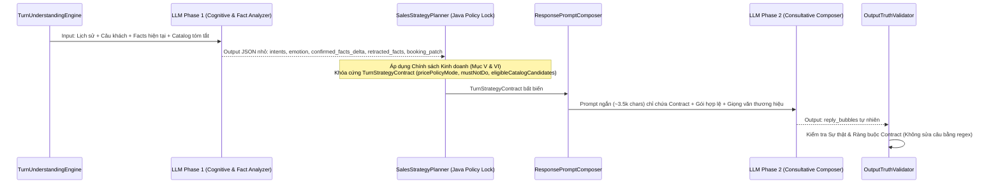

# LLM EXECUTION OPTIONS — SINGLE-PASS VS TWO-PHASE VS HYBRID ADAPTIVE

> **Phase Gate**: `P2 — Architecture Design (Mục VII.3 Master Directive)`  
> **Baseline Commit**: `f091ba557a079da86c8ae14cd7ccc19fe8ece59d`  
> **Active Runtime Model**: `qwen3.8-max` (`https://api.vilao.ai/v1`)

---

## 1. Bối cảnh Bài toán

Trong kiến trúc hiện tại (`executeAciCognitiveTurn`), mọi lượt hội thoại đều đi qua **một lần gọi LLM duy nhất (`Single-Pass JSON`)** sử dụng `ACI_COGNITIVE_SYSTEM_PROMPT_TEMPLATE` (~18,000–24,000 ký tự). Trong cùng một JSON trả về, LLM phải đồng thời:
1. Giải quyết đại từ và trạng thái cảm xúc (`customer_understanding`).
2. Cập nhật 5 tầng bộ nhớ và đề xuất thêm/xóa fact (`confirmed_facts_delta`).
3. Chọn chiến thuật và kỹ năng (`strategy` + `selected_skills`).
4. Đề xuất bản vá trạng thái đặt lịch (`proposed_booking_patch`).
5. Đánh giá chuyển giao nhân viên (`conditional_handoff`).
6. Viết câu trả lời tiếng Việt tự nhiên, giàu cảm xúc (`reply_bubbles`).

**Hệ quả đã xác minh**:
- Vì prompt ôm đồm cả luật kiểm toán bộ nhớ lẫn luật viết văn, LLM thường rơi vào trạng thái "văn mẫu lắp ghép" hoặc quên mất một ràng buộc phụ (ví dụ: vừa xin lỗi khách nhưng câu sau lại tiếp tục chào gói dịch vụ).
- Để chữa cháy, hệ thống hiện tại phải đặt `reconcileWithCurrentUtterance` (665 dòng regex) và hơn 15 hàm `*InPlace` trong `CleanAgentOutputRefereeAndSanitizer` để cắt sửa văn bản sau khi LLM trả lời.

---

## 2. So sánh 3 Phương án Thực thi LLM

| Tiêu chí đánh giá | Phương án 1: Pure Single-Pass JSON (Hiện tại) | Phương án 2: Pure Two-Phase LLM (Mọi lượt đều gọi 2 lần) | Phương án 3 (Đề xuất): Hybrid Adaptive Execution (Fast-Path 1-Call + Strategic 2-Phase) |
|---|---|---|---|
| **Cơ chế hoạt động** | 1 lần gọi LLM sinh cả `brain_reflection` + `reply_bubbles` cho mọi lượt. | Mọi lượt đều gọi LLM Pha 1 (sinh `TurnStrategyContract` + Memory Delta JSON) rồi gọi LLM Pha 2 (sinh `reply_bubbles` từ Contract). | - **Fast-Path (1 lần gọi LLM)**: Cho lượt đơn giản, rõ ràng. - **Two-Phase Strategic (2 lần gọi LLM)**: Cho lượt phức tạp, đa ý định, phản đối giá, đính chính/phàn nàn. |
| **Chất lượng hội thoại ở tình huống phức tạp** | Trung bình – Khá: Dễ bị phân tán giữa việc điền JSON schema lớn và việc viết lời tư vấn mềm mại. | **Rất cao**: Pha 1 chuyên tâm phân tích trạng thái/chiến thuật; Pha 2 chỉ nhận prompt ngắn gọn (~3,500 ký tự) để tập trung 100% vào giọng văn tư vấn tự nhiên. | **Rất cao**: Toàn bộ các ca khó (đa ý định, chê đắt, bắt lỗi bot, so sánh gói, đa chi nhánh) đều đi qua 2 pha tách biệt. |
| **Độ tuân thủ Chính sách Kinh doanh (Mục VI)** | Phụ thuộc nặng vào regex hậu kiểm vì prompt quá dài. | **Rất cao**: `SalesStrategyPlanner` khóa cứng `pricePolicyMode` và `mustNotDo` vào `TurnStrategyContract` ở giữa Pha 1 và Pha 2. | **Rất cao**: `SalesStrategyPlanner` luôn khóa `TurnStrategyContract` trước khi sinh lời thoại ở cả 2 chế độ. |
| **Độ trễ trung bình (Latency trên `qwen3.8-max`)** | ~3.5s – 6.5s / lượt (nhưng nếu dính Referee retry 24s thì vọt lên > 12s). | ~6.5s – 11.0s cho mọi lượt (kể cả câu chào `"Alo shop"` hay `"Để chị xem thêm"`). | - Lượt Fast-Path (~45% số lượt): **~2.5s – 4.2s** - Lượt Two-Phase (~55% số lượt): **~5.5s – 8.5s** (do prompt mỗi pha nhỏ và gọn hơn nhiều so với monolith prompt). |
| **Chi phí Token** | ~4,500 – 6,000 input tokens / lượt. | ~6,500 – 8,000 input tokens / lượt. | Trung bình ~4,800 – 6,200 tokens / lượt (tương đương hiện tại nhưng phân bổ thông minh). |

---

## 3. Thiết kế Chi tiết Phương án Đề xuất: Hybrid Adaptive Execution

### 3.1. Bộ phân loại Chế độ Thực thi (`ExecutionModeSelector`)

Trước khi gọi LLM, `TurnUnderstandingEngine` đánh giá độ phức tạp của lượt hiện tại để chọn `ExecutionMode`:

1. **Khi nào chạy `FAST_SINGLE_PASS` (1 lần gọi LLM gọn nhẹ)**:
   - Lượt 1 chỉ chào hỏi xã giao (`"Chào shop"`, `"Alo em"`) hoặc hỏi giá cộc lốc đơn thuần (`"Giá"`, `"Cho hỏi giá"` — đã có luật khóa cứng `FIRST_TURN_BARE_PRICE_CLARIFY_FIRST`).
   - Lượt khách báo tạm dừng / hẹn lúc khác (`"Để mình xem thêm nhé"`, `"Ok cảm ơn em"`).
   - Lượt hỏi thông tin vận hành đơn giản (`"Mấy giờ bên mình đóng cửa?"`, `"Có chỗ đậu ô tô không?"`).
   - Lượt khách cung cấp nốt 1 thông tin đặt lịch đơn lẻ khi đang trong luồng chốt lịch (`"Chiều mai 3h nhé"`, `"SĐT anh là 0912..."`).

2. **Khi nào chạy `TWO_PHASE_STRATEGIC` (2 pha tách biệt)**:
   - Khách gửi câu **đa ý định** (ví dụ: vừa kể triệu chứng đau mỏi, vừa hỏi giá, vừa hỏi chi nhánh).
   - Khách **phản đối giá / chê đắt / đòi giảm giá / phân vân ngân sách**.
   - Khách **đính chính thông tin / bác bỏ giả định của bot / phàn nàn cách trả lời** (`CUSTOMER_CORRECTION`, `STYLE_COMPLAINT`).
   - Khách yêu cầu **so sánh giữa các gói dịch vụ** hoặc hỏi sâu về thành phần gói (`"Gói 399k khác gì gói 239k?"`, `"Gói nào không gội đầu?"`).
   - Khách hỏi về **tình trạng chỗ trống / lựa chọn giữa nhiều chi nhánh**.

### 3.2. Luồng chạy của `TWO_PHASE_STRATEGIC`

- **Ưu điểm vượt trội**:
  - Giữa Pha 1 và Pha 2, `SalesStrategyPlanner` của Java kiểm soát 100% chính sách kinh doanh (`TurnStrategyContract`): lọc đúng gói dịch vụ được phép giới thiệu, khóa đúng `pricePolicyMode` và `branchDisclosurePolicy`.
  - Pha 2 (`ConsultativeResponseGenerator`) không còn phải gánh 5 tầng JSON bộ nhớ, nên câu trả lời tiếng Việt đạt độ mềm mại, tự nhiên và thấu cảm cao nhất mà không vi phạm chính sách giá.
