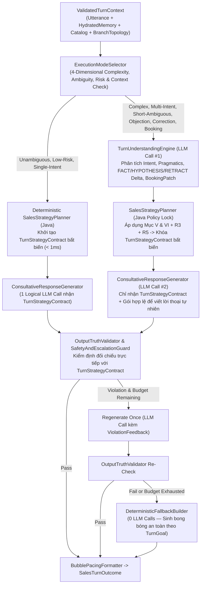

# LLM EXECUTION OPTIONS — COMPLEXITY ROUTING & CROSS-LAYER RETRY BUDGET (`R6`)

> **Document Authority**: **TO-BE NORMATIVE SPECIFICATION** (Quy định kiến trúc thực thi LLM thích ứng `Hybrid Adaptive Execution`, bộ định tuyến độ phức tạp `ExecutionModeSelector` và ngân sách retry xuyên tầng theo `R6`).  
> **Phase Gate**: `P2 — Architecture Lock Pending Project Owner Approval`  
> **Approval Status**: **PROPOSED** *(Chỉ chuyển sang `ACCEPTED` sau khi Chủ dự án phê duyệt Architecture Lock)*  
> **Baseline Commit Before P0**: `244a2ec8a120878f8f863cb0388d72d51ae8bc2e`  
> **P0 Cleanup Commit**: `f091ba557a079da86c8ae14cd7ccc19fe8ece59d`  
> **P2 Initial Draft Commit**: `5aa985d43b5ef6ea1621f37fa546bcae520633c2`  
> **Active Runtime Model**: `qwen3.8-max` (`https://api.vilao.ai/v1`)

---

## 1. Bối cảnh & Lý do Chọn `Hybrid Adaptive Execution`

Trong kiến trúc hiện tại (`executeAciCognitiveTurn`), mọi lượt hội thoại đều đi qua **một lần gọi LLM duy nhất (`Single-Pass JSON`)** với prompt khổng lồ (~18,000–24,000 ký tự). Model phải vừa cập nhật 5 tầng bộ nhớ JSON, vừa lập chiến thuật, vừa chọn skill, vừa vá trạng thái đặt lịch, vừa viết lời thoại tiếng Việt.
- Với các lượt phức tạp (khách phản đối giá, bác bỏ giả định sai của bot, hỏi đa ý định), Single-Pass dễ bị phân tán giữa việc điền JSON schema lớn và việc giữ giọng văn tự nhiên, hoặc quên mất một ràng buộc `mustNotDo`.
- Ngược lại, nếu ép 100% các lượt (kể cả câu chào `"Alo shop"` hay câu hỏi giờ mở cửa) chạy 2 pha LLM thì sẽ làm tăng độ trễ không cần thiết.

Do đó, thiết kế đích sử dụng **`Hybrid Adaptive Execution` (`FAST_SINGLE_PASS` vs `TWO_PHASE_STRATEGIC`)**, trong đó **cả hai chế độ đều bắt buộc tạo và tuân thủ `TurnStrategyContract`**.

---

## 2. Thiết kế `ExecutionModeSelector`: Định tuyến Theo Độ Phức tạp Quyết định, Độ Mơ hồ, Rủi ro và Ngữ cảnh (`R6`)

> [!IMPORTANT]
> **Quy tắc Bất khả xâm phạm (`R6`)**: **TUYỆT ĐỐI KHÔNG sử dụng độ dài câu (`message.length()`) làm tiêu chí chính để chọn `FAST_SINGLE_PASS`**. Trong tiếng Việt hội thoại thực tế, những câu cực ngắn (1–4 từ) thường mang hàm ý phản bác, chê đắt, bực bội hoặc chốt đơn có điều kiện phụ thuộc sâu vào ngữ cảnh lượt trước.

### 2.1. Bốn Chiều Đánh giá của `ExecutionModeSelector`

`ExecutionModeSelector` quyết định chế độ thực thi dựa trên 4 chiều tín hiệu:
1. **`Decision Complexity` (Độ phức tạp quyết định)**:
   - Có nhiều hơn 1 ý định trong câu khách (`multiIntent == true`)?
   - Có yêu cầu so sánh giữa nhiều gói dịch vụ hoặc lọc điều kiện loại trừ (`"gói nào không gội đầu"`)?
2. **`Pragmatic Ambiguity` (Độ mơ hồ ngữ dụng)**:
   - Câu trả lời ngắn/tỉnh lược phụ thuộc hoàn toàn vào câu hỏi/hành động liền trước của bot (`lastBotAction`) như `"Không phải"`, `"Chịu em"`, `"Thôi"`, `"Đặt luôn"`, `"Ừ/Ok"`?
3. **`Policy & Safety Risk` (Rủi ro chính sách & an toàn)**:
   - Có tín hiệu phản đối giá (`PRICE_OBJECTION`), phàn nàn cách nói chuyện (`STYLE_COMPLAINT`), đính chính thông tin (`CUSTOMER_CORRECTION`), hoặc rút lui (`WITHDRAWAL_INTENT`)?
4. **`Conversation Context State` (Ngữ cảnh trạng thái phiên)**:
   - Phiên đang có `activeObjections`, vừa báo giá ở lượt trước, hay đang ở giữa luồng `BookingProgressState` còn thiếu nhiều trường (`bookingMissingFields`)?

**Quy tắc Định tuyến Tất định**:
- Chỉ chọn **`FAST_SINGLE_PASS`** khi **CẢ 4 điều kiện sau đều thỏa mãn**:
  1. `Decision Complexity == LOW` (Chỉ có 1 ý định rõ ràng: chào hỏi lượt 1, hỏi giá cộc lốc lượt 1 `"Giá?"`, hỏi FAQ vận hành đơn thuần như giờ mở cửa/bãi đỗ xe, hoặc báo tạm dừng tường minh `"Để chị xem thêm có gì nhắn sau nhé"`).
  2. `Pragmatic Ambiguity == NONE` (Ý nghĩa câu tự thân rõ ràng, không cần giải mã ẩn ý từ lượt trước).
  3. `Policy & Safety Risk == LOW` (Không có tín hiệu phản đối giá, không có phủ định/đính chính, không có phàn nàn thái độ).
  4. Nếu là trả lời slot đặt lịch (`"19h tối nay nhé"`), câu trả lời khớp 1-1 với duy nhất `nextBookingQuestionTarget` vừa hỏi và không kèm điều kiện phản bác.
- Trong **MỌI trường hợp còn lại**, bắt buộc định tuyến sang **`TWO_PHASE_STRATEGIC`**.

### 2.2. Bảng Phân tích & Định tuyến Bắt buộc cho 5 Nhóm Câu Ngắn Nhưng Phức tạp (`R6 Mandatory Cases`)

| Câu nói của Khách | Độ dài | Tại sao phức tạp / Rủi ro nếu chạy Fast-Path | Chế độ Định tuyến Bắt buộc | Hành vi Xử lý Chuẩn trong Pipeline Đích |
|---|---:|---|---|---|
| **1. `"Thế thôi đắt quá."`** | 4 từ | Kết hợp 2 hành động hội thoại: `PRICE_OBJECTION` (chê đắt) + `WITHDRAWAL_INTENT` (muốn bỏ cuộc) ngay sau khi nghe giá. Nếu chạy Fast-Path, bot dễ lờ đi ý rút lui hoặc cố chào ép gói khác. | **`TWO_PHASE_STRATEGIC`** | - Pha 1 nhận diện `primaryIntent = PRICE_OBJECTION`, `secondaryIntents = [POLITE_DEFERRAL_OR_PAUSE]`, `customerEmotion = HESITANT`. - `SalesStrategyPlanner` khóa `pricePolicyMode = EXPLAIN_VALUE_AND_OFFER_LOWER_OR_TRIAL_OPTION`, `mustNotDo = [NO_PUSHY_BOOKING_CTA, NO_FABRICATED_DISCOUNT]`. - Pha 2 đồng cảm nhẹ nhàng, giới thiệu ngắn gọn 1 gói trải nghiệm mềm hơn (nếu có) và tôn trọng quyền cân nhắc của khách. |
| **2. `"Không phải."`** | 2 từ | Câu phủ định tỉnh lược (`CUSTOMER_CORRECTION`). Tự thân 2 từ này không nói rõ "không phải cái gì" — bắt buộc phải đối chiếu với `lastBotAction` và `activeHypotheses` (ví dụ: bot vừa hỏi *"Mình bị mỏi cổ vai gáy phải không ạ?"* hay vừa xác nhận *"Mình đặt cơ sở Cầu Giấy đúng không ạ?"*). | **`TWO_PHASE_STRATEGIC`** | - Pha 1 đối chiếu `"Không phải"` với `lastBotAction` để xác định chính xác giả định/thông tin bị bác bỏ và phát lệnh `RETRACT` mục đó. - `SalesStrategyPlanner` khóa `responseMode = APOLOGY_AND_REALIGN`, `mustNotDo = [NO_FALSE_APOLOGY, NO_PACKAGE_PITCH, NO_PRICE_MENTION, NO_REPEATING_RETRACTED_FACT]`. - Pha 2 xin lỗi ngắn gọn và hỏi lại đúng ý khách muốn. |
| **3. `"Chịu em."`** | 2 từ | Độ mơ hồ ngữ dụng cực cao (`HIGH_PRAGMATIC_AMBIGUITY`). Trong tiếng Việt, *"Chịu em"* sau một câu trả lời ngô nghê của bot là lời than phiền/bất lực (`STYLE_COMPLAINT`: *"bó tay với em"*), KHÔNG PHẢI là *"Chị đồng ý với em"*! | **`TWO_PHASE_STRATEGIC`** | - Pha 1 phân tích ngữ cảnh lượt trước để nhận diện thái độ cảm thán/phàn nàn (`ANNOYED_AT_BOT` / `STYLE_COMPLAINT`), tuyệt đối không nhầm từ `"Chịu"` thành đồng ý đặt lịch. - `SalesStrategyPlanner` khóa `mustNotDo = [NO_PACKAGE_PITCH, NO_BOOKING_CTA]` để bot cầu thị hỏi lại điều khách đang cần hỗ trợ. |
| **4. `"Đặt luôn."`** | 2 từ | Tín hiệu `BOOKING_INTENT` mạnh nhưng thiếu thông tin tham chiếu: nếu lượt trước bot vừa giới thiệu 2 gói (`239k` và `399k`), `"Đặt luôn"` chưa xác định được `serviceId`; đồng thời `bookingMissingFields` còn thiếu `BRANCH`, `TIME_SLOT`, `PHONE`. | **`TWO_PHASE_STRATEGIC`** | - Pha 1 kiểm tra `eligibleCatalogCandidates` và `BookingProgressState`: nếu chỉ có 1 gói vừa thảo luận -> khóa `serviceId`; nếu có >= 2 gói -> giữ `SERVICE` ở đầu `bookingMissingFields`. - `SalesStrategyPlanner` chọn `nextBookingQuestionTarget` (tối đa 2 trường liên quan trong 1 câu hỏi tự nhiên), gắn `mustNotDo = [NO_PREMATURE_BOOKING_CONFIRMATION]`. |
| **5. `"Ừ"` / `"Ok"` sau một câu hỏi chưa đủ điều kiện xác nhận booking** | 1 từ | Ví dụ: Bot vừa giới thiệu gói Cổ Vai Gáy 60p và hỏi *"Mình thấy gói 60 phút này phù hợp với mình không ạ?"*, khách đáp *"Ừ"* / *"Ok"*. Lúc này khách mới chỉ đồng ý chọn gói (`serviceId`), hoàn toàn chưa có `branchId`, `timeSlot`, `phone`! | **`TWO_PHASE_STRATEGIC`** *(hoặc Deterministic Slot State Machine)* | - Cập nhật `serviceId` từ `HYPOTHESIS/CANDIDATE` thành `FACT` trong `BookingProgressState`, chuyển `status` sang `COLLECTING_DETAILS` (tuyệt đối **không** chuyển sang `CONFIRMED`). - `SalesStrategyPlanner` lấy `nextBookingQuestionTarget = [BRANCH, TIME_SLOT]` (hoặc `[TIME_SLOT, PHONE]` nếu Page 1 chi nhánh) để hỏi bước tiếp theo. |

---

## 3. Cơ chế Tạo và Thực thi `TurnStrategyContract` trong Cả Hai Chế độ (`R6`)

- **Điểm mấu chốt**: Dù đi qua nhánh `FAST_SINGLE_PASS` hay `TWO_PHASE_STRATEGIC`, **100% lượt hội thoại đều phải có một đối tượng `TurnStrategyContract` bất biến được khóa bởi `SalesStrategyPlanner` trong Java trước khi LLM sinh câu trả lời**, và đều đi qua cùng một cổng kiểm định `OutputTruthValidator`.

---

## 4. Phân biệt `Logical LLM Calls` vs `Actual Provider HTTP Attempts` & Ngân sách Retry Xuyên Tầng (`R6`)

### 4.1. Nguy cơ Nhân cấp số nhân Retry giữa các tầng (Đã xác minh trong Codebase hiện tại)
Trong codebase hiện tại:
- Tầng Orchestrator (`CleanAgentOrchestratorService`) có: 1 lần gọi chính (`L4708`) + 1 lần retry khi JSON lỗi (`L4790`) + 1 lần gọi Referee Repair (`L5025`) = 3 lần gọi logic.
- Tầng Client (`OpenAiCompatibleLlmClient` / `ResilientFallbackLlmClient`) lại có cơ chế retry/fallback riêng khi gặp lỗi mạng/timeout/HTTP 5xx.
- Nếu không kiểm soát xuyên tầng, `3 Logical Calls × 2 Client Retries = 6 HTTP Attempts` trong một lượt, làm thời gian phản hồi vọt lên `> 35–45 giây` và gây nghẽn toàn bộ luồng webhook!

### 4.2. Thiết kế `TurnLlmBudgetTracker` Xuyên Tầng (Cross-Layer Budget Enforcement)

Mỗi lượt hội thoại khởi tạo một đối tượng **`TurnLlmBudgetTracker`** gắn vào ngữ cảnh lượt (`ValidatedTurnContext` / `ThreadLocal`) và truyền xuyên suốt từ `SalesTurnOrchestrator` xuống tận `LlmClient` (`OpenAiCompatibleLlmClient` & `ResilientFallbackLlmClient`):

| Chỉ số Ngân sách (Per-Turn Budget) | Chế độ `FAST_SINGLE_PASS` | Chế độ `TWO_PHASE_STRATEGIC` | Quy tắc Cưỡng chế Xuyên Tầng (Hard Enforcement) |
|---|---:|---:|---|
| **Số lần gọi LLM Logic tối đa (`maxLogicalCalls`)** | **2** (`1 Compose` + tối đa `1 Validator Regenerate`) | **3** (`1 Phase-1 Understand` + `1 Phase-2 Compose` + tối đa `1 Validator Regenerate` ở Pha 2) | `SalesTurnOrchestrator` kiểm tra `budget.tryAcquireLogicalCall()` trước mỗi pha. Khi hết quota logic -> chuyển thẳng sang `DeterministicFallbackBuilder`. |
| **Tổng số HTTP Attempts thực tế tối đa tới Provider (`maxActualHttpAttempts`)** | **3** HTTP requests | **4** HTTP requests | `OpenAiCompatibleLlmClient` phải gọi `budget.tryAcquireHttpAttempt()` trước **mỗi** lệnh `httpClient.send(...)` (bao gồm cả retry do lỗi mạng/5xx/JSON gãy). Tối đa chỉ được phép **1 lần transport/JSON retry cộng dồn trên toàn bộ lượt**. |
| **Thời gian Chờ Tối đa Toàn Lượt cho LLM (`maxTotalLlmWallClockMs`)** | **`12,000 ms`** | **`18,000 ms`** | Timeout của mỗi HTTP request được tính động: `min(perCallTimeoutMs, budget.remainingWallClockMs())`. Nếu `remainingWallClockMs() < 1500ms` -> không phát thêm HTTP request mới, kích hoạt ngay `DeterministicFallbackBuilder`. |

- **Ghi nhận Telemetry minh bạch**: Cả `logicalLlmCalls` và `actualHttpAttempts` đều được ghi vào `DecisionTrace` và `TurnEvaluationTelemetry` (`R8`) để kiểm toán độc lập trong giai đoạn `P7`.
