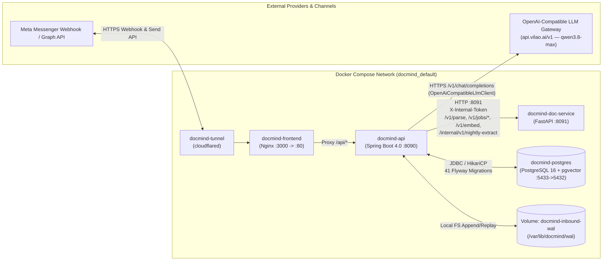

# RUNTIME DEPENDENCY REPORT — DOCMIND ADAPTIVE SALES INTELLIGENCE

> **Document Authority**: **AS-IS & P0 RUNTIME EVIDENCE** *(Bằng chứng kiểm tra Docker containers, ports, volumes và việc gỡ bỏ an toàn Python `agent-brain` `:8095`).*  
> **Phase Gate**: `P0 — Runtime Cleanup` & `P1 — Architecture Discovery`  
> **Approval Status**: **VERIFIED (P0 COMPLETED)**  
> **Baseline Commit Before P0**: `244a2ec8a120878f8f863cb0388d72d51ae8bc2e`  
> **P0 Cleanup Commit**: `f091ba557a079da86c8ae14cd7ccc19fe8ece59d` (`chore: retire standalone Python Agent Brain service (8095)`)  
> **P2 Initial Draft Commit**: `5aa985d43b5ef6ea1621f37fa546bcae520633c2`  
> **Audit Mode**: Read-only đối với logic nghiệp vụ (`src/main/java`)

---

## 1. Phân loại mức độ bằng chứng

- **Đã xác minh (Verified)**: Kiểm chứng trực tiếp bằng lệnh `docker ps -a`, `docker compose ls`, `docker volume ls`, `Get-NetTCPConnection`, `git grep`, `curl` health check và kết quả chạy JUnit test thực tế.
- **Suy luận kỹ thuật (Inferred)**: Kết luận rút ra trực tiếp từ cấu hình `docker-compose.yml`, `application.yml`, `.env` và đồ thị phụ thuộc tĩnh trong mã nguồn.
- **Chưa xác minh (Unverified)**: Chưa đo tải thực tế (load test đồng thời nhiều user) trên hạ tầng production ngoài môi trường Docker local hiện tại.

---

## 2. Trạng thái Container & Dịch vụ Runtime (Đã xác minh)

Kết quả kiểm tra thực tế trên Windows Docker Engine (`docker ps -a` & `docker compose ls`):

| Container Name | Image / Build Context | Host -> Container Port | Trạng thái | Vai trò trong kiến trúc | Quyết định theo Master Directive |
|---|---|---|---|---|---|
| `docmind-api` | `docmind-api` (`./api-java`) | `127.0.0.1:8090 -> 8090/tcp` | `Up (healthy)` | Java 21 / Spring Boot 4.0.0 Gateway, Orchestrator, In-Process `AgentBrainService`, Hybrid RAG, Referee & Webhook | **GIỮ LẠI** (Core Backend) |
| `docmind-doc-service` | `docmind-doc-service` (`./doc-service-py`) | `127.0.0.1:8091 -> 8091/tcp` | `Up (healthy)` | Python FastAPI Document Parser (`/v1/parse`, `/v1/jobs/*`), Embeddings (`/v1/embed`, 384-dim) & Cold-path Nightly Security Audit (`/internal/v1/nightly-extract`) | **TUYỆT ĐỐI GIỮ LẠI** |
| `docmind-frontend` | `docmind-frontend` (`./frontend-react`) | `0.0.0.0:3000 -> 80/tcp` | `Up (healthy)` | Nginx + React Admin UI, Live Chat Simulator, Architecture Portal | **GIỮ LẠI** |
| `docmind-postgres` | `pgvector/pgvector:pg16` | `127.0.0.1:5433 -> 5432/tcp` | `Up (healthy)` | PostgreSQL 16 + `pgvector` (41 Flyway migrations `V1..V41`) | **GIỮ LẠI** |
| `docmind-tunnel` | `cloudflare/cloudflared:latest` | Host/Bridge internal | `Up` | Cloudflare Zero-Trust Tunnel (`https://assistant.goc-an-nhien.site` -> `frontend:80` -> `api:8090`) | **GIỮ LẠI** |
| *(Legacy `agent-brain`)* | `./agent-brain` (đã gỡ bỏ) | `8095` (không còn tồn tại) | **Decommissioned** | Standalone Python FastAPI Agent Brain `:8095` (đã thay thế hoàn toàn bằng Java `AgentBrainService` in-process) | **ĐÃ GỠ BỎ AN TOÀN (`f091ba5`)** |

---

## 3. Bằng chứng xác minh & loại bỏ Python Agent Brain `:8095` (`P0`)

### 3.1. Kiểm tra tiến trình, cổng mạng và Docker Volume (Đã xác minh)
1. **Docker container trên cổng `8095`**:
   - Lệnh: `docker ps -a --filter "publish=8095"` và `docker ps -a --filter "name=agent-brain"`
   - Kết quả: **0 container**.
2. **Tiến trình lắng nghe cổng `8095` trên Windows Host**:
   - Lệnh: `Get-NetTCPConnection -LocalPort 8095 -State Listen`
   - Kết quả: **0 listener**.
3. **Docker Volumes trên máy chủ**:
   - Lệnh: `docker volume ls`
   - Kết quả: Chỉ tồn tại 2 volume hợp lệ của hệ thống chính:
     - `docmind_docmind-pgdata` (dữ liệu PostgreSQL 16)
     - `docmind_docmind-inbound-wal` (Write-Ahead Log cho tin nhắn inbound tại `/var/lib/docmind/wal`)
   - Không có volume `agent_brain_data` hay `docmind-braindata` tồn tại trên host. Trong thư mục `agent-brain/` trước khi xóa cũng không có bất kỳ file `.db`, `.sqlite`, `.jsonl` dữ liệu người dùng nào (chỉ có **21 file** mã nguồn/cấu hình/test Python tổng cộng **`2,708 LOC`**).
4. **Kiểm tra Dependency toàn Repo và Số liệu Git Diff Chính xác của Commit `P0` (`f091ba557a079da86c8ae14cd7ccc19fe8ece59d`)**:
   - Lệnh: `git grep -n -i -E "8095|agent-brain|/v1/brain|AGENT_BRAIN|recall-and-advise|retain-turn"` và `git show --stat f091ba557a079da86c8ae14cd7ccc19fe8ece59d`
   - Xác minh:
     - `AgentBrainClient.java` đã được loại bỏ từ giai đoạn trước.
     - `docker-compose.yml` và `api-java/src/main/resources/application.yml` không còn bất kỳ biến môi trường hay cấu hình nào trỏ tới `:8095` hoặc `agent-brain`.
     - Topology triển khai thực tế là **Single-Instance (`1` container `docmind-api` `:8090` duy nhất)**.
     - Trong commit `f091ba557a079da86c8ae14cd7ccc19fe8ece59d` (`chore: retire standalone Python Agent Brain service (8095)`), số liệu Git diff chính xác là **`23 files changed, 11 insertions(+), 2,714 deletions(-)`**: gồm **21 file bị xóa (`D`)** trong thư mục `agent-brain/` (`2,708 dòng bị xóa`) và **2 file được cập nhật (`M`)** (`api-java/src/test/java/com/example/docmind/service/bot/CleanAgentArchitectureVerificationTest.java`: `+5 dòng`; `docs/architecture/docmind_system_architecture.html`: `+6/-6 dòng`). Bài test kiến trúc `CleanAgentArchitectureVerificationTest#testP31_AgentBrain8095AndAgentBrainClientCompletelyDecommissionedWhilePreservingInProcessAgentBrainService` đạt **1/1 PASS**.

---

## 4. Bản đồ Giao tiếp Liên dịch vụ (Inter-Service Dependency Map)

### 4.1. Chi tiết các kết nối HTTP nội bộ từ `docmind-api` (`:8090`) sang `docmind-doc-service` (`:8091`)
Đã xác minh qua [`RestDocServiceClient.java`](file:///d:/Project/digital-spirituality/docmind/api-java/src/main/java/com/example/docmind/client/RestDocServiceClient.java), [`FastApiAgentService.java`](file:///d:/Project/digital-spirituality/docmind/api-java/src/main/java/com/example/docmind/service/bot/FastApiAgentService.java) và [`doc-service-py/app/api.py`](file:///d:/Project/digital-spirituality/docmind/doc-service-py/app/api.py):

1. `POST /v1/parse` (`RestDocServiceClient.submitParse` L54): Gửi file tài liệu multipart để bóc tách cấu trúc Markdown/blocks.
2. `GET /v1/jobs/{jobId}` & `GET /v1/jobs/{jobId}/result` (`RestDocServiceClient` L75, L86): Polling trạng thái và lấy kết quả bóc tách tài liệu.
3. `POST /v1/embed` (`RestDocServiceClient.embed` L97): Sinh vector embedding 384 chiều (`paraphrase-multilingual-MiniLM-L12-v2` hoặc deterministic stub fallback) phục vụ tìm kiếm ngữ nghĩa `pgvector`.
4. `POST /internal/v1/nightly-extract` (`FastApiAgentService.extractNightlySamples` L102): Luồng Cold-Path bóc tách mẫu hội thoại ban đêm và kiểm toán bảo mật (có cơ chế fallback nội bộ `runLocalNightlyFallback` trong JVM nếu `:8091` không phản hồi).
5. `GET /healthz` & `GET /readyz`: Probe kiểm tra sức khỏe container `:8091`.

### 4.2. Chi tiết kết nối LLM Provider hiện hành (Đã xác minh)
Đã xác minh qua [`LlmConfiguration.java`](file:///d:/Project/digital-spirituality/docmind/api-java/src/main/java/com/example/docmind/config/LlmConfiguration.java), [`OpenAiCompatibleLlmClient.java`](file:///d:/Project/digital-spirituality/docmind/api-java/src/main/java/com/example/docmind/service/llm/OpenAiCompatibleLlmClient.java) và `.env`:
- `LLM_PROVIDER=qwen` (được ánh xạ qua `OpenAiCompatibleLlmClient` trong `LlmConfiguration.java` L70–L115).
- `LLM_BASE_URL=https://api.vilao.ai/v1`
- `LLM_MODEL=qwen3.8-max`
- Cơ chế bảo vệ: `ResilientFallbackLlmClient` bọc client chính và fallback sang `StubLlmClient` nếu cấu hình cho phép, hoặc trả lỗi để `CleanAgentOrchestratorService` chuyển sang deterministic safe fallback / human handoff.

### 4.3. Kết quả Health Check Thực tế sau `P0` (Đã xác minh)
- `GET http://localhost:8090/api/health` -> `HTTP 200` `{"service":"docmind-api","status":"ok"}`
- `GET http://localhost:8091/healthz` -> `HTTP 200` `{"status":"ok"}`
- `Port 8095` -> Không tồn tại tiến trình hay container nào.
