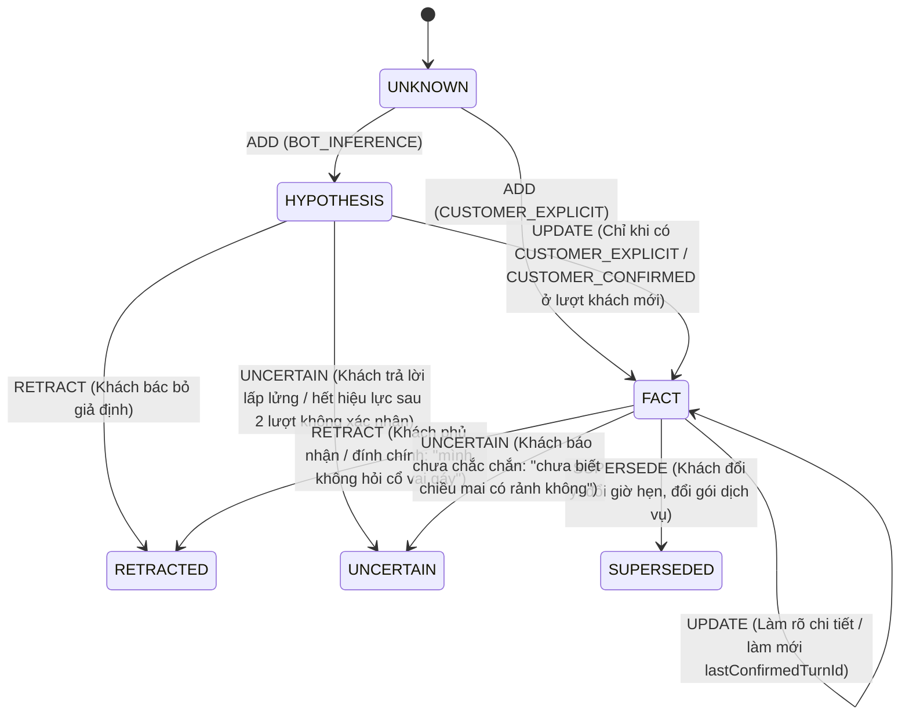

# STATE OWNERSHIP & CONSISTENCY SPECIFICATION (TO-BE NORMATIVE DESIGN)

> **Document Authority**: **TO-BE NORMATIVE SPECIFICATION** (Quy định thiết kế đích cho quyền sở hữu trạng thái, giao thức nhất quán dữ liệu `R2` và mô hình trí tuệ khách hàng `R3`; có hiệu lực cao hơn tài liệu khảo sát hiện trạng [`STATE_OWNERSHIP_MAP.md`](file:///d:/Project/digital-spirituality/docmind/docs/architecture/STATE_OWNERSHIP_MAP.md)).  
> **Phase Gate**: `P2 — Architecture Lock Pending Project Owner Approval`  
> **Approval Status**: **PROPOSED** *(Chỉ chuyển sang `ACCEPTED` sau khi Chủ dự án phê duyệt Architecture Lock)*  
> **Baseline Commit Before P0**: `244a2ec8a120878f8f863cb0388d72d51ae8bc2e`  
> **P0 Cleanup Commit**: `f091ba557a079da86c8ae14cd7ccc19fe8ece59d`  
> **P2 Initial Draft Commit**: `5aa985d43b5ef6ea1621f37fa546bcae520633c2`

---

## 1. Phân cấp Tài liệu & Bảng Quyền Sở hữu Trạng thái Đích (R9)

- [`STATE_OWNERSHIP_MAP.md`](file:///d:/Project/digital-spirituality/docmind/docs/architecture/STATE_OWNERSHIP_MAP.md) là **Báo cáo Kiểm toán Hiện trạng (`AS-IS AUDIT`)**, chỉ dùng để ghi nhận sự phân mảnh của hệ thống cũ trước khi tái cấu trúc.
- Tài liệu này (`STATE_OWNERSHIP.md`) là **Đặc tả Thiết kế Đích (`TO-BE NORMATIVE`)**. Khi triển khai `P3–P7`, mọi module bắt buộc tuân theo quyền sở hữu trạng thái và giao thức nhất quán dưới đây:

| Thực thể Trạng thái (State Entity) | Owner Duy nhất (Read/Write Authority) | Nơi Lưu Bền Vững (Durable Backing) | Cơ chế Đồng bộ & Bảo vệ |
|---|---|---|---|
| **1. `SessionControlState`** (`controlMode`, `optedOut`, `optedOutAt`, `reOptInAt`, `lastInboundMid`) | `InboundSessionPersistenceService` (Miền A — Gateway) | Bảng `conversation_sessions` (`control_mode`, `opted_out`, `version`) & `conversation_messages` (`ux_conversation_messages_session_external_mid`) | Giao dịch `Tx-Entry` (`REQUIRES_NEW`) ở đầu lượt + kiểm tra đọc tươi ở `Layer-2 Exit Fence`. |
| **2. `CustomerIntelligenceLedger`** (`FACT`, `HYPOTHESIS`, `UNKNOWN` + `CustomerStatementRecord`) | `ConversationMemoryStore` (Miền B — Memory) | `conversation_sessions.aci_memory_state_json` (PostgreSQL JSONB, được bảo vệ bởi JPA `@Version`) | Cập nhật qua `ConversationSessionOptimisticMergeCoordinator` (`Tx-Commit`) với luật `Monotonic Merge` theo `turnSeq` và độ ưu tiên trạng thái. |
| **3. `CustomerRelationshipState`** (`customerPronoun`, `pronounConfidence`, `relationshipStage`, `priceObjectionCount`, `customerLocation`) | `ConversationMemoryStore` (Miền B — Memory) | `conversation_sessions.aci_memory_state_json` + cột `honorific` trên `conversation_sessions` | Khóa tự tin `1.0` khi khách chủ động đính chính xưng hô; tách biệt hoàn toàn `customerLocation` với `preferredBranchId`. |
| **4. `BookingProgressState`** (`serviceId`, `branchId`, `timeSlot`, `partySize`, `customerPhone`, `status`, `appliedBookingPatchIds`) | `ConversationMemoryStore` (Miền B — Memory) | `conversation_sessions.aci_memory_state_json` + cột `captured_phone`, `preferred_time` | **Xóa bỏ bản sao trong `ConversationState.SESSION_CACHE`**. Chỉ cập nhật qua `BookingPatch` có `patchId` bất biến và kiểm tra idempotency. |
| **5. `SentBubbleLedger`** (`deliveredBubbles`, `deliveryStatus`, `externalMid`) | `SentBubbleLedger` / `JdbcSentBubbleStore` (Miền A — Gateway) | Bảng `sent_bubble_ledger_entries` & `conversation_messages` | Chỉ ghi nhận sau khi vượt qua `Layer-2 Exit Fence` và phát tin thành công. |

---

## 2. Giao thức Nhất quán Dữ liệu `ConversationMemoryStore` (`R2 — Consistency Protocol`)

### 2.1. Nguyên tắc Cốt lõi: Không Dùng Khóa Phân tán Phức tạp Khi Chưa Cần Thiết
- **Đã xác minh trong mã nguồn hiện tại**: Hệ thống đã có [`ConversationSessionOptimisticMergeCoordinator.java`](file:///d:/Project/digital-spirituality/docmind/api-java/src/main/java/com/example/docmind/service/bot/ConversationSessionOptimisticMergeCoordinator.java) (`L54–L283`, sử dụng JPA `@Version` trên bảng `conversation_sessions` với `MAX_OPTIMISTIC_MERGE_ATTEMPTS = 6`) và [`AciCustomerBrainMemorySnapshot.java`](file:///d:/Project/digital-spirituality/docmind/api-java/src/main/java/com/example/docmind/service/bot/AciCustomerBrainMemorySnapshot.java) (`L680–L1043`, hàm `monotonicMerge`).
- **Phân định vai trò của `Striped<Lock>` vs JPA `@Version` OCC**:
  - `Striped<Lock>` trong JVM **KHÔNG phải** là giải pháp đồng bộ đa instance (multi-instance). Nó chỉ đóng vai trò **bộ giảm tranh chấp cục bộ trong cùng 1 JVM** (giúp 2 thread trong cùng 1 container không chạy song song vô ích trên cùng một `pageId::senderId`).
  - Tính đúng đắn dữ liệu (Data Correctness) giữa nhiều thread hoặc nhiều Java instances được bảo đảm hoàn toàn bởi **PostgreSQL Row-Level OCC (`conversation_sessions.version`) + Deterministic Monotonic Merge**.
  - **Không thêm Distributed Lock (Redis/ZooKeeper) và không giữ `pg_advisory_xact_lock` trong suốt lượt hội thoại**: `pg_advisory_xact_lock` chỉ được dùng duy nhất trong giao dịch ngắn (< 5ms) khi khởi tạo dòng `conversation_sessions` lần đầu tiên (`findOrCreateSessionWithAdvisoryLockInTx` tại `AciSessionMemoryPersistenceService.java` `L160`) để tránh tạo 2 dòng session trùng cho khách mới.

### 2.2. Giải đáp 7 Yêu cầu Thiết kế Nhất quán Dữ liệu (R2.1 – R2.7)

#### (1) Ranh giới Giao dịch (`Transaction Boundary`) khi Đọc State, Áp dụng Patch, Tăng `version` và Lưu `patchId`
Mỗi lượt hội thoại được tách thành **2 giao dịch cơ sở dữ liệu ngắn (`REQUIRES_NEW`)** và **1 pha suy luận không giữ kết nối DB** ở giữa (nhằm tránh làm cạn kiệt HikariCP connection pool trong 3–8 giây chờ LLM):

1. **Giao dịch 1 — `Tx-Entry` (`REQUIRES_NEW`, ~5–15ms, tại `InboundSessionPersistenceService`)**:
   - Kiểm tra `control_mode`, `opted_out`, chèn tin nhắn khách vào `conversation_messages` với ràng buộc duy nhất `UNIQUE (session_id, external_mid)` (`V32`).
   - Đọc `ConversationSessionEntity` hiện tại: lấy `(sessionId, baseDbVersion, aciMemoryStateJson)`.
   - Giải phóng kết nối DB ngay sau khi `Tx-Entry` commit.
2. **Pha Tính toán Không Giữ Giao dịch DB (`Stateless Compute & LLM Phase`)**:
   - Thực hiện Hybrid RAG, chạy `TurnUnderstandingEngine` / `SalesStrategyPlanner` / `ConsultativeResponseGenerator` / `OutputTruthValidator`.
   - Tạo ra ứng viên cập nhật bộ nhớ (`MemoryDeltaCandidate`) và bản vá đặt lịch (`BookingPatch` kèm `patchId`, `turnSeq`).
3. **Giao dịch 2 — `Tx-Commit` (`REQUIRES_NEW`, ~5–15ms, tại `ConversationSessionOptimisticMergeCoordinator`)**:
   - Trong cùng **một giao dịch SQL nguyên tử**:
     - Nạp hoặc gắn `ConversationSessionEntity` với `@Version = baseDbVersion`.
     - Kiểm tra `BookingPatch.patchId` chưa tồn tại trong `applied_booking_patch_ids`.
     - Áp dụng `MemoryDeltaCandidate` + `BookingPatch` + ghi thêm `patchId` vào danh sách `applied_booking_patch_ids` (giới hạn 32 UUID gần nhất theo cơ chế FIFO) bên trong `aci_memory_state_json`.
     - Cập nhật đồng bộ cột `captured_phone` và `preferred_time` trên dòng `conversation_sessions`.
     - Thực thi `UPDATE conversation_sessions SET aci_memory_state_json = ?, captured_phone = ?, preferred_time = ?, updated_at = ?, version = version + 1 WHERE id = ? AND version = ?`.

#### (2) Xử lý Xung đột OCC (`OCC Conflict Handling`): Re-read, Re-apply Patch, Bounded Retry & Terminal Failure
Khi câu lệnh `UPDATE ... WHERE id = ? AND version = expectedBaseVersion` trả về `0 rows` (ném `OptimisticLockingFailureException` / `StaleStateException`):
1. **Re-read**: Mở giao dịch `REQUIRES_NEW` mới, đọc bản ghi `freshDb` mới nhất vừa được instance/luồng khác commit từ PostgreSQL (`sessionRepository.findById(sessionId)`).
2. **Check Control & Epoch Preemption**:
   - Nếu `freshDb.controlMode` đã chuyển sang `HUMAN_TAKEOVER` hoặc `freshDb.optedOut == true`, hoặc `SenderEpochRegistry` báo lượt hiện tại đã bị thay thế bởi tin nhắn mới hơn của khách -> giữ lại các `FACT` hợp lệ khách vừa cung cấp trong lượt này (nếu có) nhưng **hủy việc phát tin nhắn ra ngoài**.
3. **Re-apply Patch via Monotonic Merge**:
   - Giải tuần tự `dbSnapshot = AciCustomerBrainMemorySnapshot.fromJson(freshDb.getAciMemoryStateJson())`.
   - Áp dụng hàm tất định `merged = monotonicMerge(dbSnapshot, candidateSnapshot)` và tái áp dụng `BookingPatch` (chỉ ghi đè các trường mà `BookingPatch.turnSeq >= dbSnapshot.bookingFieldTurnSeq` và `patchId` chưa có trong `dbSnapshot.appliedBookingPatchIds`).
4. **Bounded Retry**:
   - Thử lại tối đa `MAX_OPTIMISTIC_MERGE_ATTEMPTS = 6` lần với backoff ngắn có jitter (`15ms, 30ms, 60ms, 120ms, 240ms`).
5. **Terminal Failure Behavior (Khi hết 6 lần thử vẫn xung đột hoặc DB lỗi)**:
   - Ghi log cảnh báo mức cao `[MEMORY-OCC-EXHAUSTED] sessionId=... turnId=...`.
   - **Evict ngay lập tức** entry của `(pageId, senderId)` khỏi bộ nhớ đệm `memoryStore` trong JVM để tránh giữ state bẩn.
   - Không ghi đè mù quáng xuống DB. Nếu `verifyOutboundStillPermittedFresh` vẫn cho phép gửi tin, trả về bong bóng tư vấn cho khách nhưng đánh dấu `memoryCommitStatus = DEGRADED_UNCOMMITTED` trong `decisionTrace`.

#### (3) Tính Lũy đẳng của `BookingPatch` (`Idempotency of BookingPatch`)
```java
public record BookingPatch(
        String patchId,             // Deterministic UUIDv3(sessionId + ":" + inboundExternalMidOrTurnId + ":booking")
        int turnSeq,                // Số thứ tự lượt tăng dần
        String sourceTurnId,        // ID lượt sinh ra patch
        Map<BookingField, FieldMutation> mutations // SET_CONFIRMED | REPLACE_USER_CHANGE | CLEAR_RETRACTED
) {}
```
- **Tại sao `patchId` được sinh tất định (Deterministic)?** Vì nếu cùng một sự kiện inbound (`external_mid`) bị retry ở tầng ứng dụng hoặc OCC retry loop chạy lại từ bước 1 đến bước 6, `patchId` luôn giống hệt nhau.
- **Quy tắc Lũy đẳng (Idempotency Rule)**:
  - Trong `aci_memory_state_json`, mảng `applied_booking_patch_ids` lưu 32 `patchId` gần nhất.
  - Nếu `applied_booking_patch_ids.contains(patch.patchId())` -> Bỏ qua ngay lập tức (No-op), trả về trạng thái hiện tại.
  - Mỗi trường trong `BookingProgressState` (`serviceId`, `branchId`, `timeSlot`, `partySize`, `customerPhone`) lưu kèm `updatedTurnSeq`. Một `BookingPatch` đến muộn có `patch.turnSeq < field.updatedTurnSeq` **không bao giờ** ghi đè được giá trị đã được khách cập nhật ở lượt mới hơn.

#### (4) Thời điểm Cập nhật Cache & Cơ chế Vô hiệu hóa / Phục hồi khi DB Commit Thành công nhưng Cache Update Thất bại
- **Quy tắc Vàng: DB-First, Cache-Second (Write-Through kèm Version Gate & Evict-on-Failure)**:
  1. Tuyệt đối **không cập nhật `memoryStore` trong JVM trước khi `Tx-Commit` xuống PostgreSQL hoàn tất**.
  2. Sau khi `Tx-Commit` trả về `PersistedSessionOutcome(sessionId, newDbVersion, mergedSnapshot)`:
     - Trong khối `try`, gọi `memoryStore.compute(cacheKey, (k, existing) -> (existing == null || newDbVersion >= existing.dbVersion()) ? new CachedMemoryEntry(newDbVersion, mergedSnapshot) : existing)`.
  3. **Xử lý khi DB commit thành công nhưng cập nhật cache lỗi (hoặc bất kỳ ngoại lệ runtime nào sau DB commit)**:
     - Trong khối `catch (Throwable t)`, bắt buộc gọi `memoryStore.remove(cacheKey)` (Cache Invalidation).
     - Ở lượt tiếp theo, khi `refreshTurnBaseFromDb(pageId, senderId)` thấy cache trống (cache miss), hệ thống tự động nạp lại (`Lazy Hydration`) bản ghi đã commit thành công từ PostgreSQL (`loadLatestSessionMemory`). Nhờ đó, **sự cố bộ nhớ đệm trong JVM không bao giờ làm lệch trạng thái phiên**.

#### (5) Hành vi khi Nhiều Java Instances Cùng Xử lý Một Cuộc Hội thoại (`Multi-Instance Behavior`)
- Hiện tại hệ thống chạy 1 container `docmind-api` (`Verified`), nhưng thiết kế đích hỗ trợ sẵn việc mở rộng ngang (N instances sau Load Balancer) mà **không cần Sticky Session hay Distributed Lock**:
  1. **Kiểm tra Độ tươi Đầu lượt (`Turn-Start Version Check`)**: Đầu mỗi lượt, `refreshTurnBaseFromDb(pageId, senderId)` truy vấn nhanh `(version, control_mode, opted_out)` từ PostgreSQL (index `idx_conv_sessions_page_psid`). Nếu `db.version != localCache.dbVersion` (do một instance khác vừa xử lý lượt trước), instance hiện tại nạp lại `aci_memory_state_json` từ PostgreSQL trước khi chạy Orchestrator.
  2. **Đồng bộ Cuối lượt qua OCC + Monotonic Merge**: Nếu 2 instances xử lý song song 2 tin nhắn của cùng 1 khách, instance về đích sau sẽ gặp `OptimisticLockingFailureException` tại PostgreSQL và tự động chạy `monotonicMerge` trên dữ liệu vừa được instance thứ nhất commit.
  3. **Giới hạn cần lưu ý (Trade-off)**: `SenderEpochRegistry` trong bộ nhớ JVM chỉ hủy sớm (early-abort) được các thread nằm trên **cùng một JVM instance**. Nếu 2 tin nhắn liên tiếp của cùng 1 khách rơi vào 2 JVM instances khác nhau, instance xử lý tin nhắn cũ hơn sẽ không bị hủy ở giữa chừng mà sẽ bị chặn ở cuối lượt tại `Tx-Commit` (nhờ kiểm tra `last_updated_turn_seq` / `last_message_at` trong DB) và `Layer-2 Exit Fence`.

#### (6) Xử lý Webhook Trùng lặp (Duplicate) và Webhook Đến Không Đúng Thứ tự (Out-of-Order)
1. **Webhook Trùng lặp (`Duplicate Webhook` cùng `external_mid`)**:
   - Chặn ngay tại `InboundSessionPersistenceService.evaluateEntryAndPersistCustomer`:
     - Tầng 1: `WEBHOOK_MID_DEDUP_CACHE` (in-JVM fast check).
     - Tầng 2 (Quyết định): Ràng buộc `UNIQUE (session_id, external_mid)` (`V32__p01_message_external_mid_unique_index.sql`) trong PostgreSQL (`INSERT ... ON CONFLICT DO NOTHING`). Nếu trùng `external_mid`, trả về `EntryAction.SUPPRESS_DUPLICATE_INBOUND` và dừng ngay lập tức (0 lần gọi LLM, 0 tin nhắn gửi lặp).
2. **Webhook Đến Không Đúng Thứ tự / Dồn dập (`Out-of-Order / Burst Webhooks`)**:
   - **Cửa sổ gom tin (`Burst Debounce`)**: `FanpageBotController` gom các tin nhắn cách nhau `<= burstDebounceMs` thành một lượt xử lý duy nhất.
   - **Cơ chế Epoch (`SenderEpochRegistry`)**: Nếu tin nhắn mới $M_2$ đến khi tin nhắn cũ $M_1$ đang chờ LLM, epoch của `(pageId, senderId)` tăng lên. $M_1$ kiểm tra epoch tại 3 điểm (`BEFORE_LLM`, `AFTER_LLM_BEFORE_REFEREE`, `BEFORE_STATE_AND_LEDGER_COMMIT`) và tự hủy (`SUPERSEDED_ABORTED`) trước khi ghi state hay gửi tin.
   - **Cơ chế Timestamp / Sequence Guard**: Nếu Meta gửi gói tin có `webhookTimestamp < session.lastInboundTimestamp` và nội dung mâu thuẫn với sự thật đã chốt ở lượt mới hơn, `compareVersionedFactWinner` (dựa trên `turnSeq` và `observedAt`) giữ nguyên sự thật của lượt mới hơn.

#### (7) Giữ Tính Nguyên tử Thực tế Giữa Conversation Memory, Booking State và Delivered Message Ledger
Trong kiến trúc thực tế có gọi HTTP ra bên ngoài (Facebook Graph API), không tồn tại giao thức Two-Phase Commit (2PC) xuyên suốt PostgreSQL và máy chủ Meta. Do đó, biên độ nguyên tử được thiết kế như sau:

| Nhóm Trạng thái | Mức độ Nguyên tử | Cơ chế Thực thi & Bù trừ (Compensating Action) |
|---|---|---|
| **`ConversationMemory` + `BookingProgressState` + `applied_booking_patch_ids`** | **100% Atomic (ACID)** | Cùng nằm trong 1 dòng `conversation_sessions` (`aci_memory_state_json`, `captured_phone`, `preferred_time`, `version`) và được ghi trong duy nhất 1 giao dịch `Tx-Commit`. |
| **`Tx-Commit` (Memory/Booking) vs `Layer-2 Exit Fence`** | **Staged Fencing** | Ngay sau `Tx-Commit`, `FanpageBotService` gọi `verifyOutboundStillPermittedFresh`. Nếu nhân viên sale vừa bật `HUMAN_TAKEOVER` ở mili-giây cuối, các `FACT` của khách đã được lưu an toàn vào DB cho nhân viên xem, nhưng bong bóng trả lời của bot bị **chặn hoàn toàn (Suppressed)** và không ghi vào `SentBubbleLedger`. |
| **`SentBubbleLedger` vs Gửi tin qua Facebook Graph API** | **At-Least-Once / Actual-Delivered Recording** | - Với kênh REST Simulator (`/api/bot/fanpage/message`): Ghi `SentBubbleLedger` (`DELIVERED`) ngay trước khi trả HTTP 200.<br/>- Với kênh Meta Webhook (`/api/bot/fanpage/webhook`): `FanpageBotController.sendSequentialBubblesToFacebook` gửi tuần tự từng bong bóng; nếu bong bóng thứ 2 bị lỗi mạng giữa chừng, chỉ những bong bóng thực tế đã nhận HTTP 200 từ Meta mới được coi là đã phát, tránh hiện tượng bot tưởng đã gửi câu hỏi ở bong bóng 2 khi khách chưa hề nhận được. |

---

## 3. Mô hình Trí tuệ Khách hàng (`R3 — Customer Intelligence Model`: `FACT` vs `HYPOTHESIS` vs `UNKNOWN`)

### 3.1. Ba Phân loại Nhận thức (`Epistemic Classification`)
Không tạo thêm hàng loạt class rời rạc; toàn bộ mô hình được chuẩn hóa ngay trong schema của `AciCustomerBrainMemorySnapshot` (`ConfirmedFactLedger`):

| Phân loại (`EpistemicStatus`) | Định nghĩa Nghiệp vụ | Điều kiện Hình thành | Quyền Sử dụng trong Tư vấn |
|---|---|---|---|
| **`FACT`** | Thông tin đã được khách hàng trực tiếp nói ra hoặc xác nhận rõ ràng. | Phải có `sourceType` là `CUSTOMER_EXPLICIT` hoặc `CUSTOMER_CONFIRMED`, kèm `evidenceQuote` trích từ lời khách và `sourceTurnId` (`confidence >= 0.85`). | Được dùng làm nền tảng khẳng định trong lời tư vấn, lọc gói dịch vụ (`CatalogIntelligenceService`) và điền vào `BookingProgressState`. |
| **`HYPOTHESIS`** | Giả thuyết do bot/LLM suy luận từ tín hiệu gián tiếp nhưng **chưa được khách xác nhận**. | `sourceType = BOT_INFERENCE`, `confidence` trong khoảng `[0.30, 0.79]`, kèm lý do suy luận (`rationale`). | Chỉ được dùng để **đặt câu hỏi thăm dò mở** (ví dụ: *"Không biết mình đang tìm gói thư giãn nhẹ nhàng hay trị liệu chuyên sâu vùng mỏi ạ?"*). **CẤM** dùng `HYPOTHESIS` để khẳng định khách bị bệnh/đau vùng đó hoặc tự khóa gói dịch vụ. |
| **`UNKNOWN`** | Thuộc tính cần cho tư vấn/đặt lịch nhưng chưa có bằng chứng đủ tin cậy (`confidence < 0.30`) hoặc khách trả lời lấp lửng (`"chưa biết nữa"`). | Trạng thái mặc định của mọi slot khi bắt đầu phiên hoặc sau khi bị hạ bậc `UNCERTAIN`. | Đưa vào danh sách thông tin cần làm rõ (`clarificationCandidates` hoặc `bookingMissingFields`) theo đúng thứ tự ưu tiên. |

### 3.2. Schema Chi tiết cho Mỗi Mục Thông tin (`CustomerIntelligenceEntry`)

```json
{
  "key": "pain_region.neck_shoulder",
  "value": "cổ vai gáy",
  "epistemic_status": "FACT | HYPOTHESIS | UNKNOWN",
  "lifecycle_state": "CURRENT | SUPERSEDED | RETRACTED | UNCERTAIN",
  "source_type": "CUSTOMER_EXPLICIT | CUSTOMER_CONFIRMED | BOT_INFERENCE | SYSTEM_AUTHORITATIVE",
  "evidence_quote": "chị bị đau mỏi cổ vai gáy cả tuần nay rồi",
  "source_turn_id": "T1",
  "updated_turn_id": "T1",
  "last_confirmed_turn_id": "T1",
  "turn_seq": 1,
  "confidence": 0.95,
  "created_at": "2026-11-04T04:00:00Z",
  "updated_at": "2026-11-04T04:00:00Z"
}
```

### 3.3. Năm Trạng thái Vòng đời (`Lifecycle Operations: ADD, UPDATE, SUPERSEDE, RETRACT, UNCERTAIN`)



### 3.4. Hai Luật Bất Khả Xâm Phạm của Mô hình Trí tuệ Khách hàng (`R3 Invariants`)

1. **Luật Chống Tự Xác Nhận Giả Thuyết (`No Self-Confirming Hypothesis Rule`)**:
   - Một `HYPOTHESIS` (`sourceType == BOT_INFERENCE`) **KHÔNG BAO GIỜ** được tự động nâng cấp thành `FACT` chỉ vì bot đã nhắc đến nó trong bong bóng trả lời ở lượt trước hoặc vì khách chỉ nói `"Ừ"`, `"Giá sao?"` mà không xác nhận trực tiếp giả thuyết đó.
   - Hàm kiểm tra chuyển trạng thái trong `ConversationMemoryStore` bắt buộc kiểm tra:
     `canPromoteToFact(entry, incomingDelta)` chỉ trả về `true` khi `incomingDelta.sourceType() in {CUSTOMER_EXPLICIT, CUSTOMER_CONFIRMED}` VÀ `incomingDelta.evidenceQuote()` nằm trong phát ngôn thực tế của khách (`CustomerStatementRecord`).
   - Nếu một `HYPOTHESIS` tồn tại quá 2 lượt mà không được khách xác nhận, nó tự động hạ về `UNCERTAIN` / hết hiệu lực dẫn dắt câu hỏi.

2. **Luật Chống Hồi Sinh Thông Tin Đã Bác Bỏ (`Anti-Resurrection of Retracted Facts Rule`)**:
   - Khi khách sửa hoặc phủ nhận một thông tin (ví dụ: `"Mình không bị đau cổ vai gáy"`, `"Chị không muốn gói có gội đầu"`), mục đó chuyển sang `lifecycle_state = RETRACTED` và được ghi vào tập khóa cấm `retractedOrForbiddenScopes` kèm `retractedTurnSeq`.
   - Trong `AciCustomerBrainMemorySnapshot.compareVersionedFactWinner`, trạng thái `RETRACTED` / `NEGATED` có độ ưu tiên cao nhất (`rank = 4` vs `CURRENT rank = 1`).
   - Mọi kết quả truy xuất RAG (`KnowledgeRetrievalService`), xếp hạng gói (`CatalogIntelligenceService`) hoặc đề xuất từ LLM ở các lượt `turnSeq <= retractedTurnSeq` (hoặc ở các lượt sau nhưng không có phát ngôn `CUSTOMER_EXPLICIT` đảo ngược rõ ràng từ chính khách hàng) đều bị chặn bởi bộ lọc `RetractedFactFilter`: thông tin cũ **tuyệt đối không thể hồi sinh** trong bộ nhớ hay trong lời tư vấn.
