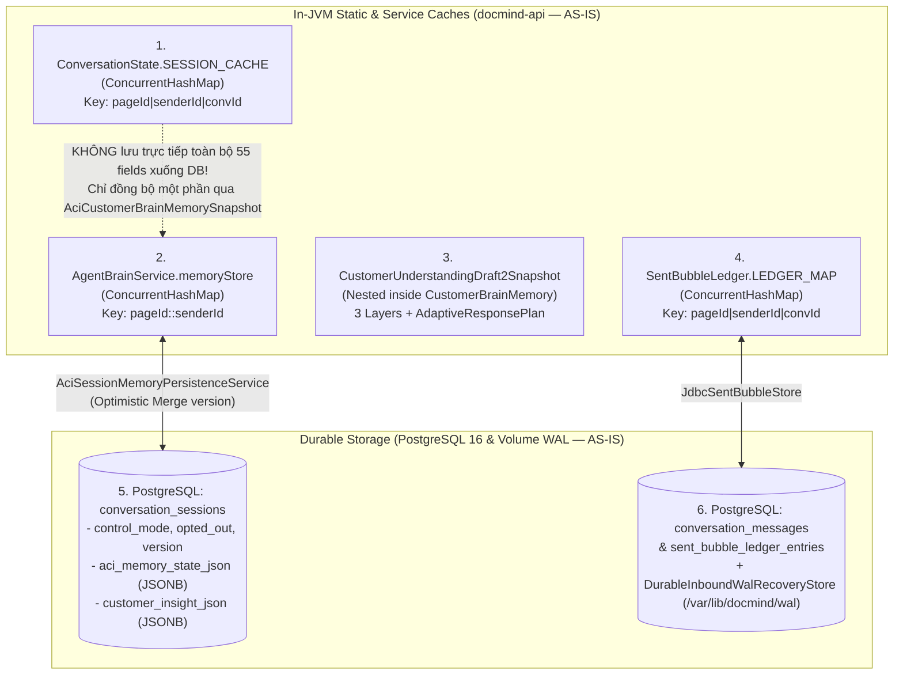

# STATE OWNERSHIP MAP — CURRENT AS-IS AUDIT ONLY

> **Document Authority**: **AS-IS CURRENT-STATE AUDIT ONLY** *(Tài liệu này chỉ ghi nhận hiện trạng phân mảnh trạng thái trước khi tái cấu trúc thuộc giai đoạn `P1 — Architecture Discovery`. Tài liệu này **KHÔNG** quy định thiết kế đích và không bao giờ ghi đè lên [`STATE_OWNERSHIP.md`](file:///d:/Project/digital-spirituality/docmind/docs/architecture/STATE_OWNERSHIP.md)).*  
> **Phase Gate**: `P1 — Architecture Discovery (Completed)`  
> **Approval Status**: **VERIFIED AS-IS AUDIT**  
> **Baseline Commit Before P0**: `244a2ec8a120878f8f863cb0388d72d51ae8bc2e`  
> **P0 Cleanup Commit**: `f091ba557a079da86c8ae14cd7ccc19fe8ece59d`  
> **P2 Initial Draft Commit**: `5aa985d43b5ef6ea1621f37fa546bcae520633c2`

---

## 1. Hiện trạng phân mảnh trạng thái hội thoại trong Codebase hiện tại (Đã xác minh)

Trong codebase hiện tại (`f091ba5`), trạng thái của **cùng một phiên hội thoại** (`pageId + senderId`) đang bị chia cắt và nhân bản trên **6 nơi lưu trữ khác nhau** (4 trong bộ nhớ JVM và 2 trong PostgreSQL + Disk WAL):

---

## 2. Bảng đối chiếu quyền sở hữu từng trường trạng thái ở Hiện trạng (AS-IS Audit)

| Nhóm dữ liệu / Trường trạng thái | Nơi lưu hiện tại #1 (`ConversationState`) | Nơi lưu hiện tại #2 (`AgentBrainService`) | Nơi lưu hiện tại #3 (`Draft2Snapshot` / `PostgreSQL`) | Vấn đề xung đột / Rủi ro hiện tại (Đã xác minh) |
|---|---|---|---|---|
| **Opt-out & Control Mode** (`optedOut`, `controlMode`) | `ConversationState.optedOut` (`SESSION_CACHE`) | `CustomerBrainMemory.optedOut` (`memoryStore`) | `conversation_sessions.opted_out` & `control_mode` (PostgreSQL) | Cần tới 3 lệnh sync thủ công (`InboundSessionPersistenceService`, `ConversationState.syncOptedOutInSession`, `agentBrainService.syncOptedOutState`). |
| **Xưng hô & Giới tính khách** (`customerPronoun`, `confidence`) | `ConversationState.customerGenderPronoun` | `CustomerBrainMemory.inferredCustomerPronoun` & `inferredPronounConfidence` | `Draft2.ConsultativeProfileLayer.addressingStyle` & `aci_memory_state_json` | Khi khách đính chính xưng hô (`"gọi anh nhé"`), cả `AdaptiveConversationIntelligence.reconcileWithCurrentUtterance` và `AgentBrainService` đều có logic cập nhật riêng. |
| **Triệu chứng & Vùng đau** (`painPoints` / `scopes`) | `ConversationState.confirmedScopes`, `primaryNeedScope` | `CustomerBrainMemory.aciCustomerStatements` (Tier 1) & `aciWorkingHypothesis` (Tier 2) | `Draft2.ConversationalContextLayer.confirmedCustomerNeeds` & `ConsultativeProfileLayer.painPoints` | Cùng một triệu chứng (`cổ vai gáy`) xuất hiện ở 4 cấu trúc dữ liệu khác nhau với quy tắc thêm/xóa khác nhau. |
| **Phạm vi khách đã từ chối / cấm nhắc lại** (`forbiddenScopes`) | `ConversationState.explicitForbiddenScopes` | `CustomerBrainMemory.explicitForbiddenScopes` | `aci_memory_state_json -> explicitForbiddenScopes` | Được ghi ở cả `ConversationState.recordAciV2TurnMinimalState` (`L855`) và `AgentBrainService.applyAciTurnMemoryUpdates` (`L2020`). |
| **Thời lượng triệu chứng** (`symptomDuration`) | `ConversationState.symptomDuration` | `CustomerBrainMemory.verifiedSymptomDuration` | `aci_memory_state_json -> verifiedSymptomDuration` | `CleanAgentOrchestratorService` (`L5602–L5605`) phải đọc fallback từ `postTurnSessionState.symptomDuration()` sang `agentBrainService.getVerifiedSymptomDuration()`. |
| **Số lần phản đối giá** (`priceObjectionCount`) | `ConversationState.priceObjectionCount`, `objectionHandled` | `CustomerBrainMemory.priceObjectionCount` | `Draft2.ConversationalContextLayer.objectionHistory` | Vừa đếm số nguyên (`priceObjectionCount`), vừa lưu danh sách chuỗi (`objectionHistory`), dễ lệch khi khách chỉ hỏi làm rõ giá. |
| **Trạng thái Đặt lịch** (`StructuredBookingState`) | `ConversationState.structuredBookingState` (`SESSION_CACHE`) | `CustomerBrainMemory.bookingState` (`recallBookingState` / `recordBookingState`) | `Draft2.BusinessCommitmentLayer` (`selectedService`, `bookingTime`, `branchOrLocation`, `customerPhone`) | **Xung đột nghiêm trọng nhất**: Tại `CleanAgentOrchestratorService.java` (`L4507–L4524`), hệ thống phải so sánh `fromBrain` và `priorFromSession` để chọn bản nào khác `NONE`; đồng thời `Draft2.BusinessCommitmentLayer` giữ một bản sao song song khác. |
| **Hành động & Lời bot lượt trước** (`lastSpeechAct`, `sentBubbles`) | `ConversationState.aciRecentAssistantSpeechActs`, `lastAssistantReplyText` | `CustomerBrainMemory.recalledActualSentSpeechAct`, `previousStrategy` | `SentBubbleLedger` (`LEDGER_MAP` + bảng `sent_bubble_ledger_entries`) | Lịch sử bong bóng thực gửi nằm ở `SentBubbleLedger`, nhưng `ConversationState` và `AgentBrainService` lại giữ các bản tóm tắt riêng. |

---

## 3. Bốn điểm ra quyết định chiến thuật đang cạnh tranh nhau trong cùng 1 lượt ở Hiện trạng (AS-IS Audit)

Đã xác minh trên luồng `executeAciCognitiveTurn` (`CleanAgentOrchestratorService.java` L4215–L5825):

1. **Điểm quyết định #1 — Pre-LLM Deterministic Turn Planner (`AdaptiveConversationIntelligence.buildLightweightCustomerUnderstandingPlan`, L5050–L5435)**:
   - Dùng regex Java (`detectCanonicalTurnIntents`, `classifyPriceIntentSubMode`) để gán `TurnAction` (`recommendedAction`) và chèn khối `<ACI_TURN_PLANNER>` vào prompt bắt LLM tuân theo.
2. **Điểm quyết định #2 — Single-Pass LLM Reflection (`AdaptiveCognitiveReflection`, JSON output của `qwen3.8-max`)**:
   - LLM sinh ra `customer_understanding`, `strategy` (`primary_objective`, `adaptation_mode`, `turn_move`), `response_plan`, `confirmed_facts_delta`, `proposed_booking_patch`, và `reply_bubbles`.
3. **Điểm quyết định #3 — Post-LLM Reflection Reconciler (`AdaptiveCognitiveReflection.reconcileWithCurrentUtterance`, L2043–L2708)**:
   - 665 dòng code Java chạy sau khi LLM trả lời, dùng regex kiểm tra lại câu khách để **ghi đè** `strategy`, `customer_understanding`, `selected_skills`, `confirmed_facts_delta` của LLM.
4. **Điểm quyết định #4 — Post-LLM Output Referee & In-Place Rewriters (`CleanAgentOutputRefereeAndSanitizer`, L4863–L5312)**:
   - Chạy hơn 10 hàm `*InPlace` (`enforceGroundedApologyAgainstHistoryInPlace`, `stripUnsolicitedPackagePitchOnNegativeReactionInPlace`, `enforceP37B2TurnActionAndBubbleIdeaDisciplineInPlace`, `enforceAciV2StyleComplaintNoCtaAndAntiClicheInPlace`) trực tiếp cắt câu, xóa câu hỏi, hoặc nối câu hỏi mới vào `reply_bubbles` của LLM.

---

## 4. Liên kết tới Thiết kế Đích (`TO-BE Specification`)

Toàn bộ thiết kế đích nhằm giải quyết triệt để hiện trạng trên (bao gồm Giao thức Nhất quán `ConversationMemoryStore` `R2` và Mô hình Trí tuệ Khách hàng `FACT` / `HYPOTHESIS` / `UNKNOWN` `R3`) được quy định chính thức tại [`STATE_OWNERSHIP.md`](file:///d:/Project/digital-spirituality/docmind/docs/architecture/STATE_OWNERSHIP.md).
