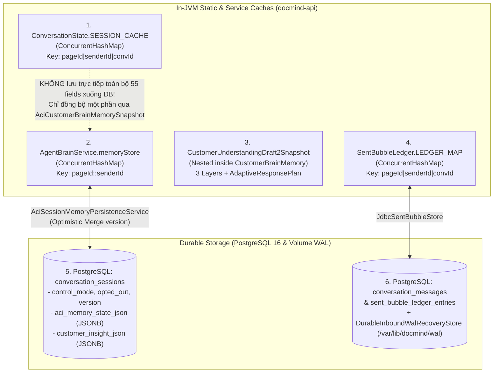

# STATE OWNERSHIP MAP — CURRENT VS TARGET

> **Phase Gate**: `P1 — Architecture Discovery`  
> **Baseline Commit**: `f091ba557a079da86c8ae14cd7ccc19fe8ece59d`

---

## 1. Hiện trạng phân mảnh trạng thái hội thoại (Đã xác minh)

Hiện tại, trạng thái của **cùng một phiên hội thoại** (`pageId + senderId`) đang bị chia cắt và nhân bản trên **6 nơi lưu trữ khác nhau** (4 trong bộ nhớ JVM và 2 trong PostgreSQL + Disk WAL):

---

## 2. Bảng đối chiếu quyền sở hữu từng trường trạng thái (State Field Ownership Audit)

| Nhóm dữ liệu / Trường trạng thái | Nơi lưu hiện tại #1 (`ConversationState`) | Nơi lưu hiện tại #2 (`AgentBrainService`) | Nơi lưu hiện tại #3 (`Draft2Snapshot` / `PostgreSQL`) | Vấn đề xung đột / Rủi ro hiện tại (Đã xác minh) |
|---|---|---|---|---|
| **Opt-out & Control Mode** (`optedOut`, `controlMode`) | `ConversationState.optedOut` (`SESSION_CACHE`) | `CustomerBrainMemory.optedOut` (`memoryStore`) | `conversation_sessions.opted_out` & `control_mode` (PostgreSQL) | Cần tới 3 lệnh sync thủ công (`InboundSessionPersistenceService`, `ConversationState.syncOptedOutInSession`, `agentBrainService.syncOptedOutState`). |
| **Xưng hô & Giới tính khách** (`customerPronoun`, `confidence`) | `ConversationState.customerGenderPronoun` | `CustomerBrainMemory.inferredCustomerPronoun` & `inferredPronounConfidence` | `Draft2.ConsultativeProfileLayer.addressingStyle` & `aci_memory_state_json` | Khi khách đính chính xưng hô (`"gọi anh nhé"`), cả `AdaptiveConversationIntelligence.reconcileWithCurrentUtterance` và `AgentBrainService` đều có logic cập nhật riêng. |
| **Triệu chứng & Vùng đau** (`painPoints` / `scopes`) | `ConversationState.confirmedScopes`, `primaryNeedScope` | `CustomerBrainMemory.aciCustomerStatements` (Tier 1) & `aciWorkingHypothesis` (Tier 2) | `Draft2.ConversationalContextLayer.confirmedCustomerNeeds` & `ConsultativeProfileLayer.painPoints` | Cùng một triệu chứng (`cổ vai gáy`) xuất hiện ở 4 cấu trúc dữ liệu khác nhau với quy tắc thêm/xóa khác nhau. |
| **Phạm vi khách đã từ chối / cấm nhắc lại** (`forbiddenScopes`) | `ConversationState.explicitForbiddenScopes` | `CustomerBrainMemory.explicitForbiddenScopes` | `aci_memory_state_json -> explicitForbiddenScopes` | Được ghi ở cả `ConversationState.recordAciV2TurnMinimalState` (`L855`) và `AgentBrainService.applyAciTurnMemoryUpdates` (`L2020`). |
| **Thời lượng triệu chứng** (`symptomDuration`) | `ConversationState.symptomDuration` | `CustomerBrainMemory.verifiedSymptomDuration` | `aci_memory_state_json -> verifiedSymptomDuration` | `CleanAgentOrchestratorService` (`L5602–L5605`) phải đọc fallback từ `postTurnSessionState.symptomDuration()` sang `agentBrainService.getVerifiedSymptomDuration()`. |
| **Số lần phản đối giá** (`priceObjectionCount`) | `ConversationState.priceObjectionCount`, `objectionHandled` | `CustomerBrainMemory.priceObjectionCount` | `Draft2.ConversationalContextLayer.objectionHistory` | Vừa đếm số nguyên (`priceObjectionCount`), vừa lưu danh sách chuỗi (`objectionHistory`), dễ lệch khi khách chỉ hỏi làm rõ giá. |
| **Trạng thái Đặt lịch** (`StructuredBookingState`) | `ConversationState.structuredBookingState` (`SESSION_CACHE`) | `CustomerBrainMemory.bookingState` (`recallBookingState` / `recordBookingState`) | `Draft2.BusinessCommitmentLayer` (`selectedService`, `bookingTime`, `branchOrLocation`, `customerPhone`) | **Xung đột nghiêm trọng nhất**: Tại `CleanAgentOrchestratorService.java` (`L4507–L4524`), hệ thống phải so sánh `fromBrain` và `priorFromSession` để chọn bản nào khác `NONE`; đồng thời `Draft2.BusinessCommitmentLayer` giữ một bản sao song song khác. |
| **Hành động & Lời bot lượt trước** (`lastSpeechAct`, `sentBubbles`) | `ConversationState.aciRecentAssistantSpeechActs`, `lastAssistantReplyText` | `CustomerBrainMemory.recalledActualSentSpeechAct`, `previousStrategy` | `SentBubbleLedger` (`LEDGER_MAP` + bảng `sent_bubble_ledger_entries`) | Lịch sử bong bóng thực gửi nằm ở `SentBubbleLedger`, nhưng `ConversationState` và `AgentBrainService` lại giữ các bản tóm tắt riêng. |

---

## 3. Bốn điểm ra quyết định chiến thuật đang cạnh tranh nhau trong cùng 1 lượt (Competing Decision Makers)

Đã xác minh trên luồng `executeAciCognitiveTurn` (`CleanAgentOrchestratorService.java` L4215–L5825):

1. **Điểm quyết định #1 — Pre-LLM Deterministic Turn Planner (`AdaptiveConversationIntelligence.buildLightweightCustomerUnderstandingPlan`, L5050–L5435)**:
   - Dùng regex Java (`detectCanonicalTurnIntents`, `classifyPriceIntentSubMode`) để gán `TurnAction` (`recommendedAction`) và chèn khối `<ACI_TURN_PLANNER>` vào prompt bắt LLM tuân theo.
2. **Điểm quyết định #2 — Single-Pass LLM Reflection (`AdaptiveCognitiveReflection`, JSON output của `qwen3.8-max`)**:
   - LLM sinh ra `customer_understanding`, `strategy` (`primary_objective`, `adaptation_mode`, `turn_move`), `response_plan`, `confirmed_facts_delta`, `proposed_booking_patch`, và `reply_bubbles`.
3. **Điểm quyết định #3 — Post-LLM Reflection Reconciler (`AdaptiveCognitiveReflection.reconcileWithCurrentUtterance`, L2043–L2708)**:
   - 665 dòng code Java chạy sau khi LLM trả lời, dùng regex kiểm tra lại câu khách để **ghi đè** `strategy`, `customer_understanding`, `selected_skills`, `confirmed_facts_delta` của LLM.
4. **Điểm quyết định #4 — Post-LLM Output Referee & In-Place Rewriters (`CleanAgentOutputRefereeAndSanitizer`, L4863–L5312)**:
   - Chạy hơn 10 hàm `*InPlace` (`enforceGroundedApologyAgainstHistoryInPlace`, `stripUnsolicitedPackagePitchOnNegativeReactionInPlace`, `enforceP37B2TurnActionAndBubbleIdeaDisciplineInPlace`, `enforceAciV2StyleComplaintNoCtaAndAntiClicheInPlace`) trực tiếp cắt câu, xóa câu hỏi, hoặc nối câu hỏi mới vào `reply_bubbles` của LLM.

---

## 4. Nguyên tắc Sở hữu Trạng thái Đích (Target State Ownership Principle — Chuẩn bị cho `P2`)

Để chấm dứt tình trạng 4 nơi giữ state và 4 nơi tranh quyền quyết định:
1. **Một nguồn sự thật duy nhất cho mỗi loại trạng thái (Single Source of Truth)**:
   - **Operational & Safety Control State** (`controlMode`, `optedOut`, `humanTakeover`, `externalMid` dedup): Thuộc quyền sở hữu tuyệt đối của `InboundSessionPersistenceService` + bảng `conversation_sessions` (PostgreSQL).
   - **Confirmed Customer & Booking State** (`confirmedFacts`, `retractedFacts`, `CustomerRelationshipState`, `BookingProgressState` gồm `serviceId`, `branchId`, `timeSlot`, `partySize`, `phone`, `missingBookingFields`): Thuộc quyền sở hữu duy nhất của `ConversationMemoryStore` (hợp nhất từ `AgentBrainService` + `AciSessionMemoryPersistenceService`), lưu bền vững xuống `conversation_sessions.aci_memory_state_json`. Loại bỏ hoàn toàn việc giữ bản sao `StructuredBookingState` rời rạc trong `ConversationState.SESSION_CACHE`.
   - **Delivered Bubble Ledger**: Thuộc quyền sở hữu duy nhất của `SentBubbleLedger` (`JdbcSentBubbleStore`).
2. **Một Hợp đồng Chiến thuật Lượt duy nhất (`TurnStrategyContract`)**:
   - Mọi quyết định về `primaryIntent`, `secondaryIntents`, `turnGoal`, `responseMode`, `maxQuestionsAllowed`, `pricePolicyMode`, `branchDisclosurePolicy` phải được chốt thành một `TurnStrategyContract` rõ ràng trước khi render câu trả lời cuối cùng; `OutputTruthAndSafetyGuard` chỉ kiểm định sự thật/an toàn và yêu cầu tạo lại (regenerate/repair) chứ **tuyệt đối không tự ý cắt ghép/viết lại văn bản bằng regex**.
