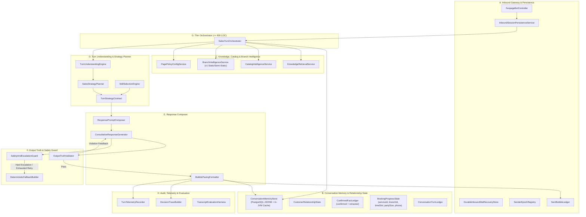

# TARGET ARCHITECTURE — DOCMIND ADAPTIVE SALES INTELLIGENCE SYSTEM

> **Phase Gate**: `P2 — Architecture Design`  
> **Baseline Commit**: `f091ba557a079da86c8ae14cd7ccc19fe8ece59d`  
> **Status**: Đề xuất trình phản biện độc lập (`Qwen3.8-Max`) và chờ Chủ dự án phê duyệt tại **Architecture Lock**

---

## 1. Triết lý & Nguyên tắc Kiến trúc Đích

Hệ thống đích là **Adaptive Sales Intelligence System** — một kiến trúc tư vấn bán hàng thích ứng lấy sự thấu hiểu khách hàng, tính chính xác của dữ liệu nghiệp vụ và sự tự nhiên của hội thoại làm trung tâm:

1. **Một nguồn sự thật cho mỗi loại trạng thái (Single Source of Truth)**: Xóa bỏ hoàn toàn tình trạng nhân bản trạng thái giữa `ConversationState`, `AgentBrainService` và `Draft2Snapshot`.
2. **Một Hợp đồng Chiến thuật Lượt duy nhất (`TurnStrategyContract`)**: Mọi quyết định về mục tiêu lượt, chính sách báo giá, chính sách tiết lộ chi nhánh, số câu hỏi tối đa và các điều cấm (`mustNotDo`) được chốt tường minh trước khi sinh câu trả lời.
3. **Output Guard chỉ Gác Cổng Sự Thật & An Toàn — Tuyệt đối Không Viết Lại Hội Thoại bằng Regex**: Loại bỏ các hàm regex cắt ghép câu hậu kiểm (`*InPlace`); nếu câu trả lời của LLM vi phạm sự thật hoặc chính sách khóa cứng, Guard trả danh sách lỗi cụ thể để `ConsultativeResponseGenerator` sinh lại có kiểm soát hoặc dùng `DeterministicFallbackBuilder` an toàn.
4. **Thực thi LLM Thích ứng Hai Chế độ (Hybrid Adaptive LLM Execution)**:
   - **Fast-Path Execution (1 lần gọi LLM)**: Dành cho lượt đơn giản (chào hỏi, xác nhận 1 thông tin đặt lịch, hỏi giờ mở cửa/địa chỉ đơn thuần, khách báo bận/tạm dừng).
   - **Two-Phase Strategic Execution (2 pha tách biệt)**: Dành cho lượt phức tạp (đa ý định, khách vừa nêu triệu chứng vừa hỏi giá/chi nhánh, phản đối giá, khách đính chính giả định sai hoặc phàn nàn cách nói chuyện, so sánh nhiều gói).
5. **Orchestrator Mỏng (`SalesTurnOrchestrator` <= 400 LOC)**: Chỉ điều phối tuần tự các domain service qua interface/contract rõ ràng, không chứa regex nghiệp vụ hay prompt template.

---

## 2. Sơ đồ 8 Miền Kiến trúc Hợp lý (8 Logical Domains A–H)

---

## 3. Thiết kế Chi tiết 8 Miền Kiến trúc

### Miền A — Inbound Gateway & Persistence (`com.example.docmind.service.bot.gateway`)
- **Thành phần**: `FanpageBotController`, `InboundSessionPersistenceService`, `DurableInboundWalRecoveryStore`, `SenderEpochRegistry`, `SentBubbleLedger`.
- **Trách nhiệm**:
  - Nhận request từ Meta Messenger Webhook hoặc Simulator REST API.
  - Thực hiện Layer-1 Entry State Guard (`HUMAN_TAKEOVER`, `OPT_OUT`, Re-consent, chống trùng `external_mid`, WAL).
  - Quản lý `SenderEpochRegistry` để hủy ngay các lượt xử lý cũ nếu khách nhắn bồi thêm tin mới.
  - Thực hiện Layer-2 Outbound Exit Fence trước khi phát tin nhắn ra ngoài.

### Miền B — Conversation Memory & Relationship State (`com.example.docmind.service.bot.memory`)
- **Thành phần**: `ConversationMemoryStore`, `CustomerRelationshipState`, `ConfirmedFactLedger`, `BookingProgressState`, `ConversationTurnLedger`.
- **Trách nhiệm**:
  - Là **nguồn sự thật duy nhất** cho bộ nhớ phiên và lịch sử quan hệ khách hàng, lưu bền vững xuống `conversation_sessions.aci_memory_state_json`.
  - `ConfirmedFactLedger`: Lưu các sự kiện khách đã xác nhận (`confirmedFacts`: triệu chứng, thời lượng, ngân sách, sở thích) và các phạm vi khách đã bác bỏ (`retractedFacts` / `forbiddenScopes`).
  - `BookingProgressState`: Nguồn sự thật duy nhất cho tiến trình đặt lịch (`serviceId`, `branchId`, `timeSlot`, `partySize`, `phone`, `missingBookingFields`, `status`).

### Miền C — Knowledge, Catalog & Branch Intelligence (`com.example.docmind.service.bot.intelligence`)
- **Thành phần**: `KnowledgeRetrievalService`, `CatalogIntelligenceService`, `BranchIntelligenceService`, `PagePolicyConfigService`.
- **Thiết kế `BranchIntelligenceService` (v1 — Tĩnh / Bán tĩnh theo Mục V Master Directive)**:
  - Đọc cấu hình chi nhánh từ Page Metadata / Knowledge Base / Playbook (không phụ thuộc hệ thống POS hay lịch thời gian thực bên ngoài).
  - Cung cấp `BranchTopology`:
    - `singleBranch` (`branchCount == 1`) vs `multiBranch` (`branchCount > 1`).
    - Danh sách `BranchProfile`: `branchId`, `branchName`, `cityOrRegion`, `address`, `openingHours`, `distinctiveServices`, `staticAvailabilityStatus` (`AVAILABLE`, `LIMITED_PEAK_HOURS`, `TEMP_CLOSED`, `UNKNOWN_REALTIME`).
  - Quy tắc nghiệp vụ khóa cứng:
    - Nếu Page chỉ có **1 chi nhánh**: Không bao giờ hỏi khách *"mình ở chi nhánh nào?"*; tự động gắn `branchId` mặc định khi đặt lịch.
    - Nếu Page có **nhiều chi nhánh**: Chỉ hỏi hoặc giới thiệu chi nhánh khi (a) khách hỏi địa chỉ/chi nhánh, (b) giá/dịch vụ khác nhau giữa các chi nhánh, hoặc (c) khách bước vào giai đoạn chốt lịch (`BookingProgressState` thiếu `branchId`).
    - Nếu khách hỏi tình trạng chỗ trống theo giờ thực tế mà dữ liệu tĩnh là `UNKNOWN_REALTIME`: Trả lời trung thực và kích hoạt `CONDITIONAL_HANDOFF` để nhân viên kiểm tra lịch thực tế.

### Miền D — Turn Understanding & Strategy Planner (`com.example.docmind.service.bot.strategy`)
- **Thành phần**: `TurnUnderstandingEngine`, `SalesStrategyPlanner`, `TurnStrategyContract`, `SkillSelectionEngine`.
- **Trách nhiệm**:
  - Phân tích đa ý định (`primaryIntent` + `secondaryIntents`), cảm xúc khách hàng (`customerEmotion`), và giai đoạn quan hệ (`relationshipStage`).
  - Áp dụng **Chính sách Kinh doanh đã khóa (Mục VI Master Directive)** để xuất ra bản hợp đồng bất biến `TurnStrategyContract` cho lượt hiện tại.
  - Chọn tối đa `1–2` kỹ năng tư vấn (`selectedSkills`) phù hợp nhất với `turnGoal` và loại trừ hoàn toàn các skill bán hàng/khai thác khi khách đang phàn nàn hoặc đính chính (`CUSTOMER_CORRECTION` / `STYLE_COMPLAINT`).

### Miền E — Response Composer (`com.example.docmind.service.bot.composer`)
- **Thành phần**: `ResponsePromptComposer`, `ConsultativeResponseGenerator`, `BubblePacingFormatter`.
- **Trách nhiệm**:
  - Dựng prompt gọn, tập trung hoàn toàn vào việc diễn đạt tự nhiên theo đúng `TurnStrategyContract`, `ConfirmedFactLedger`, `eligibleCatalogCandidates` và `BranchContext`.
  - Định dạng nhịp điệu bong bóng (`BubblePacingFormatter`) và tính thời gian đọc bảng giá (`PriceQuoteReadingBudgetScheduler`) mà không can thiệp sửa ý hay cắt câu.

### Miền F — Output Truth & Safety Guard (`com.example.docmind.service.bot.guard`)
- **Thành phần**: `OutputTruthValidator`, `SafetyAndEscalationGuard`, `DeterministicFallbackBuilder`.
- **Nguyên tắc bất khả xâm phạm**:
  - **CHỈ kiểm tra**: (1) Giá tiền & tên gói có khớp `eligibleCatalogCandidates` không; (2) Có vi phạm `pricePolicyMode` (ví dụ báo giá ở lượt 1 khi `FIRST_TURN_BARE_PRICE_CLARIFY_FIRST`, hoặc chào gói khi `MUST_NOT_PITCH_ON_CORRECTION`) không; (3) Có bịa khuyến mãi/chính sách tip/giờ mở cửa không; (4) Có vi phạm an toàn y tế, lộ mã nội bộ hay tự nhận là người thật không; (5) Có xin lỗi sai sự thật (`FalseApology`) hoặc nhắc lại phạm vi khách đã cấm (`retractedFacts`) không.
  - **KHÔNG BAO GIỜ dùng regex cắt ghép câu in-place**: Chỉ cho phép chuẩn hóa hình thức vô hại (trim khoảng trắng, xóa mã SKU nội bộ `[PKG_...]`, viết hoa chữ cái đầu). Nếu vi phạm nội dung/chính sách -> trả `ValidationFeedback` cụ thể để `ConsultativeResponseGenerator` sinh lại 1 lần, hoặc chuyển sang `DeterministicFallbackBuilder`.

### Miền G — Thin Orchestrator (`SalesTurnOrchestrator`)
- Điều phối 8 bước rõ ràng từ `InboundGuard` -> `Memory & Context Recall` -> `Knowledge & Branch Intelligence` -> `Turn Strategy Planning` -> `Response Composition` -> `Truth & Safety Validation` -> `Atomic Memory & Ledger Commit` -> `Telemetry & Decision Trace`.

### Miền H — Audit, Telemetry & Evaluation (`com.example.docmind.service.bot.audit`)
- **Thành phần**: `DecisionTraceBuilder`, `TurnTelemetryRecorder`, `TranscriptEvaluationHarness`.
- Xuất `decisionTrace` chuẩn hóa phục vụ giám sát, debug và chạy bộ 10 kịch bản nghiệm thu đầu-cuối (`SC01..SC10`).

---

## 4. Kế hoạch Phân rã 8 God Classes sang Kiến trúc Đích (Mục VIII Master Directive)

| God Class hiện tại (LOC) | Sẽ được phân rã / chuyển giao vào các Module Đích | Trạng thái cuối sau `P7` |
|---|---|---|
| `CleanAgentOrchestratorService` (`6,718 LOC`) | - Xóa nhánh chết `executeCleanAgentTurn` (~3,840 LOC) - Tách điều phối sang `SalesTurnOrchestrator` (<= 400 LOC) - Tách trace sang `DecisionTraceBuilder` | Giữ facade mỏng tương thích ngược hoặc thay thế hoàn toàn bởi `SalesTurnOrchestrator` |
| `CleanAgentOutputRefereeAndSanitizer` (`7,820 LOC`) | - `OutputTruthValidator` (kiểm tra giá, gói, fact, false apology) - `SafetyAndEscalationGuard` (y tế, bảo mật, AI honesty) - `DeterministicFallbackBuilder` - **Xóa bỏ 15+ hàm regex cắt ghép câu in-place** | Giảm > 70% LOC, tách thành 3 class chuyên biệt trong `guard/` |
| `ConversationState` (`5,928 LOC`) | - Chuyển quyền sở hữu state sang `ConversationMemoryStore`, `ConfirmedFactLedger`, `BookingProgressState` - Loại bỏ các trường V1 chết và các bộ parser regex trùng lặp | Thu gọn thành DTO/Snapshot bất biến nhẹ |
| `CleanAgentCatalogAndPromptBuilder` (`5,773 LOC`) | - Xóa `buildCleanAgentPrompt` cũ (~1,995 LOC) - Tách xếp hạng gói sang `CatalogIntelligenceService` - Tách dựng prompt sang `ResponsePromptComposer` | Tách thành `CatalogIntelligenceService` + `ResponsePromptComposer` |
| `AdaptiveConversationIntelligence` (`5,558 LOC`) | - Tách DTO sang package `model/` - Tách hiểu ý định sang `TurnUnderstandingEngine` - Tách lập kế hoạch sang `SalesStrategyPlanner` + `TurnStrategyContract` - Loại bỏ `reconcileWithCurrentUtterance` 665 dòng regex ghi đè hậu kiểm | Tách thành `TurnUnderstandingEngine` + `SalesStrategyPlanner` + `TurnStrategyContract` |
| `FanpageBotService` (`5,152 LOC`) | - Giữ phần Gateway điều phối `handleCustomerMessage` (~650 LOC) - Dọn dẹp ~2,550 LOC hàm V1 chết (`L1743–L4290`) | Thu gọn còn < 1,200 LOC |
| `PrimaryActionRouter` (`4,703 LOC`) | - Chuyển `isStrictSystemOptOutMessage` sang `SafetyAndEscalationGuard` - Cô lập/gỡ bỏ ~4,500 LOC máy trạng thái V1 không còn dùng | Decommission / thu gọn còn enum telemetry |
| `AgentBrainService` (`3,858 LOC`) | - Hợp nhất thành `ConversationMemoryStore` (xóa nhánh legacy `recallAndAdvise` V1) - Chuẩn hóa lưu trữ `ConfirmedFactLedger`, `CustomerRelationshipState`, `BookingProgressState` | Tinh gọn, giữ 100% tương thích JSONB PostgreSQL |
